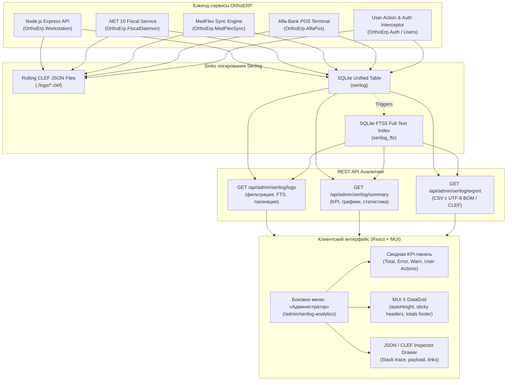
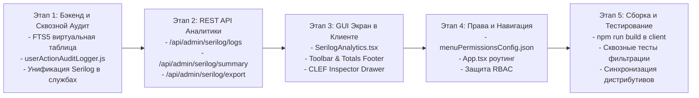

# Архитектурный план: Аналитика логов Serilog и аудит действий пользователей

## 1. Концепция и цели

Создание в боковом меню **«Администратор»** (доступном ролям `sysadmin` и `administrator`) централизованного высокопроизводительного аналитического центра **«Аналитика логов Serilog»** (`/admin/serilog-analytics`).

Модуль решает три ключевые задачи:
1. **Сквозная консолидация логов всех бэкенд-сервисов**:
   - `OrthoErp.Workstation` (Node.js Express: АРМ врача, приёмы, протоколы).
   - `OrthoErp.FiscalDaemon` (.NET 10 Web API: драйвер АТОЛ 91Ф, ККТ 54-ФЗ, смены, чеки).
   - `OrthoErp.MedFlexSync` (Node.js: онлайн-запись MedFlex / ПроДокторов, вебхуки, оффлайн-очередь).
   - `OrthoErp.AlfaPos` (Node.js: терминал эквайринга Альфа-Банка Arcus-2/INPAS).
   - `OrthoErp.Auth` и `OrthoErp.Users` (Node.js: аутентификация, PBKDF2-SHA512, сессии, RBAC).
   - `OrthoErp.Admin` (Node.js: SQLite Studio, настройки `appsettings.json`, резервные копии).
2. **Тотальный аудит действий пользователей (152-ФЗ и медицинская безопасность)**:
   - Регистрация входа, выхода, неудачных попыток подбора пароля, блокировок УЗ.
   - Создание, сохранение черновиков, подписание, отзыв и печать протоколов и направлений.
   - Открытие/закрытие кассовых смен (Z-отчеты), чеки коррекции, возвраты.
   - Сверка итогов и транзакции эквайринга.
   - Изменение системных параметров и выполнение прямых SQL-запросов.
3. **Современный интерактивный GUI/UX**:
   - Строгое соответствие стандартам `grid-improvements` (отсутствие внутренних полос прокрутки, автоматическая высота строк, отображение полного текста без срезов, sticky header, сводный бухгалтерский подвал с итогами).
   - Строгое соответствие `menu-permission-sync` (актуализация `menuPermissionsConfig.json`, многоуровневые права, разграничение экранных кнопок).
   - Мгновенный полнотекстовый поиск (FTS5) по сообщениям и JSON-свойствам.
   - Быстрые фильтры, KPI-дашборд и Slide-over Drawer для инспекции структурированных CLEF-записей со стек-трейсами.

---

## 2. Архитектура хранилища и потоков данных



### 2.1. Единая структура таблицы SQLite `serilog`
Таблица `serilog` расширяется триггерами FTS5 и оптимизируется индексами:

```sql
CREATE TABLE IF NOT EXISTS serilog (
  id INTEGER PRIMARY KEY AUTOINCREMENT,
  timestamp TEXT NOT NULL DEFAULT (datetime('now', 'localtime')),
  level TEXT NOT NULL,                  -- 'Debug', 'Information', 'Warning', 'Error', 'Fatal'
  event_type TEXT NOT NULL,             -- 'auth_login_success', 'protocol_signed', etc.
  source_context TEXT NOT NULL,         -- 'OrthoErp.Workstation', 'OrthoErp.FiscalDaemon', etc.
  message TEXT NOT NULL,                -- Человекочитаемое сообщение / шаблон
  properties_json TEXT,                 -- Структурированные параметры CLEF в формате JSON
  protocol_id INTEGER,                  -- Связанный протокол (если применимо)
  appointment_id INTEGER,               -- Связанный прием (если применимо)
  patient_id INTEGER,                   -- Связанный пациент (если применимо)
  doctor_id INTEGER,                    -- Врач / сотрудник (staff_id)
  user_id INTEGER,                      -- Идентификатор пользователя (users.id)
  username TEXT,                        -- Логин пользователя (например, 'admin')
  client_ip TEXT,                       -- IP-адрес клиента (IPv4/IPv6)
  duration_ms INTEGER DEFAULT 0,        -- Время выполнения операции в миллисекундах
  exception TEXT                        -- Полный стек ошибки (если произошел сбой)
);

-- Индексы для сверхбыстрой выборки и аналитики
CREATE INDEX IF NOT EXISTS idx_serilog_ts ON serilog(timestamp DESC);
CREATE INDEX IF NOT EXISTS idx_serilog_level ON serilog(level);
CREATE INDEX IF NOT EXISTS idx_serilog_source ON serilog(source_context);
CREATE INDEX IF NOT EXISTS idx_serilog_event ON serilog(event_type);
CREATE INDEX IF NOT EXISTS idx_serilog_user ON serilog(user_id);
CREATE INDEX IF NOT EXISTS idx_serilog_patient ON serilog(patient_id);

-- FTS5 виртуальная таблица для мгновенного полнотекстового поиска
CREATE VIRTUAL TABLE IF NOT EXISTS serilog_fts USING fts5(
  message,
  properties_json,
  exception,
  username,
  event_type,
  content=serilog,
  content_rowid=id,
  tokenize='unicode61'
);

-- Триггеры синхронизации FTS5
CREATE TRIGGER IF NOT EXISTS trg_serilog_ai AFTER INSERT ON serilog BEGIN
  INSERT INTO serilog_fts(rowid, message, properties_json, exception, username, event_type)
  VALUES (new.id, new.message, new.properties_json, new.exception, new.username, new.event_type);
END;

CREATE TRIGGER IF NOT EXISTS trg_serilog_ad AFTER DELETE ON serilog BEGIN
  INSERT INTO serilog_fts(serilog_fts, rowid, message, properties_json, exception, username, event_type)
  VALUES('delete', old.id, old.message, old.properties_json, old.exception, old.username, old.event_type);
END;
```

---

## 3. Матрица аудита действий пользователей

Все действия пользователей перехватываются единым аудитором `server/userActionAuditLogger.js` и регистрируются в `serilog`:

| Категория | `event_type` | Описание события | Ключевые свойства в `properties_json` |
|---|---|---|---|
| **Безопасность / Auth** | `auth_login_success` | Успешный вход в систему | `username`, `role`, `staff_id`, `client_ip`, `user_agent` |
| | `auth_login_failed` | Неудачная попытка входа | `username`, `reason`, `client_ip`, `attempt_count` |
| | `auth_logout` | Выход пользователя из системы | `username`, `session_duration_sec` |
| | `security_access_denied` | Попытка доступа к запрещенному ресурсу | `username`, `attempted_path`, `required_permissions` |
| **Управление УЗ** | `user_created` | Создание новой учетной записи | `target_user`, `assigned_role`, `staff_id`, `created_by` |
| | `user_updated` | Изменение данных пользователя | `target_user`, `changed_fields`, `updated_by` |
| | `user_locked` | Блокировка УЗ (152-ФЗ / админ) | `target_user`, `reason`, `locked_by` |
| | `user_password_changed` | Смена или сброс пароля | `target_user`, `initiated_by` |
| | `user_permissions_updated` | Изменение прав доступа к экранам | `target_user`, `new_permissions`, `updated_by` |
| **Клинический контур** | `visit_initiated` | Начало приема пациента | `patient_id`, `appointment_id`, `doctor_id` |
| | `exam_draft_saved` | Сохранение черновика осмотра | `protocol_id`, `patient_id`, `is_autosave` |
| | `protocol_signed` | Подписание медицинского протокола | `protocol_id`, `mkb_code`, `doctor_id`, `sign_timestamp` |
| | `protocol_returned_to_draft`| Возврат протокола на доработку | `protocol_id`, `reason`, `doctor_id` |
| | `protocol_revoked` | Аннулирование протокола | `protocol_id`, `reason`, `doctor_id` |
| | `protocol_deleted` | Удаление протокола (sysadmin) | `protocol_id`, `deleted_by` |
| | `patient_document_issued` | Выдача направления / справки / больничного | `doc_type`, `patient_id`, `doctor_id`, `number` |
| | `patient_document_printed`| Печать документа на принтере | `doc_type`, `format` (PDF/DOCX), `printer_name` |
| **Касса и ККТ 54-ФЗ** | `fiscal_shift_opened` | Открытие кассовой смены | `shift_number`, `cashier_name`, `kkt_serial` |
| | `fiscal_shift_closed` | Закрытие смены (Z-отчет) | `shift_number`, `revenue_total`, `checks_count` |
| | `fiscal_receipt_issued` | Фискализация кассового чека | `receipt_id`, `fiscal_sign`, `sum_total`, `tax_type` |
| | `fiscal_receipt_refund` | Чек возврата прихода | `receipt_id`, `original_receipt_id`, `sum_total` |
| **Эквайринг POS** | `pos_auth_success` | Оплата картой через терминал | `rrn`, `auth_code`, `pan_masked`, `sum_rub` |
| | `pos_auth_decline` | Отказ процессинга банка | `response_code`, `decline_reason`, `sum_rub` |
| | `pos_settlement_success`| Сверка итогов терминала | `total_amount`, `transactions_count`, `slip_text` |
| **Администрирование** | `appsettings_updated` | Изменение настроек системы | `modified_keys`, `updated_by` |
| | `menu_config_updated` | Изменение структуры меню и прав | `backup_file`, `updated_by` |
| | `sqlite_studio_query` | Выполнение SQL в SQLite Studio | `query_snippet`, `execution_time_ms`, `rows_affected` |
| | `db_backup_created` | Создание снимка базы данных | `backup_filename`, `size_mb`, `created_by` |

---

## 4. Спецификация REST API бэкенда (`server/serilogAnalyticsRoutes.js`)

### 4.1. `GET /api/admin/serilog/logs`
Выборка журнала событий с фильтрацией, пагинацией и полнотекстовым поиском.
- **Query Parameters**:
  - `page`: номер страницы (1-based, default: 1).
  - `pageSize`: размер страницы (`10`, `25`, `50`, `100`, default: 25).
  - `startDate`, `endDate`: диапазон дат в формате ISO или `YYYY-MM-DD`.
  - `levels`: список уровней через запятую (`Information,Warning,Error,Fatal`).
  - `sources`: список сервисов (`OrthoErp.Workstation,OrthoErp.FiscalDaemon,...`).
  - `eventTypes`: список событий через запятую.
  - `search`: строка полнотекстового поиска (обрабатывается через SQLite FTS5 или `LIKE`).
  - `userId`, `doctorId`, `patientId`: фильтрация по субъекту.
  - `sortBy`: поле сортировки (`timestamp`, `level`, `duration_ms`, default: `timestamp`).
  - `sortOrder`: направление (`asc`, `desc`, default: `desc`).
- **Response**:
  ```json
  {
    "total": 1420,
    "page": 1,
    "pageSize": 25,
    "totalPages": 57,
    "items": [
      {
        "id": 9845,
        "timestamp": "2026-10-28 14:15:22",
        "level": "Information",
        "event_type": "protocol_signed",
        "source_context": "OrthoErp.Workstation",
        "message": "[protocol_signed] Протокол #1042 подписан врачом Добрушкин В. А.",
        "properties_json": "{\"protocol_id\":1042,\"patient_id\":312,\"doctor_id\":1,\"client_ip\":\"127.0.0.1\"}",
        "user_id": 1,
        "username": "admin",
        "client_ip": "127.0.0.1",
        "duration_ms": 142,
        "exception": null
      }
    ]
  }
  ```

### 4.2. `GET /api/admin/serilog/summary`
Агрегированная сводка для KPI-карточек и графиков:
- **Response**:
  ```json
  {
    "totalLogs": 25410,
    "totalErrors": 14,
    "totalWarnings": 89,
    "totalUserActions": 12450,
    "levelBreakdown": {
      "Debug": 520,
      "Information": 24787,
      "Warning": 89,
      "Error": 12,
      "Fatal": 2
    },
    "topEvents": [
      { "event_type": "exam_draft_autosaved", "count": 6400 },
      { "event_type": "auth_login_success", "count": 340 }
    ],
    "timeline": [
      { "date": "2026-10-28", "info": 1200, "warn": 4, "error": 1 }
    ]
  }
  ```

### 4.3. `GET /api/admin/serilog/sources-and-events`
Справочник доступных источников и типов событий для выпадающих списков интерфейса.

### 4.4. `GET /api/admin/serilog/export`
Экспорт выборки логов в файл CSV (с UTF-8 BOM для безупречного открытия в MS Excel) либо в JSON/CLEF.

---

## 5. Дизайн и UX интерфейса экрана (`/admin/serilog-analytics`)

### 5.1. Позиционирование в боковом меню (`menuPermissionsConfig.json`)
- **Раздел**: группа `administrator` («Администратор»).
- **ID**: `serilog_analytics`.
- **Заголовок**: `Журнал и Аналитика Serilog`.
- **Путь**: `/admin/serilog-analytics`.
- **Иконка**: `ManageSearch` (акцентный цвет `#0284C7`).
- **Права**: `["sysadmin", "administrator"]`.
- **Tooltip**: `Централизованный анализ журналов Serilog всех служб бэкенда (Express, .NET Fiscal, MedFlex, POS) и аудит действий пользователей`.

### 5.2. Реализация требований навыка `grid-improvements`
1. **Zero Internal Vertical Scroll**:
   - Сетка монтируется с параметром `autoHeight={true}`.
   - Никаких внутренних скроллбаров внутри ячеек или контейнера таблицы. Страница скроллится естественно вместе с окном браузера.
2. **Zero Horizontal Scroll**:
   - Все колонки пропорционально вписываются в 100% ширины рабочего окна (`flex: 1.5`, `flex: 2`, `flex: 3`, сбалансированные `minWidth`).
   - CSS-переопределение:
     ```tsx
     sx={{
       width: '100%',
       '& .MuiDataGrid-virtualScroller': { overflowX: 'hidden' }
     }}
     ```
3. **Full Inner Data View (Без многоточий и обрезки)**:
   - Включен автоматический перенос строк:
     ```tsx
     getRowHeight={() => 'auto'}
     ```
   - Ячейки сообщений и параметров настроены с `whiteSpace: 'normal'`, `wordBreak: 'break-word'`, `lineHeight: 1.35`, `py: 1`.
4. **Обязательный модуль-уровневый Toolbar (MUI X DataGrid v9+)**:
   - Компонент `SerilogGridToolbar` объявляется **снаружи** функционального компонента страницы на уровне модуля.
   - Свойство `showToolbar` активировано на `<DataGrid showToolbar ... />`.
   - Кнопки панели:
     - `GridToolbarColumnsButton` (выбор колонок).
     - `GridToolbarFilterButton` (дополнительные фильтры MUI).
     - `GridToolbarDensitySelector` (режимы плотности).
     - `GridToolbarExport` (экспорт в CSV).
     - Кнопка **«Сбросить фильтры»** (`FilterAltOffIcon`).
     - `GridToolbarQuickFilter` с `debounceMs={300}`.
5. **Sticky Header и Accounting Totals Footer**:
   - Заголовки колонок зафиксированы (`position: 'sticky', top: 0, zIndex: 1, bgcolor: '#F8FAFC'`).
   - Сводный подвал (`CustomFooter`) рассчитывает:
     - Общее число отфильтрованных записей.
     - Беджи с распределением по критичности (Info: N, Warn: N, Error: N).
     - Среднее время выполнения операций (мс).

### 5.3. Интерактивные компоненты экрана
- **Верхняя статусная панель**:
  - Быстрый переключатель автообновления: `Выкл`, `5 сек`, `15 сек`, `30 сек`, `60 сек`.
  - Индикатор живого потока (пульсирующий зеленый бейдж «Live Sync»).
  - Кнопка ручного обновления (`RefreshIcon`).
- **Блок KPI-метрик (4 карточки с акцентным оформлением)**:
  1. *Всего записей*: общее число событий за выбранный интервал.
  2. *Ошибки и сбои*: счетчик `Error` + `Fatal` с подсветкой и кликом для быстрой фильтрации только ошибок.
  3. *Предупреждения*: счетчик `Warning`.
  4. *Действия пользователей*: события аудита сотрудников.
- **Панель быстрых фильтров**:
  - Пресеты диапазона: «Сегодня», «Вчера», «Последние 7 дней», «Последние 30 дней», «Весь период».
  - Мульти-селектор служб (Express API, Fiscal Daemon, MedFlex Sync, Alfa POS, Auth/Security).
  - Мульти-селектор уровней логов (Chips: Debug, Info, Warn, Error, Fatal).
  - Полнотекстовый поисковый ввод FTS с мгновенной подсветкой совпадений.
- **Slide-over Drawer (Детальная инспекция CLEF)**:
  - Выдвигается справа при клике на строку или кнопку инспекции.
  - Содержит:
    - Время с точностью до миллисекунд и относительное время («3 минуты назад»).
    - Шаблон сообщения (`@mt`) и отрендренное сообщение.
    - Форматированный JSON свойств (`@properties`) с подсветкой синтаксиса и кнопкой копирования в буфер обмена.
    - Стек исключения (`@x`) с возможностью быстрого копирования для баг-трекера.
    - Быстрые ссылки перехода к сущностям (пациент, прием, протокол, пользователь).

---

## 6. Пошаговый план внедрения



### Этап 1: Бэкенд и сквозной аудит всех действий пользователей
1. Создать виртуальную таблицу FTS5 `serilog_fts` и триггеры синхронизации в `server/initOrthoSchema.js` или `server/orthoAuditLogger.js`.
2. Создать единый модуль аудита `server/userActionAuditLogger.js`, подключаемый как middleware и утилита:
   - Перехват успешных и неуспешных логинов в `server/authRoutes.js`.
   - Перехват создания, редактирования и блокировки пользователей в `server/userRoutes.js`.
   - Перехват изменений меню и прав в `server/menuConfigRoutes.js`.
   - Перехват выполнения SQL-запросов в SQLite Studio (`server/index.js`).
   - Перехват обновления настроек `appsettings.json`.
3. Модифицировать `server/fiscal_service/OrthoErp.FiscalService/Services/SqliteFiscalAuditSink.cs`, чтобы фискальный сервис параллельно записывал события в единую таблицу `serilog` с `source_context = 'OrthoErp.FiscalDaemon'`.
4. Обновить `server/medflexAuditLogger.js` и `server/posAuditLogger.js`, чтобы они также транслировали структурированные события в мастер-таблицу `serilog`.

### Этап 2: REST API аналитики (`server/serilogAnalyticsRoutes.js`)
1. Реализовать контроллер с параметризованной безопасной выборкой (защита от SQL-инъекций через параметры SQLite `?`).
2. Подключить полнотекстовый поиск через `serilog_fts MATCH ?`.
3. Реализовать эндпоинты `/logs`, `/summary`, `/sources-and-events`, `/export`.
4. Зарегистрировать маршруты в `server/index.js` под защитой проверки прав (`['sysadmin', 'administrator']`).

### Этап 3: Разработка GUI/UX экрана (`client/src/pages/SerilogAnalytics.tsx`)
1. Реализовать страницу в строгом соответствии со стандартом `grid-improvements`:
   - `autoHeight={true}` и `getRowHeight={() => 'auto'}`.
   - Модуль-уровневые компоненты `SerilogGridToolbar` и `SerilogGridFooter`.
   - Sticky headers и бейджи итогов в футере.
2. Реализовать 4 карточки KPI с динамическими фильтрами.
3. Реализовать блок быстрых фильтров и автообновления таймером.
4. Разработать выдвижной Slide-over Drawer для инспекции структуры CLEF JSON и стек-трейсов.

### Этап 4: Синхронизация навигации и прав доступа
1. Внести изменения в `client/src/config/menuPermissionsConfig.json`:
   - Добавить пункт `serilog_analytics` в группу `administrator` с правами `["sysadmin", "administrator"]`.
   - Добавить правила экранных элементов в `screenElements.serilog_analytics` (`export_logs`, `purge_logs`, `view_payload`).
2. Добавить ленивый импорт и маршрут `<Route path="/admin/serilog-analytics" element={<SerilogAnalytics />} />` в `client/src/App.tsx`.

### Этап 5: Верификация, сборка и синхронизация
1. Запустить проверку сборки фронтенда `npm run build` в `client/`.
2. Выполнить проверку запросов к REST API бэкенда с различными фильтрами и FTS.
3. Синхронизировать измененные файлы с дистрибутивными папками `distributive/` и `OrthoERP/`.
