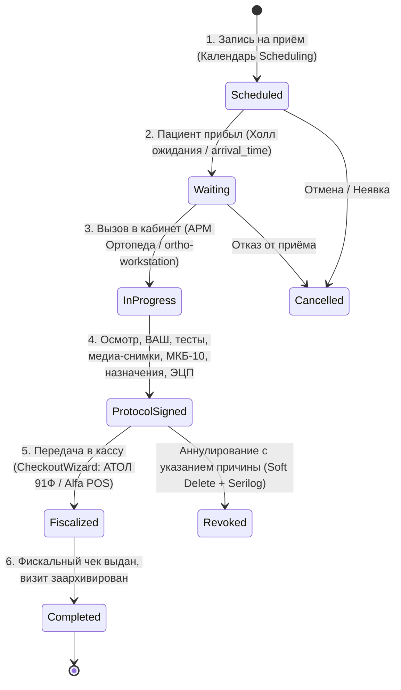

# Архитектурный план: АРМ врача травматолога-ортопеда в МИС (v2.2)
### Загрузка и анализ клинических медиафайлов пациента (Рентген/МРТ/КТ/Фото/Видео), Журнал истории визитов (CRUD + FTS5), глубокая UX-эргономика, мультиформатный вывод (PDF/DOCX/RTF/TXT), масштабируемая БД и Serilog-регистр операций

Настоящий документ развивает архитектурную концепцию приема врача травматолога-ортопеда на основе стандарта [«Архитектура приема врача травматолога-ортопеда в МИС»](https://docs.google.com/document/d/1qCQdb24FZuD1iaZvpGX4fp5607AEAoEntpL-KWph1UM/edit?usp=sharing), объединяя её с существующей базой данных SQLite клиники (61k пациентов, 32k протоколов, 15k МКБ-10, 382 услуги SERVDICT, 861 снимок PROTSHOTS), кассовым узлом (АТОЛ 91Ф / Альфа-Банк POS), стандартом интерактивных таблиц `grid-improvements`, мультимедийным диагностическим хабом и требованиями к аудиту (Serilog).

---

## 1. Концепция жизненного цикла визита (FSM)



---

## 2. Модуль загрузки и управления клиническими медиаданными пациента (Patient Clinical Media Hub)

В ортопедии визуальная диагностика — ключевой инструмент объективизации диагноза. В существующей базе клиники уже хранится **861 снимок** (`protshots`) и бланки анализов (`labpdf`). Создается современный интерактивный **Медиа-хаб пациента**, встроенный как в шапку АРМ ортопеда, так и в карточку визита.

```
┌────────────────────────────────────────────────────────────────────────────────────────────────────────────────────────┐
│ [КЛИНИЧЕСКИЙ МЕДИА-ХАБ ПАЦИЕНТА]  Иванов И.И. (48 лет) | Загружено материалов: 6 файлов | Зона: Правый коленный сустав │
├────────────────────────────────────────────────────────────────────────────────────────────────────────────────────────┤
│ [ 📁 Перетащите файлы сюда (Drag & Drop) или Нажмите для выбора ]  [ 📷 Снимок с веб-камеры / плантоскопа ]            │
│ Поддерживаемые форматы: Рентген/КТ/МРТ (DICOM .dcm, JPG, PNG), Видео походки (.mp4), PDF-заключения (до 50 МБ)       │
├────────────────────────────────────────────────────────────────────────────────────────────────────────────────────────┤
│ ГАЛЕРЕЯ МЕДИАСНИМКОВ С ТЕГАМИ И СУСТАВНОЙ ПРИВЯЗКОЙ:                                                                   │
│ ┌───────────────────┐ ┌───────────────────┐ ┌───────────────────┐ ┌───────────────────┐ ┌──────────────────────────┐ │
│ │ [РЕНТГЕН]         │ │ [МРТ СУСТАВА]     │ │ [КЛИНИЧЕСКОЕ ФОТО]│ │ [ПЛАНТОСКОП]      │ │ [ВИДЕО ПОХОДКИ]          │ │
│ │   [Превью снимка] │ │   [Превью МРТ]    │ │   [Фото вальгуса] │ │   [Отпечаток стоп]│ │   [▶ 00:15 сек]          │ │
│ │ 13.10.2026        │ │ 24.08.2026        │ │ 13.10.2026        │ │ 13.10.2026        │ │ 13.10.2026               │ │
│ │ Колено (R) прямой │ │ Разрыв мениска R  │ │ Вальгус 12°       │ │ Продольное плоск. │ │ Хромота на правую ногу   │ │
│ │ [👁 Просмотр] [⤓] │ │ [👁 Просмотр] [⤓] │ │ [👁 Просмотр] [⤓] │ │ [👁 Просмотр] [⤓] │ │ [▶ Воспроизвести] [⤓]    │ │
│ └───────────────────┘ └───────────────────┘ └───────────────────┘ └───────────────────┘ └──────────────────────────┘ │
├────────────────────────────────────────────────────────────────────────────────────────────────────────────────────────┤
│ РЕЖИМ СРАВНЕНИЯ «ДО / ПОСЛЕ» (SIDE-BY-SIDE COMPARISON):                                                                │
│ ┌──────────────────────────────────────────────────┬──────────────────────────────────────────────────┐                │
│ │ ДО ЛЕЧЕНИЯ (24.08.2026): Сужение суставной щели  │ ПОСЛЕ КУРСА SIS/ГИАЛУРОНАТА (13.10.2026): Норма  │                │
│ │ [ Инструменты: Зум 150% | Яркость | Контраст | Негатив ] [ Синхронное панорамирование ]            │                │
│ └──────────────────────────────────────────────────┴──────────────────────────────────────────────────┘                │
└────────────────────────────────────────────────────────────────────────────────────────────────────────────────────────┘
```

### 2.1. Функциональные возможности медиа-модуля:
1. **Категории и тегирование медиафайлов:**
   - `xray` — Рентгенография (прямая, боковая, аксиальная проекции).
   - `mri` — Магнитно-резонансная томография (МРТ-сканы и срезы).
   - `ct` — Компьютерная томография.
   - `ultrasound` — УЗИ суставов и мягких тканей.
   - `clinical_photo` — Клиническая фотография (деформации оси, отеки, послеоперационные рубцы, объем движений).
   - `plantography` — Плантография и фото с подоскопа/плантоскопа (своды стопы, завал пятки).
   - `gait_video` — Видеозапись биомеханики походки и функциональных тестов (хромота, симптом Тренделенбурга).
   - `external_pdf` — Внешние медицинские выписки, описания МРТ и лабораторные бланки.
2. **Анатомическая привязка к суставам на SVG-гомункулусе:**
   - Каждый загруженный снимок ассоциируется с суставом (`knee_r`, `shoulder_l`, `spine_lumbar`).
   - При клике на колено на гомункулусе в карточке сустава сразу отображаются бейджи: *«Снимки: Рентген (2), МРТ (1)»* с возможностью мгновенного открытия в 1 клик.
3. **Интерактивный специализированный вьюер (Medical Lightbox):**
   - **Масштабирование и панорамирование (Zoom & Pan):** детальное изучение суставной щели и остеофитов.
   - **Инверсия цвета (Негатив / Позитив):** классический негативный рентгеновский вид для лучшей контрастности костных балок.
   - **Регулировка яркости и контрастности (Window/Level):** цифровая коррекция пересвеченных или затемненных рентгенограмм.
   - **Режим «До / После» (Side-by-Side):** сопоставление контрольных снимков до и после терапии/операции.
4. **Безопасное хранение:**
   - Файлы сохраняются в структурированном защищенном каталоге `uploads/patients/{patientId}/{year}/` с генерацией легковесных веб-миниатюр (thumbnails).
   - В SQLite фиксируются метаданные, MIME-тип, размер, контрольная сумма SHA-256 и прямая связь с `patient_id` и `protocol_id`.

---

## 3. Журнал и реестр истории визитов (Visit History Navigation & Management GUI)

В клинике уже накоплено **37 538** визитов (`patient_visits`) и **32 881** протокол осмотра (`protocols`). Для врачей, главного врача и регистратуры создается выделенный **Реестр истории приемов и протоколов (`ProtocolsRegistry.tsx`)** с расширенными возможностями CRUD, фасетной фильтрацией и стандартом `grid-improvements`.

```
┌────────────────────────────────────────────────────────────────────────────────────────────────────────────────────────────────────────┐
│ [РЕЕСТР ПРИЁМОВ И ПРОТОКОЛОВ]  Всего в базе: 32 881 протокол | Сегодня: 14 приёмов | Подписано: 12 | В кассе: 2                       │
├────────────────────────────────────────────────────────────────────────────────────────────────────────────────────────────────────────┤
│ [🔍 Полнотекстовый поиск (FTS5): гонартроз ферматрон правое колено...                                   ][ Найти ][ Сброс фильтров ]│
│ Быстрый период: [ Сегодня ] [ Вчера ] [ Текущая неделя ] [ Месяц ]  |  Интервал дат: [ 01.10.2026 ] — [ 13.10.2026 ]                  │
│ Фильтр сустава: [ Все ] [ Коленный ] [ Плечевой ] [ Позвоночник ] [ Стопа/голеностоп ] | Врач: [ Все врачи ▼ ] | Статус: [ Все ▼ ]   │
├────────────────────────────────────────────────────────────────────────────────────────────────────────────────────────────────────────┤
│ ПАНЕЛЬ ИНСТРУМЕНТОВ: [ Колонки ] [ Фильтры ] [ Плотность ] [ Экспорт CSV ] [ 🖨 Печать выбранных PDF ]          [ + Новый приём ]      │
├────────────────────────────────────────────────────────────────────────────────────────────────────────────────────────────────────────┤
│ ТАБЛИЦА ПРОТОКОЛОВ (DataGrid v9+, autoHeight, sticky headers, без внутреннего скролла):                                                │
│ ┌──┬────────────┬─────────────────────────┬─────────────────┬──────────┬──────────────────────┬─────┬───────────┬─────────────┬──────────┤
│ │  │ Дата/Время │ Пациент                 │ Врач            │ Сустав   │ Диагноз МКБ-10       │ ВАШ │ Услуги    │ Статус      │ Действия │
│ ├──┼────────────┼─────────────────────────┼─────────────────┼──────────┼──────────────────────┼─────┼───────────┼─────────────┼──────────┤
│ │☑ │ 13.10 12:30│ Иванов И.И. (48 л., №10)│ Добрушкин А.М.  │ [Колено R│ M17.1 Гонартроз II ст│  4  │ 3 (15.5k₽)│ [ПОДПИСАН]  │ 👁 ✏ 📷 📄│
│ │☐ │ 13.10 11:15│ Смирнова Е.В. (34 года) │ Добрушкин А.М.  │ [Плечо L]│ M75.1 Разрыв вращат. │  6  │ 2 (8.0k₽) │ [В КАССЕ]   │ 👁 ✏ 📷 📄│
│ │☐ │ 13.10 10:00│ Петров С.А. (52 года)   │ Добрушкин А.М.  │ [Позвон.]│ M54.5 Люмбалгия      │  5  │ 1 (3.5k₽) │ [ОПЛАЧЕН]   │ 👁 ✏ 📷 📄│
│ └──┴────────────┴─────────────────────────┴─────────────────┴──────────┴──────────────────────┴─────┴───────────┴─────────────┴──────────┘
├────────────────────────────────────────────────────────────────────────────────────────────────────────────────────────────────────────┤
│ ИТОГОВЫЙ ПОДВАЛ (Accounting Totals Footer):                                                                                            │
│ Найдено приемов: 3 | Подписано: 2 | Оплачено: 1 | Сумма назначенных услуг: 27 000.00 ₽ | Средняя боль ВАШ: 5.0                        │
└────────────────────────────────────────────────────────────────────────────────────────────────────────────────────────────────────────┘
```

### 3.1. Полная реализация CRUD-операций:
1. **Create (Создание приёма):** быстрый запуск нового осмотра прямо из реестра, из карточки пациента (`Patients.tsx`) или из электронной очереди (`LiveQueueMonitor.tsx`).
2. **Read / View (Интерактивный просмотр):**
   - Боковой слайд-инспектор (Drawer) с вкладками:
     - **Вкладка 1: Интерактивный гомункулус:** визуализация суставов с тепловой картой зафиксированных на этом приеме патологий и углов гониометрии.
     - **Вкладка 2: Мультиформатный просмотр и печать:** живой предпросмотр и экспорт в PDF (A4 с логотипом), DOCX (Word), RTF и TXT.
     - **Вкладка 3: Медиа-хаб и снимки:** галерея рентгенов, МРТ, фото с зумом, негативом и режимом «До/После».
     - **Вкладка 4: Таймлайн аудита (Serilog):** хронология событий от открытия приёма до фискализации.
3. **Update / Edit (Редактирование и клинические дополнения):**
   - Если статус `draft`: открытие в полноценном интерактивном режиме АРМ Ортопеда.
   - Если статус `signed`: создание **Клинического дополнения (Addendum)** с фиксацией времени и автора дополнения в Serilog-аудите.
4. **Delete / Revoke (Мягкое аннулирование):**
   - Безопасное мягкое аннулирование (`status = 'revoked'`) с обязательным указанием причины (ошибочный пациент, отмена по просьбе пациента, повторный приём) и записью в Serilog-аудит.

### 3.2. Полнотекстовый поиск (SQLite FTS5 Architecture):
Для мгновенного поиска по **32 881** протоколам создается виртуальная таблица FTS5:

```sql
CREATE VIRTUAL TABLE IF NOT EXISTS protocols_fts USING fts5(
    protocol_id UNINDEXED,
    patient_id UNINDEXED,
    patient_name,
    doctor_name,
    joint_area,
    mkb_codes,
    mkb_names,
    complaints,
    status_localis,
    full_content,
    prescriptions_text,
    tokenize = 'unicode61 remove_diacritics 2'
);
```

---

## 4. Глубокая проработка UX и GUI интуитивности (Doctor Ergonomics)

```
┌────────────────────────────────────────────────────────────────────────────────────────────────────────────────────────────────────────┐
│ [ШАПКА ВИЗИТА]  Пациент: Иванов Иван Иванович, 48 лет (№10482) | Кабинет №1 | Врач: Добрушкин А.М. | Статус: [НА ПРИЁМЕ] (08:42 мин)   │
│ Аллергии: Пенициллин ⚠ | Эндопротезы: Правый ТБС (2022) | Кардиостимулятор: НЕТ | Медиа: [Рентген (2) 📷] [МРТ (1) 📷] [Загрузить +]│
├──────────────────────────────────────────────────────────────────┬─────────────────────────────────────────────────────────────────────┤
│ ЛЕВАЯ ПАНЕЛЬ: ИНТЕРАКТИВНЫЙ КЛИНИЧЕСКИЙ ВВОД (55% ширины)        │ ПРАВАЯ ПАНЕЛЬ: LIVE PREVIEW & МУЛЬТИФОРМАТНЫЙ ЭКСПОРТ (45% ширины) │
│                                                                  │                                                                     │
│ [1. СУБЪЕКТИВНО (ЖАЛОБЫ И ВАШ)]                                  │  [ Вкладки превью ]: [📄 PDF / Печать A4] [📘 Word] [📝 RTF] [📋 TXT]│
│   Интенсивность боли ВАШ (0-10):                                 │ ┌─────────────────────────────────────────────────────────────────┐ │
│   [ 0 ][ 1 ][ 2 ][ 3 ][(4)][ 5 ][ 6 ][ 7 ][ 8 ][ 9 ][ 10 ]        │ │ ЦЕНТР ОРТОПЕДИИ И ТРАВМАТОЛОГИИ ДОКТОРА ДОБРУШКИНА              │ │
│   Триггеры: [x] Стартовая боль  [x] Нагрузка  [ ] Ночь  [ ] Покой│ │ ПРОТОКОЛ ОСМОТРА ВРАЧА ТРАВМАТОЛОГА-ОРТОПЕДА                    │ │
│                                                                  │ │ Дата: 13.10.2026 12:45 | Пациент: Иванов И.И. (48 лет)          │ │
│ [2. STATUS LOCALIS: 2D ВЕКТОРНЫЙ SVG-ГОМУНКУЛУС]                 │ │                                                                 │ │
│   ┌────────────────────┐   Выбрана область:                      │ │ Жалобы: Умеренная боль в правом коленном суставе (4/10 по ВАШ), │ │
│   │   [ Впереди / Сзади]│   ► ПРАВЫЙ КОЛЕННЫЙ СУСТАВ              │ │ возникающая при физической нагрузке и начале ходьбы.            │ │
│   │     ( Голова )     │                                         │ │                                                                 │ │
│   │    /   |   \       │   [✓ ВСЁ В ПРЕДЕЛАХ НОРМЫ] (Хоткей: F2) │ │ Status Localis: Правый коленный сустав дефигурирован за счёт    │ │
│   │   /    |    \      │   - Ось: [ Норма ] (Вальгус / Варус)    │ │ умеренного внутрисуставного выпота (II степень). Пальпаторно:   │ │
│   │       / \          │   - Выпот: (0) (I) [(II)] (III)         │ │ локальная болезненность по медиальной суставной щели.           │ │
│   │     [L] [R]◄Колено │   - ROM (нейтраль-ноль): 110° / 0° / -5°│ │ Движения (ROM): сгибание 110°, дефицит разгибания -5°.           │ │
│   │     | | | |        │   - Тесты: Лахман (+), Пер. ящик (+),   │ │ Тесты: Лахман (+), передний «выдвижной ящик» (+), тест          │ │
│   │     _|_ _|_        │            Мак-Мюррей (+), Pivot-shift(-)│ │ Мак-Мюррея медиально (+), баллотирование надколенника (+).      │ │
│   └────────────────────┘                                         │ │                                                                 │ │
│                                                                  │ │ Диагноз: M17.1 Первичный гонартроз прочий односторонний (справа)│ │
│ [3. ДИАГНОЗ МКБ-10] [Предиктивный поиск... гонартроз   🔍]       │ │ Kellgren-Lawrence II стадия, синовит правого коленного сустава. │ │
│   Сторона: ( ) Слева  (*) Справа  ( ) Двусторонний               │ │                                                                 │ │
│   Стадия: [ Kellgren-Lawrence II ]                               │ │ План лечения и назначения:                                      │ │
│                                                                  │ │ 1. Пункция правого коленного сустава, эвакуация выпота.         │ │
│ [4. НАЗНАЧЕНИЯ И УСЛУГИ]                                         │ │ 2. Введение протеза синовиальной жидкости (Ферматрон плюс 1.5%).│ │
│   [x] Пункция сустава и введение Ферматрон (3 500 ₽)             │ │ 3. Индивидуальные ортопедические стельки (термоформовка).       │ │
│   [x] Курс высокоинтенсивной магнитотерапии SIS (5 сеансов)      │ │ 4. Курс высокоинтенсивной магнитотерапии SIS №5.                │ │
│   [x] Изготовление индивидуальных стелек (4 500 ₽)               │ │ Итого назначено медицинских услуг: 3 поз. на сумму 15 500 ₽     │ │
│   Итого услуг к оплате: 15 500 ₽                                 │ │                                                                 │ │
│                                                                  │ │ [ Врач травматолог-ортопед: Добрушкин А.М. ]  [ ЭЦП: ВАЛИДНА ]  │ │
│                                                                  │ └─────────────────────────────────────────────────────────────────┘ │
├──────────────────────────────────────────────────────────────────┴─────────────────────────────────────────────────────────────────────┤
│ ПАНЕЛЬ ДЕЙСТВИЙ:                                                                                                                       │
│ [ Автосохранение черновика: 12:45:01 ]  [ 💾 Скачать DOCX ]  [ 📋 Копировать текст ]  [ 🖨 Печать протокола A4 ]  [ ➔ ПЕРЕДАТЬ В КАССУ ]│
└────────────────────────────────────────────────────────────────────────────────────────────────────────────────────────────────────────┘
```

---

## 5. Мультиформатный движок вывода с живым превью (PDF / DOCX / RTF / TXT)

```
                  ┌──> [ Live Preview WYSIWYG ] (Отображение в правой панели)
                  │
[Данные протокола]├──> [ PDF Export ]  ───────> react-to-print (Фирменный A4, колонтитулы, логотип)
 (React State)    │
                  ├──> [ DOCX Export ] ───────> Библиотека docx (Нативный MS Word c таблицами)
                  │
                  ├──> [ RTF Export ]  ───────> Rich Text Format (CP1251, открывается в WordPad/любой МИС)
                  │
                  └──> [ TXT Export ]  ───────> Plain Monospace (Быстрая вставка в ЕГИСЗ/СЭМД)
```

---

## 6. Расширение структуры базы данных (SQLite DB Schema)

```sql
-- 1. Расширение существующей таблицы protocols
ALTER TABLE protocols ADD COLUMN protocol_json TEXT;           -- Полное дерево формы (JSON v2.0)
ALTER TABLE protocols ADD COLUMN schema_version TEXT DEFAULT '2.0';
ALTER TABLE protocols ADD COLUMN appointment_id INTEGER;       -- Связка с таблицей appointments
ALTER TABLE protocols ADD COLUMN status TEXT DEFAULT 'signed'; -- 'draft', 'signed', 'revoked'
ALTER TABLE protocols ADD COLUMN vas_score INTEGER DEFAULT 0;  -- Шкала боли ВАШ (0-10)
ALTER TABLE protocols ADD COLUMN primary_joint TEXT;           -- Основная зона: 'knee_r', 'shoulder_l' и т.д.
ALTER TABLE protocols ADD COLUMN side TEXT;                    -- 'right', 'left', 'bilateral'
ALTER TABLE protocols ADD COLUMN is_signed INTEGER DEFAULT 1;
ALTER TABLE protocols ADD COLUMN signed_at TEXT;
ALTER TABLE protocols ADD COLUMN signed_by_docn INTEGER;
ALTER TABLE protocols ADD COLUMN signature_hash TEXT;          -- Контрольная сумма / SHA-256 хэш подписи
ALTER TABLE protocols ADD COLUMN revocation_reason TEXT;       -- Причина аннулирования при Soft-Delete

-- 2. Клинический профиль / Ортопедический паспорт пациента
CREATE TABLE IF NOT EXISTS patient_clinical_profiles (
    patient_id INTEGER PRIMARY KEY,
    allergies TEXT,                       -- Аллергоанамнез
    implants_endoprosthetics TEXT,        -- Эндопротезы, металлоконструкции (локализация, год)
    has_pacemaker INTEGER DEFAULT 0,      -- Кардиостимулятор (абсолютное противопоказание SIS/МРТ)
    dominant_limb TEXT DEFAULT 'right',   -- Ведущая рука/нога ('right', 'left')
    chronic_conditions TEXT,              -- Соматические патологии (сахарный диабет, остеопороз)
    blood_group TEXT,                     -- Группа крови / резус
    ortho_anamnesis_notes TEXT,           -- Анамнез предшествующих травм и операций
    updated_at TEXT DEFAULT (datetime('now', 'localtime')),
    updated_by TEXT,
    FOREIGN KEY(patient_id) REFERENCES patients(id)
);

-- 3. Реестр клинических медиафайлов пациента (Patient Media Attachments)
CREATE TABLE IF NOT EXISTS patient_media_attachments (
    id INTEGER PRIMARY KEY AUTOINCREMENT,
    patient_id INTEGER NOT NULL,
    protocol_id INTEGER,                  -- NULL если загружено вне приёма
    appointment_id INTEGER,
    media_category TEXT NOT NULL,         -- 'xray', 'mri', 'ct', 'ultrasound', 'clinical_photo', 'plantography', 'gait_video', 'external_pdf'
    joint_area TEXT,                      -- 'knee_r', 'shoulder_l', 'spine', etc.
    title TEXT NOT NULL,                  -- 'Рентгенография правого коленного сустава в 2-х проекциях'
    file_name TEXT NOT NULL,              -- Исходное имя файла
    file_path TEXT NOT NULL,              -- Относительный путь в хранилище (uploads/...)
    file_size_bytes INTEGER NOT NULL,     -- Размер в байтах
    mime_type TEXT NOT NULL,              -- 'image/jpeg', 'application/pdf', 'video/mp4', 'application/dicom'
    thumbnail_path TEXT,                  -- Путь к легковесному превью
    description TEXT,                     -- Клинический комментарий врача
    study_date TEXT,                      -- Дата проведения исследования
    sha256_hash TEXT,                     -- Контрольная сумма файла
    created_at TEXT DEFAULT (datetime('now', 'localtime')),
    created_by TEXT,
    FOREIGN KEY(patient_id) REFERENCES patients(id),
    FOREIGN KEY(protocol_id) REFERENCES protocols(id)
);
CREATE INDEX IF NOT EXISTS idx_pma_patient ON patient_media_attachments(patient_id);
CREATE INDEX IF NOT EXISTS idx_pma_protocol ON patient_media_attachments(protocol_id);
CREATE INDEX IF NOT EXISTS idx_pma_joint ON patient_media_attachments(joint_area);

-- 4. Назначения лечебно-биомеханического плана
CREATE TABLE IF NOT EXISTS ortho_treatment_prescriptions (
    id INTEGER PRIMARY KEY AUTOINCREMENT,
    protocol_id INTEGER NOT NULL,
    appointment_id INTEGER,
    patient_id INTEGER NOT NULL,
    category TEXT NOT NULL,               -- 'manipulation', 'orthotics', 'physio', 'diagnostics', 'service'
    service_id INTEGER,                   -- Связка с servdict(id)
    service_code TEXT,                    -- Код услуги из прейскуранта
    title TEXT NOT NULL,                  -- Название процедуры / товара
    details_json TEXT,                    -- Препарат, серия, доза, параметры УВТ/SIS, заготовка стелек
    quantity INTEGER DEFAULT 1,
    unit_price REAL DEFAULT 0,
    total_price REAL DEFAULT 0,
    is_transferred_to_cashier INTEGER DEFAULT 0, -- Отправлено в CheckoutWizard
    created_at TEXT DEFAULT (datetime('now', 'localtime')),
    FOREIGN KEY(protocol_id) REFERENCES protocols(id),
    FOREIGN KEY(patient_id) REFERENCES patients(id),
    FOREIGN KEY(service_id) REFERENCES servdict(id)
);
CREATE INDEX IF NOT EXISTS idx_otp_protocol ON ortho_treatment_prescriptions(protocol_id);
CREATE INDEX IF NOT EXISTS idx_otp_patient ON ortho_treatment_prescriptions(patient_id);

-- 5. Хронологический реестр биомеханики суставов (для графиков реабилитации)
CREATE TABLE IF NOT EXISTS joint_biomechanics_history (
    id INTEGER PRIMARY KEY AUTOINCREMENT,
    patient_id INTEGER NOT NULL,
    protocol_id INTEGER NOT NULL,
    recorded_date TEXT NOT NULL,
    joint_name TEXT NOT NULL,             -- 'knee', 'shoulder', 'hip', 'ankle', 'spine'
    side TEXT NOT NULL,                   -- 'right', 'left', 'spine'
    flexion_active INTEGER,               -- Сгибание активное (градусы)
    flexion_passive INTEGER,              -- Сгибание пассивное
    extension_deficit INTEGER,            -- Дефицит разгибания (градусы, со знаком минус)
    rotation_ext INTEGER,                 -- Наружная ротация
    rotation_int INTEGER,                 -- Внутренняя ротация
    effusion_grade INTEGER DEFAULT 0,     -- Выпот (0, 1, 2, 3)
    vas_score INTEGER DEFAULT 0,          -- Боль в этой зоне (0-10)
    key_findings TEXT,                    -- Ключевые патологические знаки (Lachman+, McMurray+)
    FOREIGN KEY(patient_id) REFERENCES patients(id),
    FOREIGN KEY(protocol_id) REFERENCES protocols(id)
);
CREATE INDEX IF NOT EXISTS idx_jbh_patient ON joint_biomechanics_history(patient_id, joint_name, side);

-- 6. Библиотека быстрых клинических шаблонов врача
CREATE TABLE IF NOT EXISTS ortho_templates (
    id INTEGER PRIMARY KEY AUTOINCREMENT,
    doctor_id INTEGER,                    -- NULL = общий для клиники
    title TEXT NOT NULL,                  -- 'Гонартроз II ст. с синовитом', 'Повреждение ПКС'
    joint_name TEXT NOT NULL,             -- 'knee', 'shoulder', 'spine'
    template_json TEXT NOT NULL,          -- Предустановленные значения полей формы
    default_mkb_code TEXT,                -- 'M17.1'
    created_at TEXT DEFAULT (datetime('now', 'localtime'))
);
```

---

## 7. Serilog Operation Register (Аудит операций приёма врача)

В клинике уже функционируют Serilog-совместимые логгеры: [fiscalAuditLogger.js](file:///c:/Users/vladimir/source/repos/Data%20Analysis/server/fiscalAuditLogger.js) (для АТОЛ 91Ф) и [posAuditLogger.js](file:///c:/Users/vladimir/source/repos/Data%20Analysis/server/posAuditLogger.js) (для эквайринга).

Создаётся компонент **`orthoAuditLogger.js`** со строгой Serilog-схемой:

```sql
CREATE TABLE IF NOT EXISTS ortho_audit_logs (
    id INTEGER PRIMARY KEY AUTOINCREMENT,
    timestamp TEXT NOT NULL DEFAULT (datetime('now', 'localtime')),
    level TEXT NOT NULL,                  -- 'Information', 'Warning', 'Error'
    event_type TEXT NOT NULL,             -- Тип события (см. ниже)
    appointment_id INTEGER,
    protocol_id INTEGER,
    patient_id INTEGER,
    doctor_id INTEGER,
    duration_ms INTEGER DEFAULT 0,
    message TEXT NOT NULL,
    properties_json TEXT,                 -- Структурированный контекст Serilog
    client_ip TEXT,
    exception TEXT
);
CREATE INDEX IF NOT EXISTS idx_oal_appointment ON ortho_audit_logs(appointment_id);
CREATE INDEX IF NOT EXISTS idx_oal_event ON ortho_audit_logs(event_type);
```

### 7.1. Реестр событий Serilog (`EventTypes`):
1. `VISIT_INITIATED` — открытие приёма врачом, загрузка карточки и снимков.
2. `MEDIA_UPLOADED` — загрузка рентгенограммы, МРТ или клинического фото.
3. `EXAM_DRAFT_AUTOSAVED` — периодическое фоновое сохранение черновика формы (раз в 30 сек).
4. `TEST_EVALUATED` — фиксация ключевого теста (например, обнаружен симптом Лахмана).
5. `DIAGNOSIS_ATTACHED` — выбор кода МКБ-10 с уточнением стороны и рентген-стадии.
6. `TREATMENT_PRESCRIBED` — добавление платной услуги, инъекции или стелек.
7. `PROTOCOL_SIGNED` — подписание протокола врачом, фиксация контрольного SHA-256 хэша.
8. `EXPORT_GENERATED` — формирование документа в форматах `PDF`, `DOCX`, `RTF`, `TXT`.
9. `TRANSFERRED_TO_CHECKOUT` — успешная передача списка назначенных услуг в кассовый узел.
10. `PROTOCOL_REVOKED` — аннулирование протокола с фиксацией причины в аудит-логе.

---

## 8. Сквозная интеграция с кассовым узлом (CheckoutWizard)

```
[АРМ Ортопеда: Назначения]
- Пункция сустава (Ферматрон): 3 500 ₽
- Индивидуальные стельки: 4 500 ₽
- Магнитотерапия SIS: 7 500 ₽
         │
         ▼ Нажатие кнопки «Передать на оплату ➔»
[API: POST /api/ortho/transfer-to-checkout]
         │
         ├── Запись в ortho_treatment_prescriptions (is_transferred=1)
         ├── Сохранение пакета в sessionStorage('checkout_prefill')
         │
         ▼ Автоматический редирект в /checkout
[Кассовый узел CheckoutWizard]
- Пациент и врач уже выбраны
- Таблица услуг заполнена 3 позициями на 15 500 ₽
- Кассир выбирает: [Безналичные: Терминал Альфа-Банк]
- Печать фискального чека на АТОЛ 91Ф
- Статус приёма в appointments меняется на 'fiscalized' ➔ 'completed'
```

---

## 9. Поэтапный план реализации (Milestones)

| Этап | Задачи и состав работ | Результаты и артефакты |
| :--- | :--- | :--- |
| **Этап 1: БД, Хранилище медиа, FTS5-индекс и Serilog** | 1. Расширение таблицы `protocols` (`protocol_json`, `vas_score`, `primary_joint`, `revocation_reason`).<br>2. Создание таблиц `patient_clinical_profiles`, `patient_media_attachments`, `ortho_treatment_prescriptions`, `joint_biomechanics_history`, `ortho_templates`.<br>3. Настройка каталога медиахранилища `uploads/patient_media/`.<br>4. Создание FTS5-таблицы `protocols_fts` и наполнение индекса по 32k записям.<br>5. Реализация `orthoAuditLogger.js` и таблицы `ortho_audit_logs`. | Выполненная миграция SQLite, FTS5 полнотекстовый индекс, защищенное хранилище медиа, Serilog-логгер. |
| **Этап 2: Backend REST API для АРМ, Медиа и Реестра** | Разработка контроллера [server/orthoProtocolRoutes.js](file:///c:/Users/vladimir/source/repos/Data%20Analysis/server/orthoProtocolRoutes.js):<br>- `POST /api/ortho/media/upload` (мультипарт-загрузка файлов, генерация миниатюр, привязка к суставу);<br>- `GET /api/ortho/media/:patientId` (список медиа с фильтром по суставам);<br>- `GET /api/ortho/registry` (фильтрация, пагинация, FTS5-поиск, сортировка);<br>- `GET /api/ortho/context/:appointmentId` (пациент, профиль, история, снимки);<br>- `POST /api/ortho/save` (черновик / чистовик);<br>- `POST /api/ortho/sign` (подписание ЭЦП, синхронизация с `protocols` и `diagnoses`);<br>- `POST /api/ortho/export/:format` (генерация DOCX / RTF / TXT);<br>- `POST /api/ortho/transfer-to-checkout` (передача в кассу). | Серверный REST API для управления приёмами, медиафайлами и полнотекстового поиска с Serilog-аудитом. |
| **Этап 3: Реестр визитов и протоколов (ProtocolsRegistry GUI)** | 1. Разработка страницы [client/src/pages/ProtocolsRegistry.tsx](file:///c:/Users/vladimir/source/repos/Data%20Analysis/client/src/pages/ProtocolsRegistry.tsx) по стандартам `grid-improvements`.<br>2. Реализация FTS5 поисковой строки с пресетами периодов дат и фильтрами суставов/врачей.<br>3. Интерактивный слайдер-инспектор просмотра приёма с вкладками: SVG-гомункулус, Мультиформатное превью (PDF/DOCX/RTF/TXT), Медиа-галерея `protshots`, Serilog-таймлайн.<br>4. Действия строк: просмотр, редактирование, аннулирование, скачивание. | Полноценный интерфейс навигации, CRUD и аналитики по всем 32k протоколам клиники. |
| **Этап 4: Клинический медиа-хаб и интерактивный АРМ Ортопеда** | 1. Компонент [PatientMediaHub.tsx](file:///c:/Users/vladimir/source/repos/Data%20Analysis/client/src/components/ortho/PatientMediaHub.tsx): Drag&Drop загрузчик, захват с веб-камеры/плантоскопа, специализированный просмотрщик (Zoom, инверсия-негатив, яркость/контрастность, режим «До/После»).<br>2. Интерактивный 2D SVG-гомункулус [BodyHomunculus.tsx](file:///c:/Users/vladimir/source/repos/Data%20Analysis/client/src/components/ortho/BodyHomunculus.tsx) с тепловой картой патологий и бейджами медиа-снимков.<br>3. Круговой визуализатор углов гониометрии [GoniometerInput.tsx](file:///c:/Users/vladimir/source/repos/Data%20Analysis/client/src/components/ortho/GoniometerInput.tsx) и блоки тестов (колено, плечо, позвоночник, стопа).<br>4. Двухоконная страница приёма [OrthoWorkstation.tsx](file:///c:/Users/vladimir/source/repos/Data%20Analysis/client/src/pages/OrthoWorkstation.tsx) со синхронным Live Preview и экспортом в 4 формата. | Полнофункциональное рабочее место врача с мультимедийной поддержкой и живым превью. |
| **Этап 5: Сквозная интеграция и навигация** | 1. Связка с [LiveQueueMonitor.tsx](file:///c:/Users/vladimir/source/repos/Data%20Analysis/client/src/components/scheduling/LiveQueueMonitor.tsx): кнопка «Вызов в кабинет» открывает приём в АРМ.<br>2. Связка с [CheckoutWizard.tsx](file:///c:/Users/vladimir/source/repos/Data%20Analysis/client/src/pages/CheckoutWizard.tsx): прием пакета услуг из АРМ, фискализация на АТОЛ 91Ф и завершение визита.<br>3. Добавление пунктов «Журнал приёмов и протоколов» и «АРМ Врача-ортопеда» в [navigationConfig.tsx](file:///c:/Users/vladimir/source/repos/Data%20Analysis/client/src/config/navigationConfig.tsx). | Полный замкнутый цикл: запись ➔ приём + снимки ➔ протокол ➔ касса ➔ архив. |
