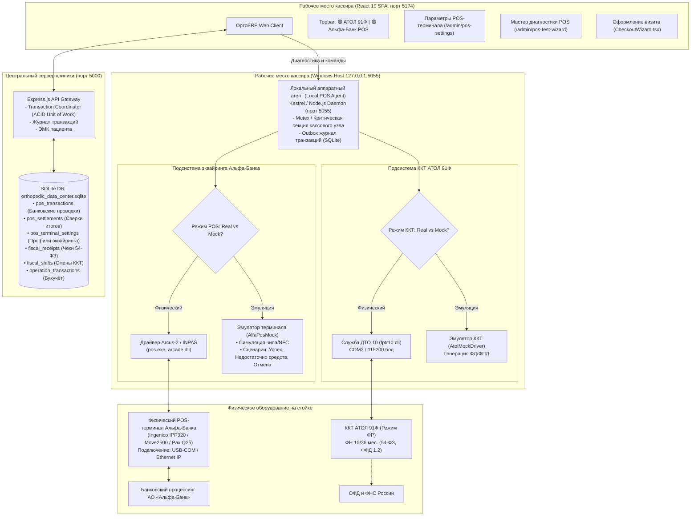
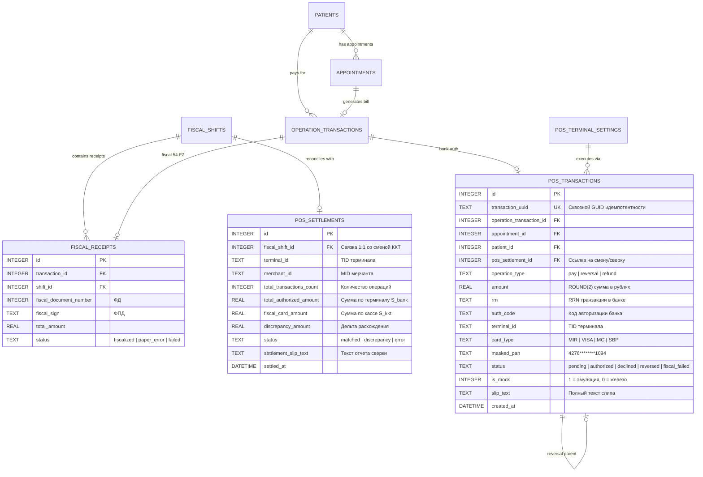

# Архитектурный план: Кассовый узел МИС, очный эквайринг Альфа-Банка и ККТ «АТОЛ 91Ф»
## Модуль очного приёма карт, двухфазной фискализации (54-ФЗ / ФФД 1.2), аппаратного агента и обеспечение абсолютной целостности данных БД (ACID & Data Integrity)

---

## 1. Введение и бизнес-контекст клиники

В **«Центре Ортопедии и Травматологии Добрушкина в Сочи»** оформление визита пациента завершается финансово-расчетной операцией в модуле **[CheckoutWizard](file:///c:/Users/vladimir/source/repos/Data%20Analysis/client/src/pages/CheckoutWizard.tsx)**.
При очном приёме пациентов ключевым платёжным сценарием является **безналичная оплата банковской картой, смартфоном (MirPay) или через СБП по QR-коду** непосредственно на стойке регистратуры через физический POS-терминал **Альфа-Банка** с синхронной печатью фискального чека на **ККТ «АТОЛ 91Ф»**.

### Базовый принцип архитектурного паритета и целостности:
Система выстраивает **полную инженерную и визуальную симметрию** между управлением онлайн-кассой «АТОЛ 91Ф» и банковским POS-терминалом Альфа-Банка, гарантируя **абсолютную финансовую и реляционную целостность данных**:
- Переключатель режимов: **Физическое устройство $\leftrightarrow$ Режим эмуляции (Mock Mode)** для обоих аппаратов;
- Выделенные экраны параметров с хранением профилей в SQLite (`fiscal_device_settings` и `pos_terminal_settings`);
- Интерактивные мастера тестирования с глубокой аппаратной диагностикой (`FiscalTestWizard` и `PosTestWizard`);
- Глобальный контекст статуса оборудования в реальном времени с индикаторами в Header/Topbar;
- Единый суточный журнал кассовых смен со сверкой итогов эквайринга и Z-отчёта ККТ;
- **Строгая модель целостности данных БД:** исключение рассинхронизации банковского списания, фискального документа и финансовой проводки визита пациента.

---

## 2. Концептуальная архитектура: Модель распределённого кассового узла



---

## 3. Режимы работы POS-терминала: Физический vs Эмуляция (Mock Mode)

Система поддерживает мгновенное переключение режима терминала без перезапуска приложения:

```
┌────────────────────────────────────────────────────────────────────────────────────────┐
│               СРАВНЕНИЕ РЕЖИМОВ РАБОТЫ ЭКВАЙРИНГА АЛЬФА-БАНКА                          │
├──────────────────────────┬─────────────────────────────┬───────────────────────────────┤
│ Характеристика           │ Физический POS-терминал     │ Эмуляция (AlfaPosMock)        │
├──────────────────────────┼─────────────────────────────┼───────────────────────────────┤
│ Аппаратное подключение   │ USB-Serial (COM), Ethernet  │ Не требуется (работает на     │
│                          │ TCP/IP или USB-HID          │ любых ПК и ноутбуках)         │
├──────────────────────────┼─────────────────────────────┼───────────────────────────────┤
│ Банковский драйвер       │ Arcus-2 (`pos.exe`, DLL)    │ Внутренний программный модуль │
│                          │ либо INPAS SmartSale        │ генерации банковских ответов  │
├──────────────────────────┼─────────────────────────────┼───────────────────────────────┤
│ Проведение платежа       │ Активация PIN-пада, ввод    │ Программная симуляция задержки│
│                          │ карты/NFC, связь с банком   │ (1–5 сек) без списания денег  │
├──────────────────────────┼─────────────────────────────┼───────────────────────────────┤
│ Банковские реквизиты     │ Реальные RRN, AuthCode,     │ Реалистичные RRN, AuthCode,   │
│                          │ маска карты из процессинга  │ маска карты `4276********1094`│
├──────────────────────────┼─────────────────────────────┼───────────────────────────────┤
│ Тестирование сбоев       │ Требует спец. карт банка    │ Выбор сценария из меню:       │
│                          │ или действий кассира        │ • Успех (Код 00)              │
│                          │                             │ • Недостаточно средств (51)   │
│                          │                             │ • Отмена клиентом (99)        │
│                          │                             │ • Таймаут ввода PIN (68)      │
├──────────────────────────┼─────────────────────────────┼───────────────────────────────┤
│ Банковский слип-чек      │ Печатается терминалом/ККТ   │ Формируется текст слипа для   │
│                          │ на термоленте               │ предпросмотра и PDF-печати    │
└──────────────────────────┴─────────────────────────────┴───────────────────────────────┘
```

---

## 4. Архитектура целостности данных БД (Data Integrity & Schema)

Финансовая система не имеет права допускать:
1. Дублирования транзакций при сетевых повторах (Idempotency Violation);
2. Списания денег банком без следа в реестре операций клиники (Orphan Bank Transactions);
3. Искажения сумм из-за погрешностей с плавающей запятой (`REAL` vs `ROUND(x, 2)`);
4. Рассинхронизации между закрытой сменой ККТ и банковской сверкой итогов (Settlement Drift);
5. Одновременного наличия нескольких активных профилей оборудования.

### 4.1. Реляционная диаграмма сущностей кассового узла (ERD)



### 4.2. DDL Схемы таблиц эквайринга в SQLite

#### 1. Таблица транзакций эквайринга (`pos_transactions`)
```sql
CREATE TABLE IF NOT EXISTS pos_transactions (
    id INTEGER PRIMARY KEY AUTOINCREMENT,
    transaction_uuid TEXT NOT NULL UNIQUE,       -- Сквозной GUID из React/Backend (гарантия от дублей)
    operation_transaction_id INTEGER REFERENCES operation_transactions(id) ON DELETE SET NULL,
    appointment_id INTEGER REFERENCES appointments(id) ON DELETE SET NULL,
    patient_id INTEGER REFERENCES patients(id) ON DELETE SET NULL,
    pos_settlement_id INTEGER REFERENCES pos_settlements(id) ON DELETE SET NULL,
    original_pos_transaction_id INTEGER REFERENCES pos_transactions(id) ON DELETE RESTRICT, -- Для Reversal
    
    operation_type TEXT NOT NULL DEFAULT 'pay',  -- 'pay' (оплата), 'reversal' (отмена), 'refund' (возврат)
    amount REAL NOT NULL CHECK(amount > 0),      -- Сумма в рублях (всегда строго положительная)
    currency_code TEXT DEFAULT '643',            -- Рубли (RUB)
    
    -- Банковские реквизиты авторизации
    terminal_id TEXT NOT NULL,                   -- TID терминала (например 'ALFA_770192')
    merchant_id TEXT,                            -- MID мерчанта (например 'MERCH_884102')
    rrn TEXT,                                    -- RRN транзакции в процессинге (12 символов)
    auth_code TEXT,                              -- Код авторизации (6 символов)
    card_type TEXT,                              -- 'MIR', 'VISA', 'MASTERCARD', 'SBP_QR'
    masked_pan TEXT,                             -- '4276********1094'
    response_code TEXT,                          -- '00' (Успех), '51' (Лимит), '99' (Отмена)
    
    -- Жизненный цикл двухфазной операции
    status TEXT NOT NULL DEFAULT 'pending',      -- 'pending_auth', 'authorized', 'declined', 'completed', 'bank_success_fiscal_failed', 'reversed'
    is_mock INTEGER NOT NULL DEFAULT 1,          -- 1 = эмуляция, 0 = физический терминал
    slip_text TEXT,                              -- Текст банковского слип-чека
    error_message TEXT,
    
    created_at DATETIME DEFAULT CURRENT_TIMESTAMP,
    authorized_at DATETIME,
    completed_at DATETIME
);

-- Индексы для быстрой выборки и гарантии уникальности RRN на терминале
CREATE INDEX IF NOT EXISTS idx_pos_tx_uuid ON pos_transactions(transaction_uuid);
CREATE INDEX IF NOT EXISTS idx_pos_tx_rrn ON pos_transactions(terminal_id, rrn);
CREATE INDEX IF NOT EXISTS idx_pos_tx_op_tx ON pos_transactions(operation_transaction_id);
CREATE INDEX IF NOT EXISTS idx_pos_tx_status ON pos_transactions(status);
CREATE INDEX IF NOT EXISTS idx_pos_tx_settlement ON pos_transactions(pos_settlement_id);
```

#### 2. Таблица суточных сверок итогов эквайринга (`pos_settlements`)
```sql
CREATE TABLE IF NOT EXISTS pos_settlements (
    id INTEGER PRIMARY KEY AUTOINCREMENT,
    fiscal_shift_id INTEGER REFERENCES fiscal_shifts(id) ON DELETE SET NULL,
    terminal_id TEXT NOT NULL,
    merchant_id TEXT,
    settlement_sequence_number INTEGER,          -- Номер сверки за смену
    
    -- Финансовые итоги по банковскому отчету
    total_transactions_count INTEGER NOT NULL DEFAULT 0,
    total_authorized_amount REAL NOT NULL DEFAULT 0.0 CHECK(total_authorized_amount >= 0),
    
    -- Контрольная фискальная сверка
    fiscal_card_amount REAL NOT NULL DEFAULT 0.0 CHECK(fiscal_card_amount >= 0),
    discrepancy_amount REAL NOT NULL DEFAULT 0.0, -- total_authorized_amount - fiscal_card_amount
    
    status TEXT NOT NULL DEFAULT 'matched',      -- 'matched' (дельты нет), 'discrepancy' (расхождение), 'failed'
    settlement_slip_text TEXT,                   -- Полный текст слипа сверки итогов
    discrepancy_reason TEXT,                     -- Комментарий администратора/кассира
    settled_at DATETIME DEFAULT CURRENT_TIMESTAMP,
    settled_by TEXT DEFAULT 'Администратор'
);

CREATE INDEX IF NOT EXISTS idx_pos_settlements_shift ON pos_settlements(fiscal_shift_id);
CREATE INDEX IF NOT EXISTS idx_pos_settlements_date ON pos_settlements(settled_at);
```

#### 3. Таблица параметров терминала (`pos_terminal_settings`)
```sql
CREATE TABLE IF NOT EXISTS pos_terminal_settings (
    id INTEGER PRIMARY KEY AUTOINCREMENT,
    profile_name TEXT NOT NULL UNIQUE,           -- 'Основной терминал стойки №1', 'Демо-эмулятор'
    is_mock_mode INTEGER NOT NULL DEFAULT 1,     -- 1 = Эмуляция (Mock), 0 = Физический терминал
    driver_type TEXT NOT NULL DEFAULT 'Arcus-2', -- 'Arcus-2', 'INPAS', 'UCS', 'Mock'
    connection_type TEXT NOT NULL DEFAULT 'COM', -- 'COM', 'TCP_IP', 'USB_HID'
    port TEXT NOT NULL DEFAULT 'COM4',           -- COM-порт подключения
    baud_rate INTEGER NOT NULL DEFAULT 115200,   -- Скорость обмена
    ip_address TEXT DEFAULT '192.168.1.150',     -- IP-адрес терминала (для Ethernet)
    ip_port INTEGER DEFAULT 8888,                -- TCP-порт
    terminal_id TEXT NOT NULL DEFAULT 'ALFA_770192', -- TID терминала
    merchant_id TEXT NOT NULL DEFAULT 'MERCH_884102',-- MID мерчанта
    bank_name TEXT NOT NULL DEFAULT 'АО «АЛЬФА-БАНК»',
    currency_code TEXT NOT NULL DEFAULT '643',
    execution_timeout_seconds INTEGER NOT NULL DEFAULT 60 CHECK(execution_timeout_seconds BETWEEN 15 AND 180),
    driver_executable_path TEXT DEFAULT 'C:\\Arcus2\\pos.exe',
    enable_sbp_qr INTEGER NOT NULL DEFAULT 1,
    mock_scenario TEXT DEFAULT 'success',        -- 'success', 'insufficient_funds', 'cancelled', 'timeout'
    mock_delay_seconds INTEGER DEFAULT 2,
    is_active INTEGER NOT NULL DEFAULT 1,        -- 1 = Активный профиль
    notes TEXT,
    updated_at DATETIME DEFAULT CURRENT_TIMESTAMP,
    updated_by TEXT DEFAULT 'Администратор'
);
```

#### 4. Защита от дефекта «Несколько активных профилей» (Trigger)
```sql
-- Триггер: при активации одного профиля все остальные автоматически деактивируются
CREATE TRIGGER IF NOT EXISTS trg_pos_single_active_profile
AFTER UPDATE OF is_active ON pos_terminal_settings
WHEN NEW.is_active = 1
BEGIN
    UPDATE pos_terminal_settings
    SET is_active = 0
    WHERE id != NEW.id;
END;
```

#### 5. Таблица аудита эквайринга (`pos_audit_logs`)
```sql
CREATE TABLE IF NOT EXISTS pos_audit_logs (
    id INTEGER PRIMARY KEY AUTOINCREMENT,
    timestamp DATETIME DEFAULT CURRENT_TIMESTAMP,
    level TEXT NOT NULL,                         -- 'Information', 'Warning', 'Error', 'Fatal'
    event_type TEXT NOT NULL,                    -- 'POS_CONNECT', 'AUTH_START', 'AUTH_SUCCESS', 'AUTH_DECLINE', 'REVERSAL', 'SETTLEMENT'
    terminal_id TEXT,
    transaction_uuid TEXT,
    amount REAL,
    rrn TEXT,
    auth_code TEXT,
    message TEXT NOT NULL,
    properties_json TEXT                         -- Структурированный контекст Serilog
);
CREATE INDEX IF NOT EXISTS idx_pos_audit_ts ON pos_audit_logs(timestamp);
CREATE INDEX IF NOT EXISTS idx_pos_audit_tx ON pos_audit_logs(transaction_uuid);
```

---

### 4.3. Гарантии ACID транзакций и Unit of Work

Для исключения рассинхронизации при сохранении чеков, платежей и визитов на сервере клиники операции оборачиваются в транзакционный контекст:

```javascript
/**
 * Атомарная фиксация успешной оплаты в базе данных (Unit of Work)
 */
async function confirmPaymentUnitOfWork(db, payload) {
  return new Promise((resolve, reject) => {
    db.serialize(() => {
      db.run('BEGIN IMMEDIATE TRANSACTION', (beginErr) => {
        if (beginErr) return reject(beginErr);

        try {
          // 1. Запись или обновление в pos_transactions
          db.run(`
            UPDATE pos_transactions
            SET status = 'completed', completed_at = datetime('now', 'localtime')
            WHERE transaction_uuid = ?
          `, [payload.transactionUuid]);

          // 2. Создание проводки в operation_transactions
          db.run(`
            INSERT INTO operation_transactions (
              patient_id, operation_id, transaction_date, billed_price,
              payment_method, pos_rrn, pos_auth_code, fiscal_document_number
            ) VALUES (?, ?, date('now'), ?, 'card', ?, ?, ?)
          `, [
            payload.patientId, payload.operationId, payload.amount,
            payload.bankRrn, payload.bankAuthCode, payload.fiscalDocNumber
          ], function (txErr) {
            if (txErr) {
              db.run('ROLLBACK');
              return reject(txErr);
            }
            const opTxId = this.lastID;

            // 3. Обновление статуса визита и записи на приём
            db.run(`
              UPDATE appointments
              SET status = 'completed', transaction_id = ?
              WHERE id = ?
            `, [opTxId, payload.appointmentId]);

            // 4. Фиксация чека в fiscal_receipts
            db.run(`
              INSERT INTO fiscal_receipts (
                transaction_id, patient_id, shift_id, total_amount,
                fiscal_document_number, fiscal_sign, status, is_fiscalized, is_printed
              ) VALUES (?, ?, ?, ?, ?, ?, 'fiscalized', 1, 1)
            `, [
              opTxId, payload.patientId, payload.shiftId, payload.amount,
              payload.fiscalDocNumber, payload.fiscalSign
            ]);

            // 5. Завершение транзакции
            db.run('COMMIT', (commitErr) => {
              if (commitErr) {
                db.run('ROLLBACK');
                return reject(commitErr);
              }
              resolve({ success: true, operationTransactionId: opTxId });
            });
          });
        } catch (err) {
          db.run('ROLLBACK');
          reject(err);
        }
      });
    });
  });
}
```

---

## 5. Экран параметров POS-терминала Альфа-Банка (`/admin/pos-settings`)

По аналогии с экраном [FiscalSettings.tsx](file:///c:/Users/vladimir/source/repos/Data%20Analysis/client/src/pages/FiscalSettings.tsx) создается экран управления эквайрингом:
- 4 вкладки:
  1. **«Профиль и режим работы»**: мгновенный тумблер `[● Физический | ○ Эмуляция]`, список профилей;
  2. **«Аппаратное подключение»**: выбор COM/Ethernet/USB, PnP автоскан, IP, каталог Arcus-2;
  3. **«Реквизиты и СБП»**: TID, MID, название клиники, чекбокс генерации QR СБП на экране терминала;
  4. **«Журнал аудита»**: DataGrid с логами Serilog (`pos_audit_logs`) и просмотром JSON.

---

## 6. Мастер диагностики и тестирования эквайринга (`/admin/pos-test-wizard`)

По аналогии с [FiscalTestWizard.tsx](file:///c:/Users/vladimir/source/repos/Data%20Analysis/client/src/pages/FiscalTestWizard.tsx):
- **Карточка устройства (`PosDeviceCard.tsx`):** модель (Ingenico IPP320 / Pax Q25), статус связи, RTT хоста;
- **Набор тестов:**
  1. *Тест связи с процессингом (Команда 05 / 26):* пинг хоста Альфа-Банка без списания средств;
  2. *Тестовое списание (1.00 ₽) с авто-отменой (Reversal / Void):* сквозная проверка авторизации карты с немедленным автоматическим возвратом по RRN;
  3. *Сверка итогов (Settlement):* тестовое снятие итогов дня и печать отчёта эквайринга;
  4. *Диагностика физического порта Windows (PnP Inspection):* опрос WMI/CIM на предмет отсутствия конфликтов USB-драйвера;
- **DataGrid тестовых транзакций:** поиск, фильтрация по статусу, пагинация, итоговые суммы в футере (стандарт `grid-improvements`);
- **Просмотр слипа:** модальное окно с визуализацией термоленты и кнопкой печати.

---

## 7. Точная GUI и функциональная симметрия с «АТОЛ 91Ф»

| Компонент / Экран | ККТ «АТОЛ 91Ф» | POS Альфа-Банка |
| :--- | :--- | :--- |
| **Topbar (Header)** | Бейдж: `[ 🟢 АТОЛ 91Ф (ФР) ]` | Бейдж: `[ 🟢 Альфа-Банк POS ]` |
| **Виджет состояния** | `FiscalDeviceCard.tsx` | `PosDeviceCard.tsx` |
| **Контекст React** | `useFiscal()` / `FiscalContext` | `usePos()` / `PosContext` |
| **Настройки** | `/admin/fiscal-settings` (`FiscalSettings.tsx`) | `/admin/pos-settings` (`PosSettings.tsx`) |
| **Мастер тестов** | `/admin/fiscal-test-wizard` (`FiscalTestWizard.tsx`) | `/admin/pos-test-wizard` (`PosTestWizard.tsx`) |
| **Журнал смен** | Закрытие смены ККТ (Z-отчет) | Сверка итогов эквайринга (Settlement) |
| **Хранилище DB** | Таблица `fiscal_device_settings` | Таблица `pos_terminal_settings` |
| **Журнал аудита** | Таблица `fiscal_audit_logs` | Таблица `pos_audit_logs` |

---

## 8. Суточный регламент закрытия кассовой смены: Совмещенный протокол

Закрытие смены выполняется в едином окне [FiscalShiftsJournal.tsx](file:///c:/Users/vladimir/source/repos/Data%20Analysis/client/src/pages/FiscalShiftsJournal.tsx):
1. **Шаг 1:** Вызов `POST /api/pos/settlement` (Сверка итогов Альфа-Банка $\to$ выгрузка транзакций, печать слипа сверки, получение $S_{\text{bank}}$);
2. **Шаг 2:** Вызов `POST /api/fiscal/shift/close` (Z-отчёт АТОЛ 91Ф $\to$ гашение регистров ККТ, передача в ОФД, получение $S_{\text{kkt}}$);
3. **Шаг 3:** Кросс-сверка сумм и сохранение в `pos_settlements`:
   $$\Delta = S_{\text{bank}} - S_{\text{kkt}}$$
   - $\Delta = 0$: «Сверка успешна, смены в банке и кассе закрыты штатно»;
   - $\Delta \neq 0$: система подсвечивает транзакции с расхождениями и формирует печатную объяснительную записку кассира.

---

## 9. Дорожная карта реализации с учетом целостности БД (Roadmap)

### Этап 1. База данных и схема целостности (`initPosSchema.js`)
- Создание DDL таблиц `pos_transactions`, `pos_settlements`, `pos_terminal_settings`, `pos_audit_logs` и триггера `trg_pos_single_active_profile` в [server/database.js](file:///c:/Users/vladimir/source/repos/Data%20Analysis/server/database.js);
- Обеспечение внешних ключей `FOREIGN KEY` и транзакционного Unit of Work при оплате.

### Этап 2. Модуль POS-драйвера в локальном агенте (`posService.js`)
- Реализация `server/posService.js` с поддержкой:
  - Режима Mock (`AlfaPosMockDriver`) со сценариями: успех, отказ 51, отмена 99, таймаут 68;
  - Физического адаптера Arcus-2 (`pos.exe` через `child_process`);
  - Эндпоинтов диагностики: `/api/pos/health`, `/api/pos/test-host`, `/api/pos/pay`, `/api/pos/reversal`, `/api/pos/settlement`.

### Этап 3. Клиентский контекст и Topbar статус
- Создание `client/src/context/PosContext.tsx` с хуком `usePos()`;
- Добавление бейджа POS-терминала в Topbar рядом с кассой АТОЛ 91Ф:
  `[ 🟢 АТОЛ 91Ф | 🟢 Альфа-Банк POS ]` (с всплывающим окном быстрого статуса).

### Этап 4. Экран параметров эквайринга (`PosSettings.tsx`)
- Реализация экрана `/admin/pos-settings` по стандарту `FiscalSettings.tsx` (4 вкладки, CRUD профилей, Serilog аудит).

### Этап 5. Мастер диагностики и тестирования эквайринга (`PosTestWizard.tsx`)
- Реализация экрана `/admin/pos-test-wizard` по стандарту `FiscalTestWizard.tsx`:
  - Карточка устройства `PosDeviceCard.tsx`;
  - Кнопки: «Тест связи с банком», «Тестовое списание 1.00 ₽ + Reversal», «Сверка итогов»;
  - DataGrid тестовых транзакций со стандартом `grid-improvements` (поиск, фильтры, сортировка, тоталы в футере, пагинация);
  - Модальное окно просмотра слип-чека и PDF-печать.

### Этап 6. Интеграция в кассовый узел ([CheckoutWizard.tsx](file:///c:/Users/vladimir/source/repos/Data%20Analysis/client/src/pages/CheckoutWizard.tsx))
- Опция «Оплатить на терминале Альфа-Банка»;
- В режиме Mock: селектор сценариев прямо в диалоге оплаты;
- Двухфазная связка: Успех в банке $\to$ Автоматическая фискализация в АТОЛ 91Ф $\to$ Атомарный коммит в БД.
