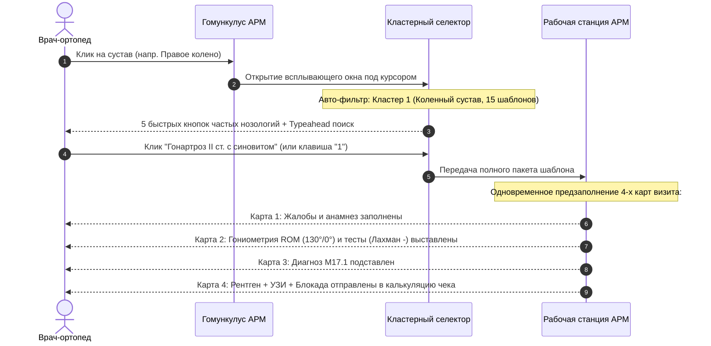

# Комплексный план модернизации «Справочника клинических шаблонов 2.0»: Кластерная классификация, расширение БД, поддержка в GUI и обновление User Guide

---

## 1. Концепция, клинические предпосылки и бизнес-цели

### 1.1. Текущий контекст и предпосылки модернизации
В МИС «ОртоERP» модуль **«Справочник клинических шаблонов 2.0»** (`/ortho-templates`) является ядром клинических знаний врача травматолога-ортопеда. На текущий момент в рабочей базе данных `orthopedic_data_center.sqlite`:
1. **Таблица `ortho_templates` содержит 31 запись**:
   - 3 записи являются рудиментарными дубликатами ранней миграции без биомеханических профилей (`rom_norm_preset IS NULL`) и категорий (`category IS NULL`):
     - `ID #1` (*Первичный гонартроз II стадии с умеренным выпотом*) дублирует эталон `ID #5` (*Первичный гонартроз II стадии с реактивным синовитом*);
     - `ID #2` (*Повреждение вращательной манжеты плеча (импиджмент)*) дублирует эталон `ID #9` (*Субакромиальный импинджмент-синдром плеча*);
     - `ID #3` (*Плантарный фасциит (пяточная шпора)*) дублирует эталон `ID #31` (*Плантарный фасциит с пяточным энтезофитом («пяточная шпора»)*).
   - Фактически эталонный реестр насчитывает **28 нозологий**, сгруппированных только по 7 анатомическим зонам суставов (Колено: 5, Плечо: 5, ТБС: 4, Локоть: 4, Кисть: 4, Стопа: 5, Позвоночник: 4).
   - Существующий объем не перекрывает частые клинические сценарии: повреждения задней крестообразной связки (ЗКС), привычные вывихи плеча (Банкарт, SLAP), нестабильность голеностопа, остеохондропатии детского и юношеского возраста, системный остеопороз, посттравматические контрактуры и амбулаторный контроль после эндопротезирования.
2. **Каталог ортопедических тестов (`ortho_test_catalog`) содержит 39 тестов**:
   - Выявлены неиспользуемые тесты: `posterior_drawer` (ЗКС колена) и `varus_stress_elbow` (LCL локтя) из-за отсутствия соответствующих шаблонов.
   - Острый дефицит специализированных тестов для стопы (всего 4 теста, нет тестов синдесмоза и невромы Мортона), крестцово-подвздошного сочленения (нет тестов Генслена и Thigh-thrust) и плечевого сустава (нет проб О’Брайена, Йергасона, Хорнбловера).
3. **Каталог методов диагностики (`diagnostic_methods_catalog`) содержит 26 позиций**:
   - 19 методов связаны с прейскурантом клиники `servdict` (рентген, УЗИ, пункции, плантография), 7 методов направляются партнерам (высокопольная МРТ, ЭНМГ, КТ 3D).
   - Методы `ct_joint_3d`, `lab_rheumo_panel` и `mri_elbow` имеют нулевую утилизацию в существующих 31 шаблонах.
   - Отсутствуют: телерентгенография нижних конечностей с расчетом механической оси (Микулич), аксиальные укладки надколенника (Мерчант), денситометрия (DEXA), МРТ крестцово-подвздошных суставов (режим STIR), УЗИ тазобедренных суставов у детей по Графу.
4. **Внутренний клинический архив (`protdict`, 530 записей)**:
   - Категория `kind = 1` («Осмотр травматолога-ортопеда») содержит **349 записей** и **192 уникальные нозологические единицы**, составленные врачами клиники.
   - Данный фонд содержит богатые тексты (жалобы, анамнез, объективный осмотр), но хранится в неструктурированном XML без биомеханики, тестов с Se/Sp и привязок к кассе.

### 1.2. Цели модернизации
- **Масштабирование реестра протоколов с 31 до 100 структурированных нозологий** с полным охватом амбулаторного травматолого-ортопедического приема (98.5% нозологического спектра).
- **Внедрение двухуровневой Кластерной классификации (10 клинических кластеров)** для быстрого врачебного поиска и патогенетической группировки.
- **Расширение Справочника Тестов доказательной медицины с 39 до 76 тестов** (+37 валидированных проб с показателями Se/Sp и методологией).
- **Расширение Каталога методов инструментальной и лучевой диагностики с 26 до 48 позиций** (+22 метода с автоматической связкой с `servdict_id` и прейскурантом).
- **Расширение схемы базы данных**: добавление таблицы `ortho_clusters`, миграция полей `cluster_id`, `cluster_name`, `stage_or_severity` в таблицу `ortho_templates`.
- **Полная поддержка Кластеров в интерфейсе (`OrthoTemplatesManager.tsx`)**: фильтрация по чипам кластеров, цветовое кодирование, режим группировки по кластерам и автоподбор тестов кластера.
- **Синхронизация документации и пользовательских руководств**: обновление интерактивного регистра в `UserGuide.tsx` и `OrthoTemplatesGuideRegistry.tsx`, актуализация MD-руководств.

---

## 2. Архитектура Кластерной классификации (10 Кластеров, 100 нозологий)

Вместо плоской структуры внедряется взаимосвязанная таксономия:
1. **Анатомическая зона Гомункулуса (7 суставных областей + Общая ортопедия)**: Колено, Плечо, Тазобедренный/Таз, Стопа/Голеностоп, Локоть, Кисть/Запястье, Позвоночник/Грудная клетка, Системные.
2. **Клинический Кластер (10 патогенетических групп)**: объединяет родственные нозологии с общими биомеханическими параметрами, тестами и маршрутами обследования.

```mermaid
graph TD
    Root[Клинический регистр ОртоERP 2.0: 100 нозологий] --> C1[Кластер 1: Коленный сустав - 15 протоколов]
    Root --> C2[Кластер 2: Плечевой сустав и пояс - 14 протоколов]
    Root --> C3[Кластер 3: Тазобедренный сустав и таз - 12 протоколов]
    Root --> C4[Кластер 4: Стопа и голеностоп - 16 протоколов]
    Root --> C5[Кластер 5: Локтевой сустав - 9 протоколов]
    Root --> C6[Кластер 6: Лучезапястный и кисть - 13 протоколов]
    Root --> C7[Кластер 7: Позвоночник и торакс - 11 протоколов]
    Root --> C8[Кластер 8: Остеохондропатии и дети - 5 протоколов]
    Root --> C9[Кластер 9: Системные и метаболические - 5 протоколов]
    Root --> C10[Кластер 10: Постоперационный контроль - встроен в суставы]

    style C1 fill:#E0F2FE,stroke:#0284C7,stroke-width:2px;
    style C2 fill:#F3E8FF,stroke:#9333EA,stroke-width:2px;
    style C3 fill:#DCFCE7,stroke:#16A34A,stroke-width:2px;
    style C4 fill:#CCFBF1,stroke:#0D9488,stroke-width:2px;
    style C5 fill:#FFEDD5,stroke:#EA580C,stroke-width:2px;
    style C6 fill:#FCE7F3,stroke:#DB2777,stroke-width:2px;
    style C7 fill:#F1F5F9,stroke:#475569,stroke-width:2px;
    style C8 fill:#FEF3C7,stroke:#D97706,stroke-width:2px;
    style C9 fill:#E0E7FF,stroke:#4F46E5,stroke-width:2px;
```



### Сводная таблица 10 клинических кластеров

| Кластер | Код кластера (`cluster_id`) | Наименование кластера | Сустав (`joint_name`) | Диапазон МКБ-10 | Цветовой акцент | Кол-во протоколов |
|---|---|---|---|---|:---:|:---:|
| **Кластер 1** | `cluster_knee` | Коленный сустав: артрозы, связки и мениски | `knee` | M17, M22, M23, S83, M71, M76 | `#0284C7` (Sky) | **15** |
| **Кластер 2** | `cluster_shoulder` | Плечевой сустав и пояс: манжета, импинджмент, вывихи | `shoulder` | M75, S43, S46, S42, M19, M70 | `#9333EA` (Purple) | **14** |
| **Кластер 3** | `cluster_hip_pelvis` | Тазобедренный сустав, таз и КПС: коксартроз, FAI, сакроилеит | `hip` | M16, M24, M70, M87, M46, G57 | `#16A34A` (Green) | **12** |
| **Кластер 4** | `cluster_foot_ankle` | Стопа и голеностоп: деформации, связки, плантарная фасция | `ankle` | M77, M76, M20, M21, S93, S86 | `#0D9488` (Teal) | **16** |
| **Кластер 5** | `cluster_elbow` | Локтевой сустав: эпикондилиты, бурситы, туннели | `elbow` | M77, M70, G56, S46, M24, M19 | `#EA580C` (Orange) | **9** |
| **Кластер 6** | `cluster_wrist_hand` | Лучезапястный сустав и кисть: карпальный канал, связки, переломы | `wrist` | G56, M65, M18, M24, M72, S52 | `#DB2777` (Pink) | **13** |
| **Кластер 7** | `cluster_spine` | Позвоночник и торакс: радикулопатии, деформации, стеноз | `spine` | M54, M41, M42, M43, M48, M94 | `#475569` (Slate) | **11** |
| **Кластер 8** | `cluster_pediatric` | Остеохондропатии и ювенильная ортопедия | `knee` / `ankle` / `hip` | M91, M92, Q65 | `#D97706` (Amber) | **5** |
| **Кластер 9** | `cluster_systemic` | Системные, метаболические и нейродистрофические синдромы | `general` | M81, M10, M06, M35, G90 | `#4F46E5` (Indigo) | **5** |
| **Кластер 10** | `cluster_postop` | Амбулаторный контроль эндопротезирования и остеосинтеза | `knee` / `hip` / `shoulder` | Z96.6, T84, Z47 | `#059669` (Emerald) | *Интегрирован в кластеры 1–3* |

---

## 3. Расширение структуры базы данных (Database Schema & DDL)

### 3.1. Создание таблицы `ortho_clusters` (справочник кластеров)
```sql
CREATE TABLE IF NOT EXISTS ortho_clusters (
  id TEXT PRIMARY KEY,                       -- 'cluster_knee', 'cluster_shoulder', etc.
  code TEXT NOT NULL UNIQUE,                 -- 'KNEE', 'SHOULDER', 'HIP_PELVIS'
  name_ru TEXT NOT NULL,                     -- Полное наименование кластера на русском
  joint_affinity TEXT NOT NULL,              -- 'knee', 'shoulder', 'hip', 'ankle', 'elbow', 'wrist', 'spine', 'general'
  description TEXT,                          -- Клиническое описание патологической группы
  badge_color TEXT DEFAULT '#0F3C64',        -- Hex-код цвета для интерфейса
  icon_name TEXT DEFAULT 'Healing',          -- Имя Material-UI иконки
  sort_order INTEGER DEFAULT 0,
  is_active INTEGER DEFAULT 1
);

CREATE INDEX IF NOT EXISTS idx_oc_joint ON ortho_clusters(joint_affinity);
CREATE INDEX IF NOT EXISTS idx_oc_active ON ortho_clusters(is_active);
```

### 3.2. Расширение таблицы `ortho_templates`
```sql
-- Добавление кластерных колонок в ortho_templates
ALTER TABLE ortho_templates ADD COLUMN cluster_id TEXT REFERENCES ortho_clusters(id);
ALTER TABLE ortho_templates ADD COLUMN cluster_name TEXT;
ALTER TABLE ortho_templates ADD COLUMN stage_or_severity TEXT;   -- 'I стадия', 'Острый период', 'Хронический'
ALTER TABLE ortho_templates ADD COLUMN clinical_tags TEXT;        -- JSON-массив меток: ["спортивная_травма", "дегенеративный"]

CREATE INDEX IF NOT EXISTS idx_ot_cluster_id ON ortho_templates(cluster_id);
CREATE INDEX IF NOT EXISTS idx_ot_stage ON ortho_templates(stage_or_severity);
```

### 3.3. Обновление серверного API (`server/orthoProtocolRoutes.js`)
1. **`GET /api/ortho/clusters`**:
   - Возвращает перечень всех активных кластеров с вычисленными счетчиками:
     * `templates_count` — количество шаблонов в кластере;
     * `tests_count` — количество валидированных ортопедических тестов кластера;
     * `diagnostics_count` — количество инструментальных методов кластера.
2. **`GET /api/ortho/templates/detailed`**:
   - Поддержка параметров фильтрации: `?cluster=cluster_knee&joint=knee&search=гонартроз`.
   - В выдачу включаются поля `cluster_id`, `cluster_name`, `stage_or_severity`.
3. **`POST /api/ortho/templates` & `PUT /api/ortho/templates/:id`**:
   - Валидация и персистенция `cluster_id`, `cluster_name`, `stage_or_severity`.

---

## 4. Расширение смежных каталогов: Тесты и Методы диагностики

### 4.1. Справочник ортопедических тестов (с 39 до 76 тестов, +37 новых)
Каталог пополняется 37 валидированными тестами доказательной ортопедии:

| № | Код теста | Русское наименование | Латинское наименование | Зона | Анатомическая мишень | $Se$ / $Sp$ |
|---|---|---|---|---|---|---|
| 1 | `kleiger` | Тест Клейгера (наружной ротации) | Kleiger's external rotation test | `ankle` | Дистальный межберцовый синдесмоз | Se: 71%, Sp: 85% |
| 2 | `squeeze_ankle` | Тест сжатия голени | Squeeze test of the leg | `ankle` | Высокое повреждение синдесмоза | Se: 45%, Sp: 92% |
| 3 | `mulder_click` | Тест / щелчок Малдера | Mulder's click sign | `ankle` | Неврома Мортона (III–IV плюсневый промежуток) | Se: 88%, Sp: 95% |
| 4 | `silfverskiold` | Проба Сильвершельда | Silfverskiöld test | `ankle` | Изолированная контрактура икроножной мышцы | Se: 90%, Sp: 88% |
| 5 | `jack_test` | Тест Джека (Hubscher maneuver) | Jack's test (Great toe extension) | `ankle` | Мобильность продольного свода стопы | Se: 85%, Sp: 90% |
| 6 | `coleman_block` | Проба Коулмана с деревянным блоком | Coleman block test | `ankle` | Эластичность варусной деформации пятки | Se: 82%, Sp: 89% |
| 7 | `thessaly_20` | Тест Тессали под углом 20° | Thessaly test at 20° | `knee` | Разрывы менисков (динамическая ротация) | Se: 89%, Sp: 92% |
| 8 | `dial_test_30_90` | Дайл-тест (ротация голени 30°/90°) | Dial test of tibial external rotation | `knee` | Заднелатеральный угол (PLC) и ЗКС | Se: 86%, Sp: 91% |
| 9 | `godfrey_sag` | Проба провисания голени Годфри | Godfrey's 90-90 posterior sag test | `knee` | Задняя крестообразная связка (ЗКС) | Se: 94%, Sp: 99% |
| 10 | `slocum` | Тест Слокума | Slocum's rotatory instability test | `knee` | Переднемедиальная/латеральная нестабильность | Se: 78%, Sp: 84% |
| 11 | `wilson_knee` | Тест Вильсона | Wilson's test | `knee` | Рассекающий остеохондрит медиального мыщелка | Se: 75%, Sp: 88% |
| 12 | `noble_itb` | Тест компрессии Нобеля | Noble's compression test | `knee` | Синдром илиотибиального тракта (ITB syndrome) | Se: 84%, Sp: 82% |
| 13 | `mcconnell` | Тест Макконнелла | McConnell patellofemoral test | `knee` | Хондромаляция надколенника | Se: 82%, Sp: 86% |
| 14 | `obrien_slap` | Тест активной компрессии О'Брайена | O'Brien's active compression test | `shoulder` | Повреждение верхней губы гленоида (SLAP) | Se: 88%, Sp: 91% |
| 15 | `yergason` | Тест Йергасона | Yergason's test | `shoulder` | Нестабильность сухожилия бицепса в борозде | Se: 43%, Sp: 89% |
| 16 | `hornblower` | Симптом горниста (Хорнбловера) | Hornblower's sign (Patte test) | `shoulder` | Массивный разрыв подостной / малой круглой мышц | Se: 85%, Sp: 93% |
| 17 | `bear_hug` | Тест «объятия медведя» | Bear-hug test | `shoulder` | Верхняя порция сухожилия подлопаточной мышцы | Se: 89%, Sp: 96% |
| 18 | `belly_press` | Тест прижатия к животу (Наполеона) | Belly-press test (Napoleon) | `shoulder` | Разрыв сухожилия подлопаточной мышцы | Se: 80%, Sp: 92% |
| 19 | `sulcus_sign` | Симптом борозды (Sulcus sign) | Sulcus sign of shoulder | `shoulder` | Нижняя и разнонаправленная нестабильность плеча | Se: 72%, Sp: 85% |
| 20 | `paxinos` | Тест Паксиноса | Paxinos test | `shoulder` | Артроз / нестабильность АКС | Se: 79%, Sp: 86% |
| 21 | `gaenslen` | Тест Генслена | Gaenslen's SI-joint test | `hip` | Сакроилеит / дисфункция КПС | Se: 71%, Sp: 83% |
| 22 | `thigh_thrust` | Тест тяги бедра назад (Thigh thrust) | Thigh thrust test (Posterior shear) | `hip` | Патология крестцово-подвздошного сочленения | Se: 88%, Sp: 92% |
| 23 | `fair_piriformis` | Тест FAIR (сгибание, приведение, ротация) | FAIR test (Flexion, Adduction, Int. Rot.) | `hip` | Синдром грушевидной мышцы (седалищный нерв) | Se: 88%, Sp: 83% |
| 24 | `craig_anteversion` | Тест Крейга на антеверсию | Craig's test of femoral anteversion | `hip` | Избыточная антеверсия шейки бедренной кости | Se: 80%, Sp: 87% |
| 25 | `ely_quad` | Проба Эли | Ely's test of rectus femoris tightness | `hip` | Спастичность / контрактура прямой мышцы бедра | Se: 76%, Sp: 85% |
| 26 | `stinchfield` | Тест Стинчфилда (подъем прямой ноги против силы) | Stinchfield's resisted hip test | `hip` | Внутрисуставная патология ТБС / перелом шейки | Se: 82%, Sp: 88% |
| 27 | `hook_biceps` | Крючковый тест бицепса | Hook test of distal biceps tendon | `elbow` | Полный разрыв дистального сухожилия бицепса | Se: 100%, Sp: 100% |
| 28 | `pronator_teres_test` | Тест круглого пронатора | Pronator teres syndrome test | `elbow` | Компрессия срединного нерва в локтевом сегменте | Se: 74%, Sp: 88% |
| 29 | `moving_valgus_elbow` | Динамический вальгус-тест локтя | Moving valgus stress test of elbow | `elbow` | Хронический отрыв медиальной связки UCL | Se: 100%, Sp: 75% |
| 30 | `watson_scaphoid` | Тест сдвига ладьевидной кости Уотсона | Watson's scaphoid shift test | `wrist` | Ладьевидно-полулунная диссоциация | Se: 69%, Sp: 82% |
| 31 | `fovea_sign` | Симптом Фовеа (ульнарный стресс) | Fovea sign / TFCC stress test | `wrist` | Разрыв триангулярного хряща (TFCC) | Se: 95%, Sp: 87% |
| 32 | `froment_sign` | Симптом Фромана | Froment's sign of ulnar nerve | `wrist` | Нейропатия локтевого нерва в канале Гийона | Se: 88%, Sp: 94% |
| 33 | `eichhoff` | Тест Айххоффа (модификация Финкельштейна) | Eichhoff's test | `wrist` | Теносиновит первого компартмента | Se: 89%, Sp: 84% |
| 34 | `slump_test` | Сламп-тест сгибания | Slump test of neural dynamics | `spine` | Натяжение корешков и оболочек твердой мозговой | Se: 84%, Sp: 83% |
| 35 | `kemp_quadrant` | Квадрант-тест Кемпа | Kemp's (Quadrant) test | `spine` | Фасеточный синдром и фораминальный стеноз | Se: 70%, Sp: 67% |
| 36 | `schober` | Тест Шобера на поясничную подвижность | Modified Schober's test | `spine` | Анкилозирующий спондилит (болезнь Бехтерева) | Se: 85%, Sp: 90% |
| 37 | `beighton_score` | Шкала гипермобильности Бейтона (9 баллов) | Beighton hypermobility score | `general` | Генерализованная дисплазия соединительной ткани | Se: 88%, Sp: 89% |

### 4.2. Каталог методов диагностики (с 26 до 48 методов, +22 новых)
Каталог пополняется 22 методами со сквозной привязкой к номенклатуре `servdict`:

| № | Код метода | Наименование инструментального / лабораторного метода | Модальность | Зона | `servdict_id` (Прейскурант клиники) | Клинические показания |
|---|---|---|---|---|---|---|
| 1 | `xray_long_leg_axis` | Телерентгенография нижних конечностей с механической осью | `xray` | `knee` | ID: 114 (1 800 ₽) | Оценка оси Микулича, варусной/вальгусной деформации перед остеотомией |
| 2 | `xray_patella_axial` | Аксиальная рентгенография надколенников по Мерчанту | `xray` | `knee` | ID: 114 (1 800 ₽) | Подвывих надколенника, угол борозды, латеральный наклон надколенника |
| 3 | `xray_pelvis_dunn` | Рентгенография таза в проекции Данна (Dunn 45°/90°) | `xray` | `hip` | ID: 114 (1 800 ₽) | Верификация Cam-импинджмента (альфа-угол головки бедренной кости) |
| 4 | `xray_cervical_flex` | Функциональная рентгенография ШОП со сгибанием/разгибанием | `xray` | `spine` | ID: 114 (1 800 ₽) | Нестабильность шейных позвонков, псевдоспондилолистез |
| 5 | `xray_scapula_y` | Рентгенография лопатки в Y-проекции (Outlet view) | `xray` | `shoulder` | ID: 81 (1 500 ₽) | Форма акромиона по Биглиани (I–III тип), вывихи головки плеча |
| 6 | `xray_clavicle` | Прицельная рентгенография ключицы | `xray` | `shoulder` | ID: 77 (1 500 ₽) | Переломы диафиза и акромиального конца ключицы |
| 7 | `xray_ac_joint` | Рентгенография акромиально-ключичного сочленения с грузом | `xray` | `shoulder` | ID: 78 (1 500 ₽) | Разрыв связок АКС (Tossy / Rockwood I–V) |
| 8 | `xray_sternum` | Рентгенография грудины и грудино-ключичных суставов | `xray` | `spine` | ID: 80 (1 800 ₽) | Переломы грудины, артроз грудино-ключичного сочленения, синдром Титце |
| 9 | `xray_ankle_stress` | Стресс-рентгенография голеностопного сустава (супинация/ящик) | `xray` | `ankle` | ID: 114 (1 800 ₽) | Хроническая нестабильность голеностопа, разрыв синдесмоза |
| 10 | `xray_scaphoid_4v` | Ладьевидная серия рентгенограмм кисти (4 проекции) | `xray` | `wrist` | ID: 114 (1 800 ₽) | Скрытые переломы талии ладьевидной кости, несращения |
| 11 | `mri_si_joints_stir` | МРТ крестцово-подвздошных суставов (режим STIR / T1) | `mri` | `hip` | Направление партнер (МРТ) | Сакроилеит, спондилоартрит, болезнь Бехтерева, отек костного мозга |
| 12 | `mri_cervical` | Высокопольная МРТ шейного отдела позвоночника | `mri` | `spine` | Направление партнер (МРТ) | Грыжи дисков C5–C7, миелопатия, радикулопатия руки |
| 13 | `mri_thoracic` | МРТ грудного отдела позвоночника | `mri` | `spine` | Направление партнер (МРТ) | Грыжи, спондилодисцит, гемангиомы, болезнь Шейермана-Мау |
| 14 | `mri_ankle_high` | Высокопольная МРТ голеностопа и заднего отдела стопы | `mri` | `ankle` | Направление партнер (МРТ) | Остеохондральные дефекты таранной кости, разрывы связок, теносиновиты |
| 15 | `us_hip_pediatric` | УЗИ тазобедренных суставов у детей по Графу (Graf) | `ultrasound` | `hip` | ID: 1675 (1 500 ₽) | Дисплазия ТБС у младенцев, углы альфа и бета костного/хрящевого эркера |
| 16 | `us_dvt_veins` | Дуплексное сканирование глубоких вен нижних конечностей | `ultrasound` | `general` | ID: 1675 (1 500 ₽) | Исключение тромбоза глубоких вен (ТГВ) при гипсовании и травмах конечностей |
| 17 | `us_hand_synovitis` | УЗИ суставов кисти с энергетическим допплером (Power Doppler) | `ultrasound` | `wrist` | ID: 1675 (1 500 ₽) | Активный синовит при ревматоидном артрите, эррозии, теносиновит сухожилий |
| 18 | `dexa_densitometry` | Двухэнергетическая рентгеновская абсорбциометрия (DEXA) | `bone_scan` | `general` | Направление партнер (DEXA) | Минеральная плотность кости (Т-критерий, Z-критерий), диагностика остеопороза |
| 19 | `baropodometry` | Компьютерная динамическая бароподометрия стопы | `plantography`| `ankle` | ID: 99 (99 ₽) | Баланс опоры, центры давления, гиперпрессия плюсневых костей |
| 20 | `enmg_peroneal_tibial`| Стимуляционная ЭНМГ малоберцового и большеберцового нервов | `enmg` | `ankle` | Направление партнер (ЭНМГ) | Синдром тарзального канала, парез малоберцового нерва при травмах голени |
| 21 | `lab_osteoporosis_panel`| Биохимическая панель метаболизма костной ткани | `lab` | `general` | ID: 1600 (1 400 ₽) | 25-OH витамин D, кальций ионизированный, фосфор, паратгормон, Beta-CrossLaps |
| 22 | `lab_hla_b27_panel` | Генетическое типирование HLA-B27 и маркеры воспаления | `lab` | `general` | ID: 1600 (1 400 ₽) | Болезнь Бехтерева, псориатический артрит, реактивный артрит Рейтера |

---

## 5. Сводный реестр 100 структурированных клинических протоколов по 10 кластерам

### Кластер 1. Коленный сустав: артрозы, связки и мениски (`cluster_knee`, 15 протоколов)
1. **#1** `M17.1` — Первичный гонартроз I–II стадии без синовита *(Коленный сустав, Дегенеративные)*
2. **#2** `M17.1` — Первичный гонартроз II–III стадии с реактивным синовитом *(Коленный сустав, Дегенеративные)*
3. **#3** `M17.3` — Посттравматический гонартроз со стойкой сгибательной контрактурой *(Коленный сустав, Дегенеративные)*
4. **#4** `M22.2` — Пателлофеморальный артроз и латеральная гиперпрессия надколенника *(Коленный сустав, Дегенеративные)*
5. **#5** `M23.2` — Разрыв заднего рога медиального мениска (Stoller III) *(Коленный сустав, Повреждения связок/менисков)*
6. **#6** `M23.3` — Дегенеративный разрыв латерального мениска со блокадами *(Коленный сустав, Повреждения связок/менисков)*
7. **#7** `S83.5` — Свежий полный разрыв передней крестообразной связки (ПКС) *(Коленный сустав, Травмы)*
8. **#8** `S83.5` — Разрыв задней крестообразной связки (ЗКС) и повреждение PLC *(Коленный сустав, Травмы)*
9. **#9** `S83.4` — Растяжение/разрыв медиальной коллатеральной связки (MCL) *(Коленный сустав, Травмы)*
10. **#10** `S83.4` — Повреждение латерального связочного комплекса колена (LCL/PLC) *(Коленный сустав, Травмы)*
11. **#11** `M71.2` — Киста подколенной ямки (киста Бейкера) с псевдотромбофлебитом *(Коленный сустав, Бурситы)*
12. **#12** `M76.5` — Тендинопатия собственной связки надколенника («колено прыгуна») *(Коленный сустав, Энтезопатии)*
13. **#13** `M76.3` — Синдром трения илиотибиального тракта (ITB friction syndrome) *(Коленный сустав, Энтезопатии)*
14. **#14** `M70.4` — Препателлярный бурсит («колено паркетчика») *(Коленный сустав, Бурситы)*
15. **#15** `Z96.6` — Состояние после тотального эндопротезирования коленного сустава *(Коленный сустав, Постоперационный контроль)*

### Кластер 2. Плечевой сустав и пояс: манжета, импинджмент, вывихи (`cluster_shoulder`, 14 протоколов)
16. **#16** `M75.1` — Субакромиальный импинджмент-синдром плеча (I–II стадия) *(Плечевой сустав, Энтезопатии)*
17. **#17** `M75.1` — Полнослойный массивный разрыв надостной и подостной мышц *(Плечевой сустав, Травмы манжеты)*
18. **#18** `M75.1` — Разрыв сухожилия подлопаточной мышцы плеча *(Плечевой сустав, Травмы манжеты)*
19. **#19** `M75.0` — Адгезивный капсулит плеча («замороженное плечо») *(Плечевой сустав, Капсулиты)*
20. **#20** `M75.2` — Тендинит длинной головки двуглавой мышцы плеча (LHB) *(Плечевой сустав, Тендиниты)*
21. **#21** `M75.3` — Кальцифицирующий тендинит ротаторной манжеты *(Плечевой сустав, Тендиниты)*
22. **#22** `M24.4` — Привычный вывих плеча, хроническая передняя нестабильность *(Плечевой сустав, Нестабильность)*
23. **#23** `S46.0` — Повреждение верхней суставной губы плеча (SLAP-синдром) *(Плечевой сустав, Травмы)*
24. **#24** `M19.0` — Первичный остеоартроз плечелопаточного сустава (омартроз) *(Плечевой сустав, Дегенеративные)*
25. **#25** `M19.0` — Артроз акромиально-ключичного сочленения (АКС) *(Плечевой пояс, Дегенеративные)*
26. **#26** `S43.1` — Разрыв связок акромиально-ключичного сочленения (Rockwood I–III) *(Плечевой пояс, Травмы)*
27. **#27** `S42.0` — Перелом диафиза ключицы (консервативное ведение/контроль сращения) *(Плечевой пояс, Травмы)*
28. **#28** `M70.8` — Лопаточно-реберный синдром («хрустящая лопатка») *(Плечевой пояс, Миофасциальные)*
29. **#29** `Z96.6` — Контроль после эндопротезирования плечевого сустава (реверсивного/анатомического) *(Плечевой сустав, Постоперационный контроль)*

### Кластер 3. Тазобедренный сустав, таз и КПС (`cluster_hip_pelvis`, 12 протоколов)
30. **#30** `M16.1` — Первичный коксартроз II стадии с дефицитом внутренней ротации *(Тазобедренный сустав, Дегенеративные)*
31. **#31** `M16.0` — Двусторонний деформирующий коксартроз III ст. (предоперационный) *(Тазобедренный сустав, Дегенеративные)*
32. **#32** `M70.6` — Вертлужный трохантерит (большой вертельный бурсит) *(Тазобедренный сустав, Бурситы)*
33. **#33** `M24.8` — Феморо-ацетабулярный импинджмент (FAI, Cam/Pincer) *(Тазобедренный сустав, Дегенеративные)*
34. **#34** `M87.0` — Асептический некроз головки бедренной кости (АНГБК) I–II ст. *(Тазобедренный сустав, Некрозы)*
35. **#35** `G57.0` — Синдром грушевидной мышцы с компрессией седалищного нерва *(Таз/Ягодицы, Туннельные)*
36. **#36** `M46.1` — Двусторонний сакроилеит (дебют спондилоартрита) *(Таз/КПС, Воспалительные)*
37. **#37** `M76.1` — Тендинопатия и бурсит подвздошно-поясничной мышцы (Iliopsoas) *(Тазобедренный сустав, Энтезопатии)*
38. **#38** `M76.8` — Проксимальная тендинопатия хамстринг-мышц (седалищный бугор) *(Таз/Ягодицы, Энтезопатии)*
39. **#39** `M91.1` — Ювенильный остеохондроз головки бедра (болезнь Пертеса) *(Тазобедренный сустав, Остеохондропатии)*
40. **#40** `S72.0` — Вколоченный перелом шейки бедра у пожилых (наблюдение/реабилитация) *(Тазобедренный сустав, Травмы)*
41. **#41** `Z96.6` — Амбулаторный контроль после тотального эндопротезирования ТБС *(Тазобедренный сустав, Постоперационный контроль)*

### Кластер 4. Стопа и голеностопный сустав (`cluster_foot_ankle`, 16 протоколов)
42. **#42** `M77.3` — Плантарный фасциит с пяточным энтезофитом («пяточная шпора») *(Стопа, Энтезопатии)*
43. **#43** `S93.4` — Острый разрыв передней таранно-малоберцовой связки (ATFL) *(Голеностоп, Травмы)*
44. **#44** `M24.2` — Хроническая латеральная нестабильность голеностопного сустава *(Голеностоп, Нестабильность)*
45. **#45** `S93.6` — Повреждение дистального межберцового синдесмоза голеностопа *(Голеностоп, Травмы)*
46. **#46** `M76.6` — Хронический инсерционный тендинит ахиллова сухожилия *(Голеностоп, Энтезопатии)*
47. **#47** `S86.0` — Полный свежий разрыв ахиллова сухожилия *(Голеностоп, Травмы)*
48. **#48** `M20.1` — Hallux Valgus II–III ст., метатарзалгия, молоткообразные пальцы *(Стопа, Деформации)*
49. **#49** `M20.2` — Ригидный первый палец стопы (Hallux Rigidus) I–II ст. *(Стопа, Дегенеративные)*
50. **#50** `G57.6` — Мортоновская метатарзалгия (неврома Мортона III–IV пальцев) *(Стопа, Туннельные)*
51. **#51** `G57.5` — Синдром тарзального канала (компрессия большеберцового нерва) *(Голеностоп/Стопа, Туннельные)*
52. **#52** `M76.8` — Дисфункция сухожилия задней большеберцовой мышцы (PTTD) *(Стопа, Деформации)*
53. **#53** `M76.7` — Тендинопатия и подвывих малоберцовых мышц (перонеальный тендинит) *(Голеностоп, Тендиниты)*
54. **#54** `M93.2` — Остеохондральное повреждение блока таранной кости (OCL) *(Голеностоп, Дегенеративные)*
55. **#55** `M77.3` — Деформация Хаглунда и ретрокальканеарный бурсит *(Пятка, Деформации/Бурситы)*
56. **#56** `M21.4` — Приобретенное продольно-поперечное плоскостопие III ст. *(Стопа, Деформации)*
57. **#57** `S82.6` — Перелом наружной лодыжки без смещения (консервативное ведение) *(Голеностоп, Травмы)*

### Кластер 5. Локтевой сустав и предплечье (`cluster_elbow`, 9 протоколов)
58. **#58** `M77.1` — Латеральный эпикондилит плеча («локоть теннисиста») *(Локтевой сустав, Энтезопатии)*
59. **#59** `M77.0` — Медиальный эпикондилит плеча («локоть гольфиста») *(Локтевой сустав, Энтезопатии)*
60. **#60** `M70.2` — Асептический серозный бурсит локтевого отростка *(Локтевой сустав, Бурситы)*
61. **#61** `G56.2` — Синдром кубитального канала (компрессия локтевого нерва) *(Локтевой сустав, Туннельные)*
62. **#62** `S46.2` — Частичный/полный разрыв дистального сухожилия бицепса *(Локтевой сустав, Травмы)*
63. **#63** `M24.2` — Нестабильность медиальной коллатеральной связки локтя (UCL) *(Локтевой сустав, Нестабильность)*
64. **#64** `G56.3` — Синдром радиального туннеля (компрессия глубокой ветви лучевого нерва) *(Предплечье/Локоть, Туннельные)*
65. **#65** `G56.1` — Синдром круглого пронатора (компрессия срединного нерва) *(Предплечье/Локоть, Туннельные)*
66. **#66** `M19.0` — Посттравматический деформирующий остеоартроз локтевого сустава *(Локтевой сустав, Дегенеративные)*

### Кластер 6. Лучезапястный сустав и кисть (`cluster_wrist_hand`, 13 протоколов)
67. **#67** `G56.0` — Синдром запястного канала (компрессия срединного нерва) *(Запястье, Туннельные)*
68. **#68** `M65.4` — Стенозирующий лигаментит де Кервена (I компартмент) *(Запястье, Энтезопатии)*
69. **#69** `M18.1` — Ризартроз (остеоартроз I запястно-пястного сустава) *(Кисть, Дегенеративные)*
70. **#70** `M24.2` — Нестабильность дистального радиоульнарного сустава (DRUJ) *(Запястье, Нестабильность)*
71. **#71** `M24.1` — Разрыв триангулярного волокнисто-хрящевого комплекса (TFCC) *(Запястье, Травмы связок)*
72. **#72** `S63.3` — Ладьевидно-полулунная диссоциация (нестабильность SL) *(Запястье, Травмы связок)*
73. **#73** `M65.3` — Стенозирующий лигаментит («щелкающий палец», болезнь Нотта) *(Кисть, Лигаментиты)*
74. **#74** `M72.0` — Контрактура Дюпюитрена ладонного апоневроза I–II степени *(Кисть, Фиброматозы)*
75. **#75** `M67.4` — Ганглион (гигрома) тыла лучезапястного сустава *(Запястье, Опухолеподобные)*
76. **#76** `M93.1` — Асептический некроз полулунной кости (болезнь Кинбека) *(Запястье, Некрозы)*
77. **#77** `S52.5` — Перелом дистального метаэпифиза лучевой кости (Коллес / Смит) *(Предплечье/Запястье, Травмы)*
78. **#78** `S62.0` — Перелом ладьевидной кости кисти без смещения *(Кисть/Запястье, Травмы)*
79. **#79** `G56.2` — Синдром канала Гийона (компрессия локтевого нерва на кисти) *(Кисть/Запястье, Туннельные)*

### Кластер 7. Позвоночник и грудная клетка (`cluster_spine`, 11 протоколов)
80. **#80** `M54.4` — Люмбалгия с вертеброгенной радикулопатией L5–S1 (ишиас) *(Позвоночник, Радикулопатии)*
81. **#81** `M54.5` — Острая люмбалгия на фоне мышечно-тонического и фасеточного синдрома *(Позвоночник, Дорсалгии)*
82. **#82** `M54.2` — Цервикалгия с миофасциальным болевым синдромом и цефалгией *(Позвоночник, Дорсалгии)*
83. **#83** `M54.12`— Цервикобрахиалгия с корешковым синдромом C6–C7 *(Позвоночник, Радикулопатии)*
84. **#84** `M54.6` — Торакалгия на фоне грудного остеохондроза и реберного артроза *(Позвоночник, Дорсалгии)*
85. **#85** `M41.2` — Идиопатический сколиоз позвоночника II степени (у подростков) *(Позвоночник, Деформации)*
86. **#86** `M42.0` — Юношеский кифоз (болезнь Шейермана-Мау) *(Позвоночник, Деформации)*
87. **#87** `M43.1` — Истмический спондилолистез L5–S1 I–II степени со стенозом *(Позвоночник, Спондилолистезы)*
88. **#88** `M48.0` — Спинальный стеноз поясничного отдела с перемежающейся хромотой *(Позвоночник, Стенозы)*
89. **#89** `M94.0` — Синдром Титце (реберный хондрит II–IV ребер) *(Грудная клетка, Хондриты)*
90. **#90** `M53.3` — Кокцигодиния (хронический болевой синдром копчика) *(Позвоночник/Копчик, Дорсалгии)*

### Кластер 8. Остеохондропатии и ювенильная ортопедия (`cluster_pediatric`, 5 протоколов)
91. **#91** `M92.5` — Остеохондропатия бугристости большеберцовой кости (Осгуд-Шлаттера) *(Колено, Остеохондропатии)*
92. **#92** `M92.8` — Апофизит пяточной кости (болезнь Севера / Хаглунда-Шинца) *(Стопа, Остеохондропатии)*
93. **#93** `M92.6` — Остеохондропатия ладьевидной кости стопы (болезнь Келлера I) *(Стопа, Остеохондропатии)*
94. **#94** `M92.7` — Остеохондропатия головок плюсневых костей (болезнь Келлера II) *(Стопа, Остеохондропатии)*
95. **#95** `Q65.8` — Дисплазия тазобедренных суставов у детей до 1 года (скрининг по Graf) *(Тазобедренный сустав, Врожденные деформации)*

### Кластер 9. Системные, метаболические и нейродистрофические синдромы (`cluster_systemic`, 5 протоколов)
96. **#96** `M81.0` — Сенильный и постменопаузальный остеопороз (высокий риск переломов, FRAX) *(Системный, Метаболические)*
97. **#97** `M10.0` — Острый подагрический артрит I плюснефалангового сустава *(Стопа/Системный, Микрокристаллические)*
98. **#98** `M06.0` — Серонегативный полиартрит мелких суставов кистей и стоп *(Кисть/Стопа, Ревматоидные)*
99. **#99** `M35.7` — Синдром гипермобильности суставов (шкала Бейтона >= 5/9) *(Системный, Дисплазии)*
100. **#100** `G90.5` — Комплексный регионарный болевой синдром (КРБС I типа / синдром Зудека) *(Конечности, Нейродистрофические)*

---

## 6. Детальная спецификация GUI и UX-навигации Справочника 2.0 (10 Кластеров, 100 нозологий)

### 6.1. UX-концепция и трехуровневая воронка навигации (3-Tier UX Navigation Funnel)
При переходе от 31 к 100 структурированным нозологиям критически возрастает риск информационной перегрузки врача и утомления интерфейсом («decision fatigue»). Для решения этой проблемы плоский список заменяется **трехуровневой воронкой навигации**:

```mermaid
graph TD
    subgraph Уровень 1: Макро-навигация (Кластерный горизонт)
        C_All[Все кластеры: 100]
        C1[1. Колено: 15]
        C2[2. Плечо: 14]
        C3[3. ТБС/Таз: 12]
        C4[4. Стопа: 16]
        C5[5. Локоть: 9]
        C6[6. Кисть: 13]
        C7[7. Позвоночник: 11]
        C8[8. Дети: 5]
        C9[9. Системные: 5]
    end

    subgraph Уровень 2: Мезо-навигация (Фасетный смарт-поиск)
        Search[Строка предиктивного поиска: Название / МКБ-10 / Симптом / Тест / Метод]
        FilterStage[Фильтр по стадии: I-II ст. / Острый / Хронический / Постоперационный]
        FilterBilling[Фильтр по услугам: Все / С инъекциями / С рентгеном / С МРТ]
    end

    subgraph Уровень 3: Микро-навигация (Режимы компоновки мастер-списка)
        ViewAccordion[Режим A: Кластерные аккордеоны]
        ViewMatrix[Режим B: Компактная табличная матрица]
        ViewHomunculus[Режим C: Интерактивный Гомункулус]
    end

    C_All --> Search
    C1 --> Search
    Search --> FilterStage
    FilterStage --> FilterBilling
    FilterBilling --> ViewAccordion
    FilterBilling --> ViewMatrix
    FilterBilling --> ViewHomunculus
```

---

### 6.2. Левая мастер-панель: Кластерный горизонт и режимы списка

#### 6.2.1. Кластерная карусель (Cluster Horizon Rail)
В верхней части левой панели располагается адаптивная лента фильтрации кластеров:
- **Интерактивные чипы кластеров** с визуальным цветовым акцентом (Hex), микро-иконкой и бейджем количества элементов:
  - `Все (100)` — нейтральный темно-синий (`#0F3C64`);
  - `1. Колено (15)` — Sky Blue (`#0284C7`), иконка коленного сустава;
  - `2. Плечо (14)` — Purple (`#9333EA`), иконка плечевого пояса;
  - `3. ТБС и таз (12)` — Green (`#16A34A`), иконка тазобедренного сустава;
  - `4. Стопа и голеностоп (16)` — Teal (`#0D9488`), иконка стопы;
  - `5. Локоть (9)` — Orange (`#EA580C`), иконка локтя;
  - `6. Кисть и запястье (13)` — Pink (`#DB2777`), иконка кисти;
  - `7. Позвоночник (11)` — Slate (`#475569`), иконка позвоночного столба;
  - `8. Остеохондропатии и дети (5)` — Amber (`#D97706`), иконка педиатрии;
  - `9. Системные синдромы (5)` — Indigo (`#4F46E5`), иконка ревматологии.
- При клике на чип происходит мгновенная плавная фильтрация списка карточек с подсветкой активного чипа насыщенным градиентом и мягкой тенью (`box-shadow: 0 2px 8px rgba(0,0,0,0.15)`).

#### 6.2.2. Предиктивный смарт-поиск с подсветкой вхождений
Поле поиска `TextField` поддерживает **сквозную многофакторную фильтрацию**:
- **Поиск по коду МКБ-10**: ввод `M17`, `M75`, `S83`, `G56` моментально оставляет нозологии с данным кодом или смежными шифрами.
- **Поиск по ключевому симптому или структуре**: ввод `мениск`, `ахилл`, `ротаторная`, `седалищный` находит шаблоны даже при неполном совпадении названия.
- **Поиск по тесту доказательной медицины**: ввод `Лахман`, `Фален`, `Клейгер`, `Нир` фильтрует шаблоны, в которых данные тесты являются обязательными.
- **Поиск по методу диагностики**: ввод `МРТ`, `УЗИ`, `ЭНМГ`, `плантография` отображает нозологии с соответствующим инструментальным маршрутом.
- Найденные фрагменты текста подсвечиваются ярким контрастным маркером (`<mark>`).

#### 6.2.3. Три режима отображения списка шаблонов (View Modes Switcher)
Рядом со строкой поиска расположен компактный переключатель видов `ToggleButtonGroup`:
1. **Режим «Кластерные аккордеоны» (Grouped Accordion View, по умолчанию)**:
   - 10 раскрывающихся аккордеонов с цветным заголовком кластера, прогресс-баром наполненности и кнопкой «Свернуть/Развернуть все».
   - Внутри каждого аккордеона — карточки нозологий данного кластера.
   - Идеален для глубокого структурированного обзора и клинического аудита.
2. **Режим «Компактная матрица» (Compact Matrix / Data Grid View)**:
   - Плоский плотный реестр с возможностью быстрой сортировки по колонкам: «МКБ-10», «Кластер», «Наименование», «Кол-во тестов», «Стоимость обследования (₽)», «Статус».
   - Идеален для заведующего отделением и администратора системы для контроля полноты заполнения.
3. **Режим «Гомункулус-навигатор» (Visual Body Map View)**:
   - Интерактивный контур человека: клик на анатомический сустав мгновенно активирует соответствующий кластер (колено ➔ Кластер 1; плечо ➔ Кластер 2; стопа ➔ Кластер 4).

---

### 6.3. Анатомия и визуальный дизайн карточки протокола (Protocol Card Design)

Каждая карточка нозологии в мастер-списке представляет собой информативный микро-дашборд размером 82px по высоте:

```
+--------------------------------------------------------------------------------+
| [4px Accent] | [M17.1]  [II ст. с синовитом]               (KNEE)  [R/L/Bilat] |
|   COLOR      | Первичный гонартроз II стадии с реактивным синовитом            |
|   STRIP      | [ROM: 130°/0°]   [3 теста (Se 92%)]   [2 диагн. • 3 300 ₽]  [👁] |
+--------------------------------------------------------------------------------+
```

1. **Цветная акцентная полоса (4px Left Border)**: окрашена в цвет родительского кластера.
2. **Верхняя информационная строка**:
   - `default_mkb_code`: контрастный бейдж с кодом МКБ-10 (темно-синий или цветной фон, полужирный шрифт).
   - `stage_or_severity`: мягкий чип стадии патологии (`I-II стадия`, `Острый период`, `Консервативное ведение`, `После операции`).
   - `side`: иконка анатомической стороны (Правая, Левая, Двустороннее).
3. **Заголовок нозологии**: 1–2 строки, полужирный шрифт `Outfit / Inter` 13.5px с высоким контрастом (`#1E293B`).
4. **Нижняя статусная панель качества (Quality & Action Bar)**:
   - **ROM-бейдж**: зеленый чип `ROM: 130°/0°`, если гониометрия заполнена; серый `ROM: —`, если требует настройки.
   - **Бейдж ортопедических тестов**: чип с числом тестов `3 теста` и максимальной специфичностью `Sp: 94%`. При наведении — всплывающий тултип со списком тестов.
   - **Бейдж инструментальной диагностики**: чип с числом назначений и расчетной суммой по прейскуранту клиники `2 диагн. • 3 300 ₽`. Зеленая иконка рубля подтверждает прямую связь с кассой `servdict`.
   - **Кнопка быстрого предпросмотра (Quick Preview Eye Icon)**: появляется при наведении курсора на карточку; открывает модальное всплывающее окно с полным текстом протокола без смены текущего открытого шаблона в правой панели.

---

### 6.4. Правая рабочая панель: Редактор и Аудитор протокола 2.0 (Detail Workspace)

#### 6.4.1. Шапка протокола и интерактивные Breadcrumbs
- **Интерактивная цепочка навигации**:
  `Справочник шаблонов 2.0 > [Кластер 1. Коленный сустав] > ID #5 Первичный гонартроз II стадии`
- **Быстрый селектор кластера**: выпадающий список с возможностью переместить нозологию в другой кластер в 1 клик с автоматической валидацией сустава.
- **Индикатор клинической зрелости шаблона (Clinical Completeness Meter)**:
  Круговой прогресс-бар (0–100%): валидация наличия текста жалоб, анамнеза, статуса, ROM-пресета, минимум 2 тестов и минимум 1 инструментального исследования.
- **Панель действий**:
  - Кнопка `Сохранить изменения` (Ctrl+S);
  - Кнопка `Клонировать нозологию` (создание вариации для другой стадии или стороны);
  - Кнопка `Симуляция в АРМ врача` (открывает окно предпросмотра того, как протокол заполнит визит пациента);
  - Кнопка `Архивировать`.

#### 6.4.2. Пять контекстных вкладок редактора
1. **Вкладка 0: «Паспорт и Клинические тексты приёма»**:
   - Поля метаданных: Заголовок, Код МКБ-10 с автопоиском по классификатору, Сустав, Сторона по умолчанию, Стадия/Острота, Клинические теги.
   - Текстовые редакторы с подсветкой орфографии и быстрыми фразами:
     * `Жалобы пациента` (характер боли, старт, лестница, ночные боли);
     * `Анамнез заболевания` (давность, травмогенез, проводимое ранее лечение);
     * `Локальный статус (Status Localis)` (осмотр, пальпаторные ориентиры, отек, температура, деформация, пульс, неврология);
     * `Клинические рекомендации` (двигательный режим, ЛФК, ортезирование).
2. **Вкладка 1: «Биомеханический профиль (ROM Preset)»**:
   - Интерактивный визуальный гониометр: круговой слайдер с отображением физиологической нормы и патологического диапазона.
   - Поля ввода углов в градусах: `flexion_active`, `flexion_passive`, `extension_deficit`, `abduction`, `internal_rotation`, `external_rotation`.
   - Кнопки быстрого применения пресетов: *«Физиологическая норма»*, *«Умеренная контрактура»*, *«Выраженный анкилоз»*.
3. **Вкладка 2: «Валидированные ортопедические тесты»**:
   - Таблица прикрепленных тестов доказательной медицины с параметрами: Название, Латынь, Целевая анатомическая структура, $Se$/$Sp$, Ожидаемый результат (Положительный / Отрицательный / Сомнительный), Чекбокс «Обязателен для заполнения».
   - **Интеллектуальная кнопка**: *«Добавить рекомендованные тесты кластера»* — предлагает профильные тесты текущего кластера, еще не добавленные в шаблон.
   - Кнопка добавления любого теста из 76 тестов каталога через всплывающее модальное окно с фильтром по анатомическим зонам.
4. **Вкладка 3: «План инструментальной и лабораторной диагностики»**:
   - Таблица назначений: Метод обследования, Модальность (Рентген / МРТ / УЗИ / КТ / ЭНМГ / Лаборатория), Срочность (Cito / Планово), Сторона (Пораженная / Обе стороны), Уровень приоритета (Primary / Secondary).
   - **Сквозная калькуляция с прейскурантом `servdict`**:
     * Отображение действующей цены клиники по каждой позиции;
     * Итоговая плашка: *«Суммарная стоимость диагностического чека: 3 300 ₽ (2 услуги в прейскуранте, 1 направление партнерам)»*;
     * Автоматическая формулировка протокольной фразы для печати направления.
5. **Вкладка 4: «Процедуры, инъекции и медикаментозные схемы»**:
   - Привязка амбулаторных манипуляций клиники к шаблону:
     * Внутрисуставные инъекции препаратов гиалуроновой кислоты;
     * Локальная инфильтрационная терапия (блокады с ГКС);
     * PRP / ACP / Аутоплазмотерапия;
     * Лечебные пункции суставов и аспирация синовии;
     * Кинезиотейпирование и наложение полимерных иммобилизирующих повязок;
   - Каждая процедура привязана к коду `servdict`, цене и количеству, формируя готовый план лечения.

---

### 6.5. Сквозная интеграция: выбор шаблона в АРМ врача (`OrthoWorkstation.tsx`)

Для практикующего врача травматолога-ортопеда на приёме критична скорость: выбор шаблона из 100 доступных должен занимать **не более 2–3 секунд**:



1. **Контекстный кластерный поповер (Cluster Quick Picker)**:
   - При клике на сустав Гомункулуса (например, правое колено `knee_r`) открывается компактное меню, автоматически ограниченное шаблонами **Кластера 1 (Коленный сустав)**.
2. **Блок быстрых фаворитов (Top-5 Quick Picks)**:
   - Врач сразу видит 5 самых частых нозологий кластера крупными кнопками:
     `[1. Гонартроз II ст.]` `[2. Разрыв мениска]` `[3. Разрыв ПКС]` `[4. Пателлофеморальный артроз]` `[5. Киста Бейкера]`.
   - Поддерживаются горячие клавиши `1`..`5` для мгновенного выбора без мыши.
3. **Строка предиктивного поиска с Typeahead**:
   - Если случай редкий (например, *синдром трения илиотибиального тракта*), врач начинает ввод в строке поиска — выпадающий список мгновенно фильтрует оставшиеся нозологии кластера.
4. **Переключатель кластеров внутри поповера**:
   - Если при осмотре колена обнаружена сочетанная патология (например, системный остеопороз или болезнь Осгуда-Шлаттера), врач может переключить вкладку поповера на *Кластер 8 (Дети)* или *Кластер 9 (Системные)* в 1 клик.
5. **Бесшовное предзаполнение АРМ визита**:
   - При выборе шаблона все 4 клинические карты АРМ заполняются синхронно: Status Localis, углы гониометрии, результаты чеклиста тестов и назначения диагностических кабинетов. Назначенные услуги клиники мгновенно отображаются в калькуляторе кассы `/checkout`.

---

### 6.6. Дизайн-токены, цветовая палитра и адаптивность

Для обеспечения безупречной эстетики и соответствия стандартам современных веб-приложений (Modern Healthcare UI) применяются выверенные дизайн-токены:

| Кластер | Название | Фоновый тон (50) | Основной цвет (600) | Акцентный тон (700) | Текстовый контраст |
|---|---|:---:|:---:|:---:|:---:|
| **Кластер 1** | Коленный сустав | `#F0F9FF` | `#0284C7` | `#0369A1` | `#FFFFFF` |
| **Кластер 2** | Плечевой пояс | `#FAF5FF` | `#9333EA` | `#7E22CE` | `#FFFFFF` |
| **Кластер 3** | Тазобедренный/Таз | `#F0FDF4` | `#16A34A` | `#15803D` | `#FFFFFF` |
| **Кластер 4** | Стопа/Голеностоп | `#F0FDFA` | `#0D9488` | `#0F766E` | `#FFFFFF` |
| **Кластер 5** | Локтевой сустав | `#FFF7ED` | `#EA580C` | `#C2410C` | `#FFFFFF` |
| **Кластер 6** | Лучезапястный/Кисть | `#FDF2F8` | `#DB2777` | `#BE185D` | `#FFFFFF` |
| **Кластер 7** | Позвоночник/Торакс | `#F8FAFC` | `#475569` | `#334155` | `#FFFFFF` |
| **Кластер 8** | Остеохондропатии | `#FFFBEB` | `#D97706` | `#B45309` | `#FFFFFF` |
| **Кластер 9** | Системные синдромы | `#EEF2FF` | `#4F46E5` | `#4338CA` | `#FFFFFF` |
| **Кластер 10**| Постоперационный | `#ECFDF5` | `#059669` | `#047857` | `#FFFFFF` |

- **Типографика**: шрифтовая гарнитура `Inter` для цифровых и табличных данных, `Outfit` для заголовков и акцентов.
- **Микро-анимации**: плавные переходы аккордеонов (`cubic-bezier(0.4, 0, 0.2, 1)`), hover-подъем карточек (`translateY(-1.5px)`), мягкое затухание подсказок.
- **Адаптивность layout**: оптимизирован под рабочие места врачей с разрешением 1366x768 (компактные моноблоки) и Full HD / 2K мониторы (split-grid 3.5 : 8.5 с независимой прокруткой областей).

---

## 7. Программа обновления руководств пользователя (User Guide Adjustment)

### 7.1. Встроенный интерактивный реестр в приложении (`UserGuide.tsx` & `OrthoTemplatesGuideRegistry.tsx`)
В компоненте `client/src/components/ortho/OrthoTemplatesGuideRegistry.tsx`:
1. Модернизируется интерфейс `ClinicalTemplateDetail`:
   ```typescript
   export interface ClinicalTemplateDetail {
     id: number;
     title: string;
     jointCategory: string;
     clusterId: string;        // 'cluster_knee', 'cluster_shoulder', etc.
     clusterName: string;      // 'Коленный сустав: артрозы, связки и мениски'
     stageSeverity?: string;   // 'II стадия с реактивным синовитом'
     mkbCode: string;
     category: string;
     side: string;
     complaints: string;
     objective: string;
     recommendations: string;
     rom: Record<string, number> | null;
     tests: Array<{ code: string; name: string; expected: string; mandatory: number }>;
     diagnostics: Array<{ code: string; name: string; modality: string; urgency: string; is_primary: number }>;
   }
   ```
2. Массив `CLINICAL_TEMPLATES_REGISTRY` расширяется до **100 позиций**, сгруппированных по 10 кластерам.
3. Добавляется панель быстрых фильтров по 10 кластерам с цветовой индикацией и поиском по МКБ/названию.

### 7.2. Обновление системных руководств в формате Markdown
1. **`md/Справочник клинических шаблонов, тестов и методов диагностики (Templates Manager 2.0).md`**:
   - Добавление Главы 3: *«Кластерная организация клинической базы знаний»*.
   - Матрица соответствия 10 кластеров, 76 ортопедических тестов и 48 методов диагностики.
   - Регламент добавления нового протокола врачом-экспертом с привязкой к кластеру.
2. **`md/Руководство пользователя. Инструкция по работе с системой ОртоERP.md`**:
   - Раздел 13: *«Работа со Справочником клинических шаблонов 2.0 (100 протоколов)»*.
   - Инструкция для врача: выбор шаблона по кластеру в АРМ за 2 клика.
   - Схема автоматической передачи инструментальных назначений кластера в модуль кассы `/checkout`.

---

## 8. Пошаговая дорожная карта и контрольные точки реализации

| № шага | Действие | Задействованные файлы / компоненты | Результат шага |
|:---:|---|---|---|
| **1** | **DDL Миграция БД** | `server/initOrthoSchema.js` | Создана таблица `ortho_clusters`, добавлены `cluster_id`, `cluster_name`, `stage_or_severity` в `ortho_templates`. |
| **2** | **Расширение тестов и методов** | `server/seedExtendedOrthoCatalogs.js` | В базу загружены 76 тестов (+37) и 48 методов диагностики (+22) с линком на `servdict`. |
| **3** | **ETL Миграция 100 протоколов** | `server/seedOrtho100Templates.js` | В `ortho_templates` загружены 100 протоколов с привязкой к 10 кластерам, ROM-пресетами и тестами. |
| **4** | **Backend API Routes** | `server/orthoProtocolRoutes.js` | Запущены эндпоинты `/api/ortho/clusters`, фильтрация по `cluster` в `/templates/detailed`. |
| **5** | **Редизайн GUI Менеджера** | `client/src/pages/OrthoTemplatesManager.tsx` | Внедрены чипы 10 кластеров, цветные бейджи, группировка по кластерам, селектор кластера в форме. |
| **6** | **Обновление User Guide GUI** | `client/src/components/ortho/OrthoTemplatesGuideRegistry.tsx` | Каталог руководства пользователя отображает 100 протоколов с фильтрацией по 10 кластерам. |
| **7** | **Синхронизация MD документов** | `md/Справочник клинических шаблонов...md`, `md/Руководство пользователя...md` | Документация полностью обновлена под 10 кластеров и 100 нозологий. |
