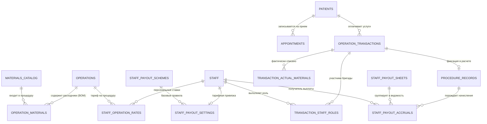
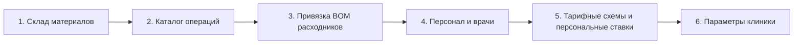
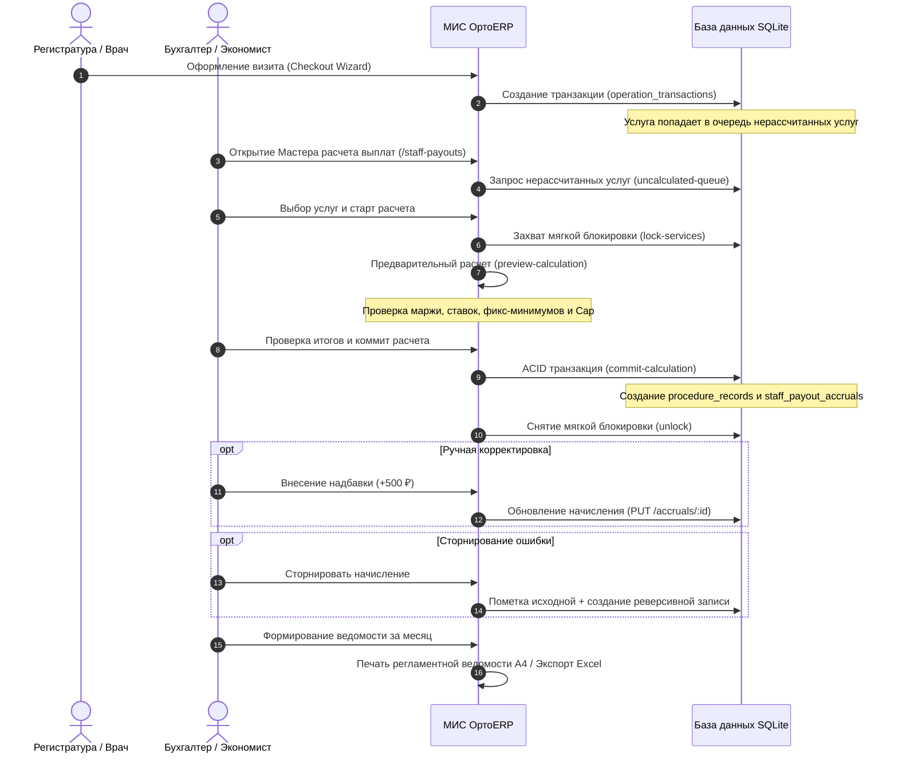

# Руководство пользователя МИС «ОртоERP»
## Центр Ортопедии и Травматологии доктора Добрушкина (г. Сочи)
### Регламент работы, взаимосвязь сущностей, параметры расчетов, потоки бизнес-процессов и печатные формы

---

**Версия документа:** 1.4.4  
**Дата утверждения:** 11 октября 2026 г.  
**Статус:** Официальное руководство пользователя и регламент эксплуатации  
**Составитель:** Экспертная группа автоматизации клинических и финансовых процессов  

---

## 1. Введение и назначение системы

Медицинская информационно-аналитическая система **«ОртоERP»** предназначена для комплексного управления клинической деятельностью, картотекой электронных медицинских карт (ЭМК), складским номенклатурным учетом, технологическими картами процедур (BOM), расчетом сдельной оплаты труда медицинского персонала и сквозной BI-аналитикой прибыльности Центра ортопедии.

### Ключевые возможности:
1. **Электронная медицинская карта (ЭМК):** ведение картотеки из 61 000+ пациентов с историей визитов, контактными данными, признаками ДМС и аудитом полноты информации.
2. **Технологические спецификации (BOM):** калькуляция реальной себестоимости процедур с автоматическим списанием материалов, упаковочной логикой и наценкой.
3. **Модуль «Расчет выплат сотрудникам»:** многоуровневый расчет вознаграждений врачей и медсестер от маржинальной базы с гарантированными минимумами, потолком выплат бригады (Cap) и сторнированием.
4. **Очередь услуг и мягкие блокировки:** исключение коллизий одновременного расчета одних и тех же процедур несколькими операторами/бухгалтерами.
5. **Печатные регламентные формы:** вывод на печать стандартизированных листов визитов, спецификаций и платежных ведомостей формата А4.

---

## 2. Концептуальная модель данных и взаимосвязи сущностей

Архитектура базы данных построена на реляционной модели SQLite с контролем целостности по внешним ключам (`PRAGMA foreign_keys = ON`).

### Основные сущности системы:

| Сущность | Назначение в системе | Ключевые поля | Взаимосвязи |
| :--- | :--- | :--- | :--- |
| **Пациенты (`patients`)** | Картотека ЭМК пациентов клиники | `id`, `mednum` (№ ЭМК), `full_name`, `phone`, `last_visit_date` | Связан с визитами (`appointments`) и транзакциями |
| **Персонал (`staff`)** | Реестр врачей, ассистентов и медсестер | `id`, `full_name`, `role`, `department`, `is_active` | Привязан к схемам выплат и процедурам |
| **Операции (`operations`)** | Каталог медицинских услуг и процедур | `id`, `name`, `price` (базовый тариф) | Имеет спецификацию BOM в `operation_materials` |
| **Склад материалов (`materials_catalog`)** | Номенклатура расходников и препаратов | `id`, `material_name`, `current_unit_cost`, `package_cost`, `unit_of_measure` | Входит в состав процедур и актов списания |
| **Спецификация BOM (`operation_materials`)** | Нормативный состав расходников на операцию | `operation_id`, `material_id`, `quantity` | Связывает операции со складом материалов |
| **Схемы выплат (`staff_payout_schemes`)** | Правила распределения маржи и лимиты | `id`, `scheme_name`, `calculation_base`, `default_rate_percent`, `max_team_cap_percent` | Наследуются в настройках сотрудников |
| **Настройки сотрудника (`staff_payout_settings`)** | Индивидуальные параметры оклада и схемы | `staff_id`, `scheme_id`, `tax_rate_percent`, `fixed_base_salary` | Персональный профиль сотрудника |
| **Ставки операций (`staff_operation_rates`)** | Персональные исключения и фикс-минимумы | `staff_id`, `operation_id`, `payout_percent`, `fixed_min_payout` | Переопределяют общие ставки схемы |
| **Записи процедур (`procedure_records`)** | Зафиксированные в расчете факты оказания услуг | `id`, `source_type`, `source_id`, `margin_base`, `dedup_hash` | Защита от повторной оплаты услуги |
| **Начисления (`staff_payout_accruals`)** | Строки персональных выплат персоналу | `id`, `sheet_id`, `staff_id`, `final_payout`, `status` | Привязаны к ведомости (`staff_payout_sheets`) |
| **Ведомости (`staff_payout_sheets`)** | Реестр расчетных периодов | `id`, `sheet_number`, `period_start`, `period_end`, `status` | Группирует начисления месяца |
| **Мягкие блокировки (`service_calculation_locks`)** | Блокировка услуг на время работы мастера | `source_type`, `source_id`, `lock_token`, `expires_at` | Автоматически удаляются после коммита |
| **Параметры (`calculation_parameters`)** | Системные коэффициенты клиники | `param_name`, `param_value` | Доступны глобально во всех алгоритмах |

---

## 3. Справочники и первоначальная настройка

Перед началом расчета выплат и регистрации услуг в системе должны быть заведены базовые справочники в строгой очередности:

### Шаг 1. Наполнение склада материалов (`/inventory`)
- Ввод наименования, единицы измерения (`шт`, `уп`, `компл`, `мл`).
- Указание учетной стоимости за единицу (`current_unit_cost`) и упаковку (`package_cost`).
- Контроль аудита качества данных: устранение нулевых цен и нетипичных единиц.

### Шаг 2. Каталог операций и технологические карты BOM (`/operations`)
- Создание наименования процедуры (например, «PRP-терапия коленного сустава», «Первичный прием травматолога»).
- Установка стоимости процедуры для пациента (`price`).
- Нажатие кнопки **«Расходники (BOM)»** и привязка необходимых материалов со склада с указанием нормы расхода на 1 манипуляцию (`quantity`).

### Шаг 3. Персонал и тарифные привязки (`/staff`)
- Регистрация сотрудника (ФИО, специализация: «Врач травматолог-ортопед», «Операционная сестра»).
- Привязка сотрудника к базовой схеме выплат:
  - *Схема 1 (Хирургия / Инвазии):* 35% врачу, лимит бригады (Cap) 60%.
  - *Схема 2 (Консультативный прием):* 25% врачу.
  - *Схема 3 (Сестринское сопровождение):* 10% ассистенту.
- Установка индивидуальных минимальных гарантий (`fixed_min_payout`) на сложные или низкомаржинальные процедуры.

### Шаг 4. Системные параметры расчетов (`/parameters`)
- `material_cost_factor`: коэффициент наценки на списание материалов (по умолчанию **1.15** = 15% накладных расходов).
- Параметры адреса, навигации и телефонов клиники для бланков.

---

## 4. Параметры настройки и алгоритмы расчетов

### 1. Расчет себестоимости материалов операции
Себестоимость технологической карты процедуры рассчитывается с учетом нормативного коэффициента накладных расходов клиники:
$$\text{Себестоимость материалов} = \left( \sum_{i=1}^{n} \text{Расход}_i \times \text{Цена\_ед}_i \right) \times \text{material\_cost\_factor}$$

*Пример:* На процедуру PRP расходуется набор пробирок ценой 6 200 ₽.  
$$\text{Себестоимость} = 6\,200 \times 1.15 = 7\,130\text{ ₽}$$

### 2. Расчет маржинальной базы
Маржинальная база операции — это объем средств, остающийся после покрытия прямых материальных затрат:
$$\text{Маржинальная база} = \max\Big(0,\; \text{Цена услуги} - \text{Себестоимость материалов}\Big)$$

> **Важно:** Маржинальная база никогда не принимает отрицательное значение. Если себестоимость материалов превысила цену услуги, маржинальная база приравнивается к 0, исключая вычитание из базовых сумм.

### 3. Расчет вознаграждения сотрудника
Вознаграждение сотрудника вычисляется по процентной ставке от маржинальной базы с контролем гарантированного минимума:
$$\text{Расчетная сумма} = \text{Маржинальная база} \times \frac{\text{Ставка \%}}{100}$$
$$\text{К выплате} = \max\Big(\text{Расчетная сумма},\; \text{Гарантированный минимум}\Big)$$

### 4. Контроль превышения лимита бригады (Team Cap)
Если сумма процентных ставок всех специалистов, участвующих в проведении процедуры (врач-хирург + ассистент + медсестра), превышает установленный лимит схемы (`max_team_cap_percent`, стандартно **60%**), система:
1. Выводит предупреждающий индикатор `isExceedingCap: true`.
2. Подсвечивает перерасход в интерфейсе мастера калькуляции для согласования главным врачом.

---

## 5. Бизнес-процессы и Flow (жизненный цикл)

---

## 6. Порядок определения и ввода первичных данных

### 1. Регистрация пациента
1. Открыть раздел **«Пациенты (ЭМК картотека)»** (`/patients`).
2. Нажать кнопку **«Новый пациент»**.
3. Заполнить ФИО, дату рождения, телефон, адрес проживания в г. Сочи.
4. При наличии полиса ДМС отметить флаг и указать номер полиса и страховую компанию.
5. Нажать «Создать» — пациенту автоматически присваивается номер электронной медицинской карты (ЭМК).

### 2. Оформление оказанной услуги
1. Открыть раздел **«Оформление визита (Wizard)»** (`/checkout`).
2. Выбрать пациента из картотеки (доступен мгновенный поиск по номеру ЭМК или фамилии).
3. Указать лечащего врача и ассистирующую медицинскую сестру.
4. Выбрать оказанные процедуры из каталога. Система автоматически подгрузит нормативные расходники из BOM.
5. При необходимости скорректировать фактически израсходованные материалы.
6. Выбрать способ оплаты (наличные, банковская карта, безналичный расчет, ДМС).
7. Завершить визит нажатием кнопки **«Зафиксировать визит»**. Запись мгновенно передается в очередь модуля выплат.

---

## 7. Экран работы с бизнес-процессами («Выплаты сотрудникам»)

Экран **«Выплаты сотрудникам»** (`/staff-payouts`) является главным рабочим местом экономиста и главного бухгалтера.

### Вкладка 1: «Мастер расчета выплат»
- **Очередь нерассчитанных услуг:** выводит все закрытые визиты и транзакции, по которым еще не начислена сдельная оплата.
- **Таблица с мультивыбором:** чекбоксы позволяют выбрать как все услуги расчетного периода, так и отдельные процедуры конкретного врача.
- **Кнопка «Предварительный расчет»:** запускает математический движок, захватывает временную блокировку (30 минут) и формирует сводную таблицу:
  - *Выручка по процедуре.*
  - *Прямая себестоимость с наценкой 1.15.*
  - *Маржинальная база клиники.*
  - *Выплата врачу с указанием сработавшего тарифа или минимума.*
  - *Выплата ассистенту.*
  - *Остаточная маржа клиники.*
- **Кнопка «Зафиксировать начисления в ведомость»:** выполняет атомарный коммит в базу данных, снимает блокировки и очищает очередь.

### Вкладка 2: «Реестр начислений»
- Интерактивный реестр всех сформированных строк выплат с фильтрами по сотрудникам, статусам (`accrued`, `paid`, `storno`) и периодам.
- Кнопка **«Корректировка»** — добавление разовых премий или удержаний.
- Кнопка **«Сторно»** — отмена ошибочного начисления с фиксацией аудиторского следа.

### Вкладка 3: «Ведомости за периоды»
- Хранилище закрытых расчетных периодов (месяцев).
- Статусы ведомостей: `draft` (черновик) $\to$ `approved` (утверждена главврачом) $\to$ `paid` (выплачена).
- Кнопка **«Печать ведомости А4»** для вывода на принтер или сохранения в PDF.
- Кнопка **«Экспорт в Excel (CSV)»** для отправки в 1С:ЗУП или клиент-банк.

---

## 8. Комбинации визитов и назначений персонала в модуле выплат

Система ОртоERP v1.4.4 полностью поддерживает и валидирует все комбинации объема услуг и состава медицинской бригады:

| Код сценария | Тип визита и услуг | Назначение персонала | Регламент расчета и результат в БД |
| :--- | :--- | :--- | :--- |
| **FL-V01** | **Single Service:** 1 консультация (5 000 ₽) | **Solo Doctor:** только врач (`nurse_id: null`) | Сестре строго 0 ₽ (ставка 0%). Врачу: 30% (1 500 ₽). Коммит: 1 процедура, 1 начисление. |
| **FL-V02** | **Single Service:** 1 инвазия (PRP 18 000 ₽, мат. 3 500 ₽) | **Brigade:** Хирург (35%) + Медсестра (10%) | Маржа 14 500 ₽. Хирург: 5 075 ₽, медсестра: 1 450 ₽. Коммит: 1 процедура, 2 начисления. |
| **FL-V03** | **Multi Services:** Пакет из 2 услуг (Консультация 5k + Блокада 8k) | **Solo Doctor:** только врач (`nurse_id: null`) | Обе услуги в рамках одного визита. Сестре 0 ₽ по обеим. Коммит: 2 процедуры, 2 начисления врачу. |
| **FL-V04** | **Multi Services:** Пакет из 2 операций (Артроскопия 35k + PRP 18k = 53k) | **Brigade:** Хирург (35%) + Медсестра (10%) | Раздельный расчет маржи по каждой позиции пакета. Коммит: 2 процедуры, 4 начисления. |
| **FL-V05** | **Appointment Flow:** прием из расписания (`status = 'completed'`) | **Лечащий врач:** врач приема | Поступает со `source_type: 'appointment'`, коммит связывается с `appointment_id`. |

---

## 9. Мониторинг служб бэкенда и статус инфраструктуры (`/admin/server-health`)

Административный раздел **«Службы бэкенда (Health)»** обеспечивает мониторинг доступности 6 компонентов:
1. **Express REST API Gateway (порт 5000):** версия Node.js, PID, непрерывный Uptime, память (RSS / Heap).
2. **SQLite Database Storage:** статус целостности (`PRAGMA quick_check = ok`), WAL-режим, число таблиц (40) и записей.
3. **OrthoErp.FiscalService (.NET Daemon, порт 5050):** статус связи с ККТ АТОЛ 91Ф на COM3, смена №14, Serilog SQLite sink.
4. **Firebird SQL Server (порт 3050):** медицинская база `MEDICAL.FDB`, 61 298 пациентов, 37 538 визитов, 36 560 договоров, 97 карт ДМС.
5. **OpenAPI & Swagger UI (`/api-docs`):** спецификация OpenAPI 3.0 и интерактивная консоль тестирования REST API.
6. **SQLite Hot Backup Subsystem (`VACUUM INTO`):** проверка директории `backups/`, ротация 7 снимков, размер последнего бэкапа.

Кнопка **«Запустить тест всех служб»** выполняет сквозную проверку с замером времени отклика (latency ms) и выводом подробного протокола в терминал.

---

## 10. Автономный контур тестов и демо-данные [TEST_DAEMON] (45 проверок)

В панели **«Управление демо-данными [TEST_DAEMON]»** (`/admin/daemon-data`) развернут тестовый комплекс:
- **Заполнить БД (Seed):** создает тестовых пациентов, персонал, 3 периода ведомостей и очередь нерассчитанных визитов с маркером `[TEST_DAEMON]`.
- **Запуск тестов потока (45 проверок):** автоматический прогон тестов FL-V01 — FL-V05 и FL-01 — FL-14 (наценка 1.15, Soft Lock, ACID коммит, защита от дублей `dedup_hash`, ручная надбавка +500 ₽, сторно -1 750 ₽, сходимость в BI KPI Summary, рейтинге врачей и Margin Waterfall).
- **Очистить демо-данные (Purge):** каскадное удаление всех тестовых строк без ущерба для рабочей отчетности клиники.

---

## 11. Печать и регламентный вывод документов

В системе соблюдаются единые стандарты корпоративной отчетности:

### 1. Расчетная ведомость по выплатам сотрудникам (формат А4)
- **Шапка документа:** официальный логотип клиники (`/MainLogoTransparent.png`), полное наименование «Центр Ортопедии и Травматологии доктора Добрушкина, г. Сочи», номер ведомости и даты расчетного периода.
- **Табличная часть:** список сотрудников с разбивкой по операциям, объему выручки, коэффициентам, начислениям и налогам (НДФЛ).
- **Итоговая часть и подписи:** сгруппированы в неделимый контейнер с CSS-свойством `pageBreakInside: 'avoid'`. Подписи главного врача, главного бухгалтера и сотрудника никогда не отрываются от итоговых сумм и не переносятся на пустой лист.

### 2. Экспорт реестров в CSV (MS Excel)
- Все CSV-файлы генерируются с кодировкой UTF-8 и байтовым маркером `\uFEFF` (BOM).
- Разделители адаптированы для автоматического открытия в русскоязычных версиях Microsoft Excel без искажения символов кириллицы.

---

## 12. Полнотекстовый поиск в руководстве и реестрах

- **Интеллектуальный мульти-токенный поиск:** при вводе запроса («бригада 35», «атол смена», «сторно 1750», «1.15 маржа») система разбивает строку на токены и находит разделы, содержащие все указанные термины.
- **Автоматическое раскрытие аккордеонов:** при вводе любого поискового запроса найденные разделы инструкции раскрываются автоматически.
- **Очистка в 1 клик:** кнопка крестика в поле поиска мгновенно сбрасывает фильтрацию.
- **Быстрые категории:** фильтрация по 10 тематическим категориям с бейджами количества статей.

---

## 13. Справочник клинических шаблонов и протоколов приёма (31 эталонный протокол)

В МИС «ОртоERP» v1.4.4 интегрирован корпоративный клинический модуль **«Справочник клинических шаблонов 2.0»** (`/ortho-templates`). Модуль объединяет доказательные стандарты обследования пациентов травматолого-ортопедического профиля и включает **100 клинических шаблонов протоколов** по 10 клиническим кластерам опорно-двигательного аппарата.

### 13.1. Клинико-архитектурная концепция

Каждый шаблон представляет собой взаимосвязанную клиническую модель, содержащую:
1. **Классификатор МКБ-10:** эталонный шифр нозологии (M17, M75, M77, S83, G56 и др.) с автоматическим поиском.
2. **Готовые структурированные тексты:** жалобы, профессиональный анамнез заболевания, локальный статус (Status Localis) и клинические рекомендации.
3. **Биомеханический профиль (ROM Preset):** физиологические нормы активного и пассивного движения (сгибание, разгибание, отведение, наружная/внутренняя ротация) с автоподстановкой в гониометрию.
4. **Обязательные ортопедические тесты:** привязка к 39 валидированным тестам доказательной медицины с показателями чувствительности ($Se$) и специфичности ($Sp$).
5. **План инструментальной и лучевой диагностики:** перечень рекомендованных обследований (МРТ, рентген, УЗИ, КТ, ЭНМГ, плантография), синхронизированный с прейскурантом услуг клиники (`servdict`).
6. **Сквозная интеграция с АРМ врача и кассой:** автоматическая передача назначенных услуг и процедур в мастер кассы (`/checkout`) без ручного дублирования.

### 13.2. Сводный реестр 31 клинического шаблона протоколов приёма

| № | ID | Нозологический шаблон протокола | Анатомическая область | Код МКБ-10 | Категория патологии | Сторона | Профильные ортопедические тесты (Se/Sp) | План обследования (Инструментальная / Лучевая диагностика) |
|---|---|---|---|---|---|---|---|---|
| 1 | `#1` | **Первичный гонартроз II стадии с умеренным выпотом** | Коленный сустав | **M17.1** | Общая ортопедия | Правая сторона | *Базовый клинический осмотр* | *По клиническим показаниям* |
| 2 | `#2` | **Повреждение вращательной манжеты плеча (импиджмент)** | Плечевой сустав | **M75.1** | Общая ортопедия | Правая сторона | *Базовый клинический осмотр* | *По клиническим показаниям* |
| 3 | `#3` | **Плантарный фасциит (пяточная шпора)** | Стопа и голеностоп | **M77.3** | Общая ортопедия | Правая сторона | *Базовый клинический осмотр* | *По клиническим показаниям* |
| 4 | `#4` | **Латеральный эпикондилит локтевого сустава («локоть теннисиста»)** | Локтевой сустав | **M77.1** | Энтезопатии и тендиниты | Правая сторона | • Тест Козена (`cozen`) • Тест Милля (`mill`) • Тест локтя гольфиста (`golfer`) • Симптом Тиннеля кубитального канала (`tinel_cubital`) • Вальгус-стресс тест локтя (`valgus_stress_elbow`) | • УЗИ сухожилий надмыщелков локтевого сустава (`us_elbow_epicond`) • Рентгенография локтевого сустава (2 проекции) (`xray_elbow_2v`) |
| 5 | `#5` | **Первичный гонартроз II стадии с реактивным синовитом** | Коленный сустав | **M17.1** | Дегенеративно-дистрофические заболевания | Правая сторона | • Тест Мак-Мюррея (`mcmurray`) • Баллотирование надколенника (`patella_ballottement`) • Тест Лахмана (`lachman`) • Передний выдвижной ящик колена (`anterior_drawer`) • Тест Кларка (трения надколенника) (`patella_grind`) | • Рентгенография коленного сустава под нагрузкой (`xray_knee_2v`) • УЗИ коленного сустава с оценкой заворотов (`us_knee`) • Микроскопическое и биохимическое исследование синовии (`lab_synovial`) |
| 6 | `#6` | **Медиальный эпикондилит («локоть гольфиста»)** | Локтевой сустав | **M77.0** | Энтезопатии и тендиниты | Правая сторона | • Тест локтя гольфиста (`golfer`) • Тест Козена (`cozen`) • Симптом Тиннеля кубитального канала (`tinel_cubital`) • Вальгус-стресс тест локтя (`valgus_stress_elbow`) | • УЗИ сухожилий надмыщелков локтевого сустава (`us_elbow_epicond`) • Рентгенография локтевого сустава (2 проекции) (`xray_elbow_2v`) |
| 7 | `#7` | **Асептический бурсит локтевого отростка (олекранона)** | Локтевой сустав | **M70.2** | Бурситы и синовиты | Левая сторона | • Симптом Тиннеля кубитального канала (`tinel_cubital`) • Тест Козена (`cozen`) | • УЗИ сухожилий надмыщелков локтевого сустава (`us_elbow_epicond`) • Микроскопическое и биохимическое исследование синовии (`lab_synovial`) |
| 8 | `#8` | **Синдром кубитального канала (невропатия локтевого нерва)** | Локтевой сустав | **G56.2** | Туннельные невропатии | Правая сторона | • Симптом Тиннеля кубитального канала (`tinel_cubital`) • Тест Козена (`cozen`) • Вальгус-стресс тест локтя (`valgus_stress_elbow`) | • Стимуляционная ЭНМГ локтевого нерва (`enmg_ulnar`) • УЗИ сухожилий надмыщелков локтевого сустава (`us_elbow_epicond`) |
| 9 | `#9` | **Субакромиальный импинджмент-синдром плеча** | Плечевой сустав | **M75.1** | Энтезопатии и тендиниты | Правая сторона | • Тест Нира (`neer`) • Тест Хокинса-Кеннеди (`hawkins`) • Тест «пустой банки» Джобса (`empty_can_jobe`) • Тест падающей руки (`drop_arm`) • Тест тревоги (передней нестабильности) (`apprehension`) | • МРТ плечевого сустава (`mri_shoulder`) • УЗИ плечевого сустава с функциональными пробами (`us_shoulder`) • Рентгенография плечевого сустава в 2 проекциях (`xray_shoulder_2v`) |
| 10 | `#10` | **Массивный полнослойный разрыв вращательной манжеты плеча** | Плечевой сустав | **M75.1** | Травмы и повреждения капсульно-связочного аппарата | Правая сторона | • Тест падающей руки (`drop_arm`) • Тест «пустой банки» Джобса (`empty_can_jobe`) • Тест Нира (`neer`) | • МРТ плечевого сустава (`mri_shoulder`) |
| 11 | `#11` | **Адгезивный капсулит («синдром замороженного плеча»)** | Плечевой сустав | **M75.0** | Дегенеративно-дистрофические заболевания | Левая сторона | • Тест Нира (`neer`) • Тест Хокинса-Кеннеди (`hawkins`) | • МРТ плечевого сустава (`mri_shoulder`) • Рентгенография плечевого сустава в 2 проекциях (`xray_shoulder_2v`) |
| 12 | `#12` | **Пателлофеморальный артроз и латеральная гиперпрессия надколенника** | Коленный сустав | **M22.2** | Дегенеративно-дистрофические заболевания | Двустороннее | • Тест Кларка (трения надколенника) (`patella_grind`) • Тест тревоги надколенника (Fairbank) (`patella_apprehension`) • Тест Лахмана (`lachman`) | • Рентгенография коленного сустава под нагрузкой (`xray_knee_2v`) • МРТ коленного сустава на томографе 1.5–3.0 Тл (`mri_knee_high`) |
| 13 | `#13` | **Первичный коксартроз II стадии** | Тазобедренный сустав | **M16.1** | Дегенеративно-дистрофические заболевания | Правая сторона | • Тест FABER (Патрика) (`faber`) • Тест Томаса (`thomas`) • Симптом Тренделенбурга (`trendelenburg`) • Тест FADIR (`fadir`) | • Обзорная рентгенография таза и обоих ТБС (`xray_pelvis_hip`) • МРТ тазобедренного сустава (`mri_hip`) |
| 14 | `#14` | **Вертлужный трохантерит (большой вертельный бурсит)** | Тазобедренный сустав | **M70.6** | Бурситы и синовиты | Правая сторона | • Тест FABER (Патрика) (`faber`) • Тест FADIR (`fadir`) • Симптом Тренделенбурга (`trendelenburg`) • Тест Обера (`ober`) | • УЗИ области большого вертела и ТБС (`us_hip_trochanter`) • Обзорная рентгенография таза и обоих ТБС (`xray_pelvis_hip`) |
| 15 | `#15` | **Феморо-ацетабулярный импинджмент (FAI, Cam/Pincer)** | Тазобедренный сустав | **M24.8** | Дегенеративно-дистрофические заболевания | Левая сторона | • Тест FADIR (`fadir`) • Тест FABER (Патрика) (`faber`) | • Обзорная рентгенография таза и обоих ТБС (`xray_pelvis_hip`) • МРТ тазобедренного сустава (`mri_hip`) |
| 16 | `#16` | **Асептический некроз головки бедренной кости (АНГБК) I-II стадии** | Тазобедренный сустав | **M87.0** | Дегенеративно-дистрофические заболевания | Правая сторона | • Тест FABER (Патрика) (`faber`) • Тест FADIR (`fadir`) | • МРТ тазобедренного сустава (`mri_hip`) • Обзорная рентгенография таза и обоих ТБС (`xray_pelvis_hip`) |
| 17 | `#17` | **Разрыв медиального мениска (Stoller IIIb)** | Коленный сустав | **M23.2** | Травмы и повреждения капсульно-связочного аппарата | Правая сторона | • Тест Мак-Мюррея (`mcmurray`) • Тест Эпли (`appley`) • Тест Лахмана (`lachman`) • Тест Pivot-Shift (`pivot_shift`) | • МРТ коленного сустава на томографе 1.5–3.0 Тл (`mri_knee_high`) • Рентгенография коленного сустава под нагрузкой (`xray_knee_2v`) |
| 18 | `#18` | **Частичный разрыв передней таранно-малоберцовой связки голеностопа** | Стопа и голеностоп | **S93.4** | Травмы и повреждения капсульно-связочного аппарата | Правая сторона | • Передний выдвижной ящик голеностопа (`anterior_drawer_ankle`) • Стресс-тест таранной кости (`talar_tilt`) • Тест Томпсона (`thompson`) | • Рентгенография стоп с физиологической нагрузкой (`xray_foot_load`) • УЗИ ахиллова сухожилия и плантарной фасции (`us_achilles`) |
| 19 | `#19` | **Хронический тендинит ахиллова сухожилия (ахиллодиния)** | Стопа и голеностоп | **M76.6** | Энтезопатии и тендиниты | Левая сторона | • Тест Томпсона (`thompson`) • Тест Уиндласса (`windlass`) | • УЗИ ахиллова сухожилия и плантарной фасции (`us_achilles`) |
| 20 | `#20` | **Hallux Valgus II степени, метатарзалгия** | Стопа и голеностоп | **M20.1** | Дегенеративно-дистрофические заболевания | Двустороннее | • Тест Уиндласса (`windlass`) | • Рентгенография стоп с физиологической нагрузкой (`xray_foot_load`) • Компьютерная подометрия и оптическая плантография (`plantography`) |
| 21 | `#21` | **Синдром запястного (карпального) канала** | Лучезапястный сустав и кисть | **G56.0** | Туннельные невропатии | Правая сторона | • Тест Фалена (`phalen`) • Симптом Тиннеля на запястье (`tinel_wrist`) • Тест Финкельштейна (`finkelstein`) • Симптом клавиши пианино (`piano_key`) | • Стимуляционная ЭНМГ срединного нерва кисти (`enmg_carpal`) • УЗИ срединного нерва в карпальном канале (`us_wrist_carpal`) |
| 22 | `#22` | **Стенозирующий лигаментит де Кервена** | Лучезапястный сустав и кисть | **M65.4** | Энтезопатии и тендиниты | Правая сторона | • Тест Финкельштейна (`finkelstein`) • Тест Фалена (`phalen`) • Симптом Тиннеля на запястье (`tinel_wrist`) | • УЗИ срединного нерва в карпальном канале (`us_wrist_carpal`) • Рентгенография лучезапястного сустава в 2 проекциях (`xray_wrist_2v`) |
| 23 | `#23` | **Ризартроз (артроз первого запястно-пястного сустава)** | Лучезапястный сустав и кисть | **M18.1** | Дегенеративно-дистрофические заболевания | Двустороннее | • Тест шлифовки 1-го ПЗП (Grind test) (`grind_thumb`) • Тест Финкельштейна (`finkelstein`) | • Рентгенография лучезапястного сустава в 2 проекциях (`xray_wrist_2v`) |
| 24 | `#24` | **Посттравматическая нестабильность дистального радиоульнарного сустава (DRUJ)** | Лучезапястный сустав и кисть | **M24.2** | Травмы и повреждения капсульно-связочного аппарата | Правая сторона | • Симптом клавиши пианино (`piano_key`) • Симптом Тиннеля на запястье (`tinel_wrist`) | • МРТ лучезапястного сустава (`mri_wrist`) • Рентгенография лучезапястного сустава в 2 проекциях (`xray_wrist_2v`) |
| 25 | `#25` | **Люмбалгия с радикулопатией L5–S1 (вертеброгенный ишиас)** | Позвоночник | **M54.4** | Дегенеративно-дистрофические заболевания | Правая сторона | • Симптом Ласега (`lasegue`) • Тест Вассермана / бедренного нерва (`wassermann`) • Проба Адамса (`adams`) | • МРТ пояснично-крестцового отдела позвоночника (`mri_lumbosacral`) • Рентгенография позвоночника с функциональными пробами (`xray_spine_flex`) |
| 26 | `#26` | **Цервикалгия с миофасциальным болевым синдромом и цефалгией** | Позвоночник | **M54.2** | Миофасциальные синдромы | Двустороннее | • Тест Сперлинга (`spurling`) • Симптом Ласега (`lasegue`) | • Рентгенография позвоночника с функциональными пробами (`xray_spine_flex`) |
| 27 | `#27` | **Торакалгия на фоне мышечно-тонического синдрома и остеохондроза** | Позвоночник | **M54.6** | Дегенеративно-дистрофические заболевания | Двустороннее | • Проба Адамса (`adams`) • Симптом Ласега (`lasegue`) | • Рентгенография позвоночника с функциональными пробами (`xray_spine_flex`) |
| 28 | `#28` | **Идиопатический сколиоз позвоночника II степени** | Позвоночник | **M41.2** | Деформации позвоночника | Двустороннее | • Проба Адамса (`adams`) • Симптом Ласега (`lasegue`) | • Панорамная спондилография позвоночника стоя (`xray_spine_total`) • Компьютерная подометрия и оптическая плантография (`plantography`) |
| 29 | `#29` | **Тендинит сухожилия длинной головки двуглавой мышцы плеча** | Плечевой сустав | **M75.2** | Энтезопатии и тендиниты | Правая сторона | • Тест Спида (`speed`) • Тест Нира (`neer`) • Тест Хокинса-Кеннеди (`hawkins`) | • УЗИ плечевого сустава с функциональными пробами (`us_shoulder`) • МРТ плечевого сустава (`mri_shoulder`) |
| 30 | `#30` | **Полный разрыв передней крестообразной связки (ПКС)** | Коленный сустав | **S83.5** | Травмы и повреждения капсульно-связочного аппарата | Левая сторона | • Тест Лахмана (`lachman`) • Передний выдвижной ящик колена (`anterior_drawer`) • Тест Pivot-Shift (`pivot_shift`) • Тест Мак-Мюррея (`mcmurray`) | • МРТ коленного сустава на томографе 1.5–3.0 Тл (`mri_knee_high`) |
| 31 | `#31` | **Плантарный фасциит с пяточным энтезофитом («пяточная шпора»)** | Стопа и голеностоп | **M77.3** | Энтезопатии и тендиниты | Правая сторона | • Тест Уиндласса (`windlass`) • Тест Томпсона (`thompson`) • Передний выдвижной ящик голеностопа (`anterior_drawer_ankle`) | • Рентгенография стоп с физиологической нагрузкой (`xray_foot_load`) • Компьютерная подометрия и оптическая плантография (`plantography`) • УЗИ ахиллова сухожилия и плантарной фасции (`us_achilles`) |

### 13.3. Распределение шаблонов по анатомическим областям

Все 31 клинический шаблон сгруппированы по 7 анатомическим зонам Гомункулуса в АРМ врача:

#### 13.3.1. Коленный сустав (5 протоколов)

- **[M17.1] Первичный гонартроз II стадии с умеренным выпотом** (ID: `1`):
- **[M17.1] Первичный гонартроз II стадии с реактивным синовитом** (ID: `5`):
  - *Жалобы:* Боль по внутренней поверхности коленного сустава при физической нагрузке, спуске по лестнице и в начале ходьбы («стартовые боли»). Чувство распирания и припухлость в области супрапателлярного заворота.
  - *Объективный статус:* Ось конечности: умеренный genu varum. Синовит: II степень (умеренный). Пальпация медиальной суставной щели и гусиной лапки резко болезненна.
  - *Рекомендации и тактика:* Разгрузка сустава тростью при длительной ходьбе, индивидуальные ортопедические стельки с компенсацией перекоса.
  - *Нормы гониометрии (ROM):* flexion_active: 110°, flexion_passive: 120°, extension_deficit: -5°
- **[M22.2] Пателлофеморальный артроз и латеральная гиперпрессия надколенника** (ID: `12`):
  - *Жалобы:* Боль по передней поверхности коленей, усиливающаяся при длительном сидении («симптом кинотеатра»), спуске с горы или лестницы. Хруст и крепитация при сгибании.
  - *Объективный статус:* Положительный симптом скольжения надколенника с крепитацией. Вальгусная установка коленей.
  - *Рекомендации и тактика:* Кинезиотейпирование надколенника с медиализирующей тягой. Укрепление медиальной широкой мышцы бедра (VMO).
  - *Нормы гониометрии (ROM):* flexion_active: 135°, flexion_passive: 140°, extension_deficit: 0°
- **[M23.2] Разрыв медиального мениска (Stoller IIIb)** (ID: `17`):
  - *Жалобы:* Острая «кинжальная» боль по внутренней суставной щели при глубоком приседании и ротации голени. Периодические блокировки («заклинивание») сустава.
  - *Объективный статус:* Синовит: I степень. Резкая локальная болезненность в точке проекции заднего рога медиального мениска.
  - *Рекомендации и тактика:* Консультация артроскопического хирурга по результатам МРТ. Ограничение глубокого приседания и ударных нагрузок.
  - *Нормы гониометрии (ROM):* flexion_active: 105°, flexion_passive: 115°, extension_deficit: -10°
- **[S83.5] Полный разрыв передней крестообразной связки (ПКС)** (ID: `30`):
  - *Жалобы:* Ощущение «выскакивания» или подкашивания голени при ходьбе и попытке сменить направление движения. Нестабильность колена.
  - *Объективный статус:* Симптом баллотирования (+). Атрофия четырехглавой мышцы бедра (-1.5 см в окружности).
  - *Рекомендации и тактика:* Жесткий функциональный рамный ортез. Направление на плановую артроскопическую аутопластику ПКС.
  - *Нормы гониометрии (ROM):* flexion_active: 125°, flexion_passive: 130°, extension_deficit: 0°

#### 13.3.2. Плечевой сустав (5 протоколов)

- **[M75.1] Повреждение вращательной манжеты плеча (импиджмент)** (ID: `2`):
- **[M75.1] Субакромиальный импинджмент-синдром плеча** (ID: `9`):
  - *Жалобы:* Боль по наружной поверхности плеча при отведении руки в диапазоне 60–120° («дуга болезненного отведения»). Боль при заведении руки за спину, невозможность спать на правом боку.
  - *Объективный статус:* Пальпация субакромиальной зоны болезненна. Атрофии дельтовидной мышцы нет.
  - *Рекомендации и тактика:* Избегать движений руки выше уровня плеча. Кинезиотейпирование дельтовидной зоны.
  - *Нормы гониометрии (ROM):* abduction: 90°, flexion_active: 100°, flexion_passive: 160°, rotation_ext: 45°, rotation_int: 50°
- **[M75.1] Массивный полнослойный разрыв вращательной манжеты плеча** (ID: `10`):
  - *Жалобы:* Резкая слабость и невозможность поднять руку выше горизонтального уровня («рука не слушается»). Постоянная ночная боль.
  - *Объективный статус:* Атрофия надостной и подостной ямок. Пассивные движения в полном объеме, активные резко ограничены.
  - *Рекомендации и тактика:* Отводящая шина-подушка на плечевой сустав. Направление на артроскопический шов вращательной манжеты якорями.
  - *Нормы гониометрии (ROM):* abduction: 40°, flexion_active: 50°, flexion_passive: 160°, rotation_ext: 30°, rotation_int: 40°
- **[M75.0] Адгезивный капсулит («синдром замороженного плеча»)** (ID: `11`):
  - *Жалобы:* Выраженная скованность и тугоподвижность плеча во всех плоскостях. Боль усиливается при любых резких попытках движения.
  - *Объективный статус:* Глобальное пропорциональное ограничение как активных, так и пассивных движений (капсулярный паттерн). Резкий дефицит наружной ротации.
  - *Рекомендации и тактика:* Гидродилатационная дистензионная блокада сустава. Ранняя разработка амплитуды на аппарате Artromot.
  - *Нормы гониометрии (ROM):* abduction: 60°, flexion_active: 70°, flexion_passive: 80°, rotation_ext: 15°, rotation_int: 20°
- **[M75.2] Тендинит сухожилия длинной головки двуглавой мышцы плеча** (ID: `29`):
  - *Жалобы:* Боль по передней поверхности плечевого сустава с иррадиацией по ходу бицепса, усиливается при подъеме тяжестей перед собой.
  - *Объективный статус:* Локальная болезненность при пальпации в sulcus intertubercularis. Движения в плече полные.
  - *Рекомендации и тактика:* Ограничение тракционных нагрузок на руку, курс локальной криотерапии.
  - *Нормы гониометрии (ROM):* abduction: 160°, flexion_active: 160°, flexion_passive: 170°, rotation_ext: 60°, rotation_int: 60°

#### 13.3.3. Стопа и голеностоп (5 протоколов)

- **[M77.3] Плантарный фасциит (пяточная шпора)** (ID: `3`):
- **[S93.4] Частичный разрыв передней таранно-малоберцовой связки голеностопа** (ID: `18`):
  - *Жалобы:* Боль по наружной поверхности голеностопа, отек латеральной лодыжки, подкожная гематома. Хромота при нагрузке.
  - *Объективный статус:* Отечность в проекции латеральной лодыжки, гематома, распространяющаяся на тыл стопы.
  - *Рекомендации и тактика:* Иммобилизация голеностопным полужестким ортезом с боковыми пластинами на 3 недели. Режим R.I.C.E.
  - *Нормы гониометрии (ROM):* dorsiflexion: 10°, plantarflexion: 25°
- **[M76.6] Хронический тендинит ахиллова сухожилия (ахиллодиния)** (ID: `19`):
  - *Жалобы:* Тянущая боль в области задней поверхности голени на 3–5 см выше пятки, возникающая в начале бега и ходьбы. Утолщение сухожилия.
  - *Объективный статус:* Локальное веретенообразное утолщение сухожилия, пальпация резко болезненна.
  - *Рекомендации и тактика:* Курс эксцентрических тренировок по Альфредсону. Подпяточники силиконовые 1 см.
  - *Нормы гониометрии (ROM):* dorsiflexion: 15°, plantarflexion: 40°
- **[M20.1] Hallux Valgus II степени, метатарзалгия** (ID: `20`):
  - *Жалобы:* Отклонение первого пальца стопы кнаружи, воспаление и натирание «косточки» в обуви. Боль под головками II-III плюсневых костей («натоптыши»).
  - *Объективный статус:* Вальгусное отклонение I пальца >25°, гиперкератоз подошвы под II плюсневой костью.
  - *Рекомендации и тактика:* Индивидуальные ортопедические стельки с метатарзальным валиком Зейца. Ночной отводящий бандаж.
  - *Нормы гониометрии (ROM):* dorsiflexion: 20°, plantarflexion: 45°
- **[M77.3] Плантарный фасциит с пяточным энтезофитом («пяточная шпора»)** (ID: `31`):
  - *Жалобы:* Острая жгучая боль в подошвенной поверхности пятки при первых утренних шагах («стартовая боль»), пациент вынужден наступать на носок. После расхаживания боль немного стихает, к вечеру нарастает.
  - *Объективный статус:* Локальная резкая болезненность при пальпации медиального бугра пяточной кости. Свод стопы уплощен.
  - *Рекомендации и тактика:* Ночной страсбургский носок / ночной фиксатор фасции. Индивидуальные ортопедические стельки с разгрузочным окном под пяткой.
  - *Нормы гониометрии (ROM):* dorsiflexion: 15°, plantarflexion: 40°

#### 13.3.4. Локтевой сустав (4 протокола)

- **[M77.1] Латеральный эпикондилит локтевого сустава («локоть теннисиста»)** (ID: `4`):
  - *Жалобы:* Жгучая боль по наружной поверхности правого локтя с иррадиацией по тылу предплечья. Усиливается при удержании чашки, рукопожатии, повороте дверной ручки или работе за мышью.
  - *Объективный статус:* Локальная резкая болезненность при пальпации латерального надмыщелка плечевой кости и сухожилий разгибателей. Отека нет.
  - *Рекомендации и тактика:* Ортезирование предплечья бандажом с силиконовым пилотом. Исключение монотонных разгибательных нагрузок на кисть.
  - *Нормы гониометрии (ROM):* flexion_active: 145°, flexion_passive: 150°, extension_deficit: 0°, rotation_ext: 85°, rotation_int: 85°
- **[M77.0] Медиальный эпикондилит («локоть гольфиста»)** (ID: `6`):
  - *Жалобы:* Ноющая и острая боль по внутренней поверхности локтя при сгибании кисти, подъеме тяжестей хватом снизу.
  - *Объективный статус:* Пальпация медиального надмыщелка плеча резко болезненна. Локтевой нерв интактен, борозда безболезненна.
  - *Рекомендации и тактика:* Локальная криотерапия, ортезирование предплечья разгрузочным бандажом.
  - *Нормы гониометрии (ROM):* flexion_active: 145°, flexion_passive: 150°, extension_deficit: 0°, rotation_ext: 85°, rotation_int: 85°
- **[M70.2] Асептический бурсит локтевого отростка (олекранона)** (ID: `7`):
  - *Жалобы:* Округлое флюктуирующее образование в области задней поверхности локтя размером с грецкий орех. Безболезненное или малоболезненное при пальпации.
  - *Объективный статус:* В проекции bursa olecrani мягкоэластичное образование 4х3 см, симптом флюктуации (+), местная температура не повышена, гиперемии нет.
  - *Рекомендации и тактика:* Давящая спиртовая повязка, эластичный налокотник с разгрузочным силиконовым кольцом.
  - *Нормы гониометрии (ROM):* flexion_active: 145°, flexion_passive: 150°, extension_deficit: 0°, rotation_ext: 85°, rotation_int: 85°
- **[G56.2] Синдром кубитального канала (невропатия локтевого нерва)** (ID: `8`):
  - *Жалобы:* Онемение, «мурашки» и снижение чувствительности в IV и V пальцах кисти. Слабость захвата кисти, неловкость мелких движений.
  - *Объективный статус:* Гипестезия локтевого края кисти и V пальца. Симптом Фромана (+): слабость приведения I пальца.
  - *Рекомендации и тактика:* Ночной иммобилизирующий ортез, препятствующий сгибанию локтя более 45°. Нейротропная терапия.
  - *Нормы гониометрии (ROM):* flexion_active: 145°, flexion_passive: 150°, extension_deficit: 0°, rotation_ext: 85°, rotation_int: 85°

#### 13.3.5. Тазобедренный сустав (4 протокола)

- **[M16.1] Первичный коксартроз II стадии** (ID: `13`):
  - *Жалобы:* Глубокая ноющая боль в паховой области, иррадиирующая по передней поверхности бедра в колено. Затруднение при надевании обуви и носков, утренняя скованность до 20 минут. Хромота при длительной ходьбе.
  - *Объективный статус:* Походка щадящая на правую ногу. Гипотрофия ягодичных мышц. Ограничение внутренней ротации и отведения.
  - *Рекомендации и тактика:* Разгрузка сустава тростью при длительной ходьбе, индивидуальные ортопедические стельки с компенсацией перекоса таза.
  - *Нормы гониометрии (ROM):* flexion_active: 95°, flexion_passive: 105°, rotation_ext: 25°, rotation_int: 15°
- **[M70.6] Вертлужный трохантерит (большой вертельный бурсит)** (ID: `14`):
  - *Жалобы:* Боль по наружной поверхности бедра в области «галифе», усиливается при лежании на больном боку, подъеме по лестнице и вставании со стула. В пах не иррадиирует.
  - *Объективный статус:* Пальпация верхушки большого вертела бедренной кости вызывает резкую локальную боль («симптом прыжка»). Движения в ТБС в полном объеме.
  - *Рекомендации и тактика:* Исключить сон на пораженном боку, курс локальной противовоспалительной терапии.
  - *Нормы гониометрии (ROM):* flexion_active: 115°, flexion_passive: 125°, rotation_ext: 40°, rotation_int: 35°
- **[M24.8] Феморо-ацетабулярный импинджмент (FAI, Cam/Pincer)** (ID: `15`):
  - *Жалобы:* Острая «стреляющая» боль в глубине паха при глубоком приседании, посадке в низкий автомобиль или занятиях спортом (бег, единоборства).
  - *Объективный статус:* Ограничение внутренней ротации бедра при сгибании 90° (до 10°).
  - *Рекомендации и тактика:* Модификация спортивных нагрузок (исключение глубокого сгибания бедра). Консультация артроскопического хирурга.
  - *Нормы гониометрии (ROM):* flexion_active: 100°, flexion_passive: 110°, rotation_ext: 35°, rotation_int: 10°
- **[M87.0] Асептический некроз головки бедренной кости (АНГБК) I-II стадии** (ID: `16`):
  - *Жалобы:* Постоянная глухая боль в паху и ягодице, не проходящая в покое и беспокоящая по ночам. Быстрое прогрессирование хромоты.
  - *Объективный статус:* Резкое ограничение ротации бедра из-за боли. Пальпация передней поверхности капсулы ТБС резко болезненна.
  - *Рекомендации и тактика:* Строгая разгрузка конечности костылями (исключение осевой нагрузки). Направление на туннелизацию с PRP.
  - *Нормы гониометрии (ROM):* flexion_active: 85°, flexion_passive: 95°, rotation_ext: 15°, rotation_int: 10°

#### 13.3.6. Лучезапястный сустав и кисть (4 протокола)

- **[G56.0] Синдром запястного (карпального) канала** (ID: `21`):
  - *Жалобы:* Онемение, покалывание и жгучие боли в I, II, III пальцах кисти, особенно ночью и под утро («будят по ночам, приходится трясти кистью»). Слабость удержания чашки, выпадение предметов.
  - *Объективный статус:* Гипестезия в зоне иннервации n. medianus (ладонная поверхность 1-3 пальцев). Гипотрофия мышц thenar.
  - *Рекомендации и тактика:* Ночной нейтральный шинирующий ортез на запястье (cock-up splint). Избегать длительного сгибания кисти.
  - *Нормы гониометрии (ROM):* flexion_active: 75°, flexion_passive: 80°, extension_deficit: 0°
- **[M65.4] Стенозирующий лигаментит де Кервена** (ID: `22`):
  - *Жалобы:* Резкая боль у основания первого пальца и по лучевому краю запястья при захвате предметов, открывании крышек банок, отведении пальца.
  - *Объективный статус:* Припухлость и резкая пальпаторная болезненность в проекции шиловидного отростка лучевой кости (I костно-фиброзный канал).
  - *Рекомендации и тактика:* Ортез лучезапястный с жесткой фиксацией I пальца (Spica splint).
  - *Нормы гониометрии (ROM):* flexion_active: 70°, flexion_passive: 75°, extension_deficit: 0°
- **[M18.1] Ризартроз (артроз первого запястно-пястного сустава)** (ID: `23`):
  - *Жалобы:* Ноющая боль у основания большого пальца кисти при силовом щипковом хвате (поворот ключа в замке, открытие бутылок). Утренняя скованность.
  - *Объективный статус:* Деформация сустава («квадратная кисть»), крепитация при аксиальном давлении.
  - *Рекомендации и тактика:* Индивидуальный термопластичный ортез на седловидный сустав кисти.
  - *Нормы гониометрии (ROM):* flexion_active: 75°, flexion_passive: 80°, extension_deficit: 0°
- **[M24.2] Посттравматическая нестабильность дистального радиоульнарного сустава (DRUJ)** (ID: `24`):
  - *Жалобы:* Боль по локтевому краю запястья при ротации кисти (выжимание тряпки, поворот ключа), ощущение щелчков и соскальзывания локтевой кости.
  - *Объективный статус:* Головка локтевой кости выстоит к тылу, болезненна при пальпации.
  - *Рекомендации и тактика:* Полужесткий фиксатор запястья с ограничением ротации предплечья.
  - *Нормы гониометрии (ROM):* flexion_active: 65°, flexion_passive: 70°, extension_deficit: 0°

#### 13.3.7. Позвоночник (4 протокола)

- **[M54.4] Люмбалгия с радикулопатией L5–S1 (вертеброгенный ишиас)** (ID: `25`):
  - *Жалобы:* Стреляющая, пронизывающая боль в пояснице, иррадиирующая по ягодице, задне-наружной поверхности правого бедра и голени до пятки и V пальца стопы. Онемение стопы. Усиливается при кашле, чихании и наклоне вперед.
  - *Объективный статус:* Сглажен поясничный лордоз, анталгический сколиоз с наклоном туловища в здоровую сторону. Напряжение длинных мышц спины («симптом вожжей»). Снижение правого ахиллова рефлекса.
  - *Рекомендации и тактика:* Полужесткий поясничный корсет при вертикализации. Исключение осевой нагрузки и сидения более 30 минут подряд.
  - *Нормы гониометрии (ROM):* flexion_active: 40°, flexion_passive: 50°, extension_deficit: -10°
- **[M54.2] Цервикалгия с миофасциальным болевым синдромом и цефалгией** (ID: `26`):
  - *Жалобы:* Тяжесть и скованность в шейно-воротниковой зоне, распространяющиеся в затылочную область («каска неврастеника»). Усиливаются к концу рабочего дня за компьютером.
  - *Объективный статус:* Пальпация трапециевидных мышц, мышцы, поднимающей лопатку, выявляет плотные болезненные триггерные тяжи.
  - *Рекомендации и тактика:* Эргономика рабочего места, ортопедическая подушка с эффектом памяти. ЛФК.
  - *Нормы гониометрии (ROM):* flexion_active: 50°, flexion_passive: 60°, extension_deficit: 0°
- **[M54.6] Торакалгия на фоне мышечно-тонического синдрома и остеохондроза** (ID: `27`):
  - *Жалобы:* Межлопаточная боль, чувство «кола» в спине между лопатками, усиливающееся при глубоком вдохе и длительной сидячей позе.
  - *Объективный статус:* Болезненность паравертебральных точек Th4–Th7. Экскурсия грудной клетки сохранена.
  - *Рекомендации и тактика:* Межлопаточный миофасциальный релиз, курс ЛФК с акцентом на грудной отдел.
  - *Нормы гониометрии (ROM):* flexion_active: 50°, flexion_passive: 55°, extension_deficit: 0°
- **[M41.2] Идиопатический сколиоз позвоночника II степени** (ID: `28`):
  - *Жалобы:* Асимметрия надплечий, выстояние угла лопатки, быстрая утомляемость спины при статической нагрузке. Боли незначительные.
  - *Объективный статус:* Асимметрия треугольников талии, правое надплечье выше левого. При наклоне вперед контурируется реберный горб.
  - *Рекомендации и тактика:* Специализированная гимнастика по методу Шрот. Консультация ортезиста по корсету Шено.
  - *Нормы гониометрии (ROM):* flexion_active: 60°, flexion_passive: 65°, extension_deficit: 0°

### 13.4. Регламент применения шаблона врачом в АРМ («Ortho Workstation 2.0»)

1. **Выбор сустава на Гомункулусе:** Врач нажимает на интерактивную анатомическую модель (например, «Правое колено» или «Левое плечо»). Интерфейс автоматически отфильтровывает список доступных шаблонов протокола для данной локализации.
2. **Загрузка эталонного протокола:** Клик по карточке шаблона (например, *«Разрыв медиального мениска Stoller IIIb»*) моментально заполняет:
   - Поле основного диагноза и код МКБ-10 (`M23.2`).
   - Разделы анамнеза, характера болей и провоцирующих факторов.
   - Гониометрические параметры подвижности сустава с предустановленными нормами.
3. **Проведение и отметка ортопедических тестов:** В интерфейсе разворачивается интерактивный чеклист специализированных тестов (Мак-Мюррей, Эпли, Лахман). По каждому тесту доступны кнопки переключения результата (*Положительный / Отрицательный*), а также кнопка вызова методической подсказки ($Se/Sp$ и пошаговая техника).
4. **Назначение инструментальной диагностики:** Врач отмечает необходимые методы (например, МРТ 1.5–3.0 Тл и УЗИ коленного сустава). Система автоматически подтягивает связанные номенклатурные позиции прейскуранта клиники (`servdict`).
5. **Передача назначений в кассу (Кнопка «В кассу»):** Все назначенные услуги, инъекционные препараты и диагностические манипуляции с точными кодами и ценами передаются в модуль оформления визита (`/checkout`), полностью исключая расхождения в расчете стоимости для пациента.
6. **Подписание протокола ЭЦП:** Сформированный протокол приёма подписывается электронной подписью врача, переводится в статус `signed` и архивируется в ЭМК пациента с защитой от несогласованных изменений.
