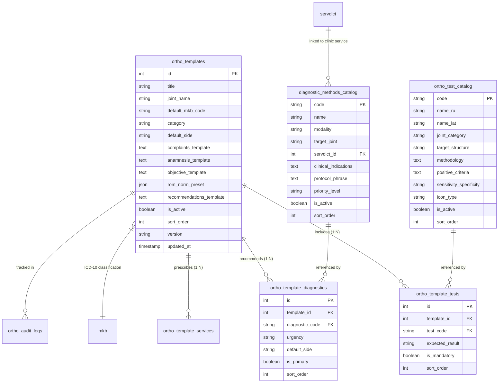
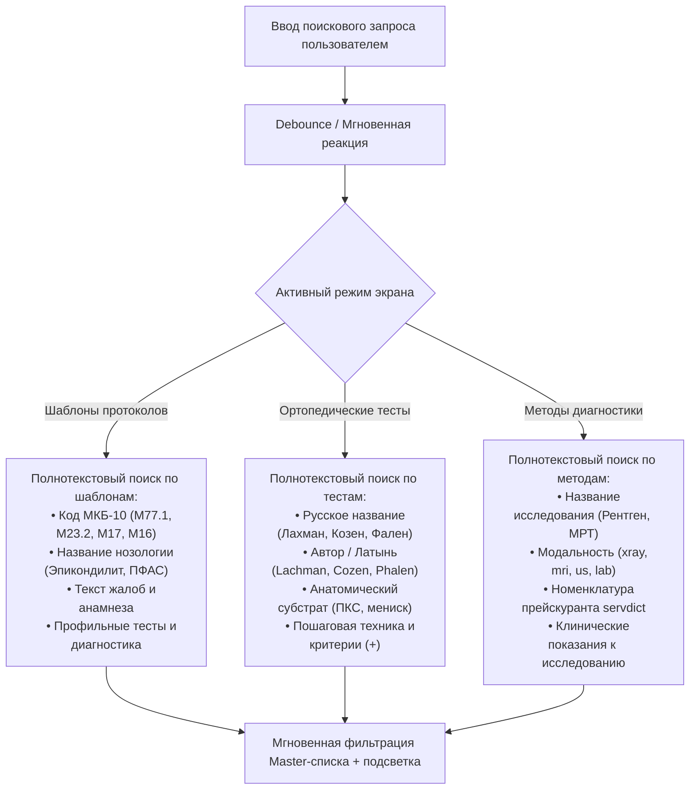
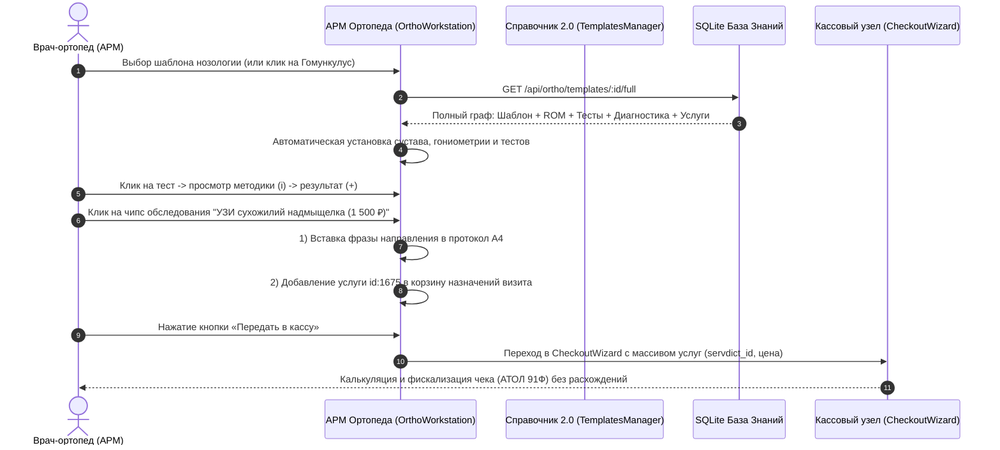
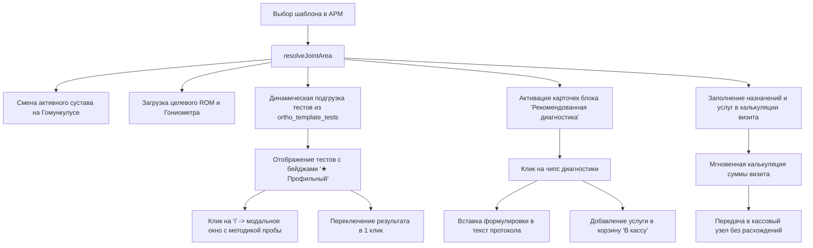
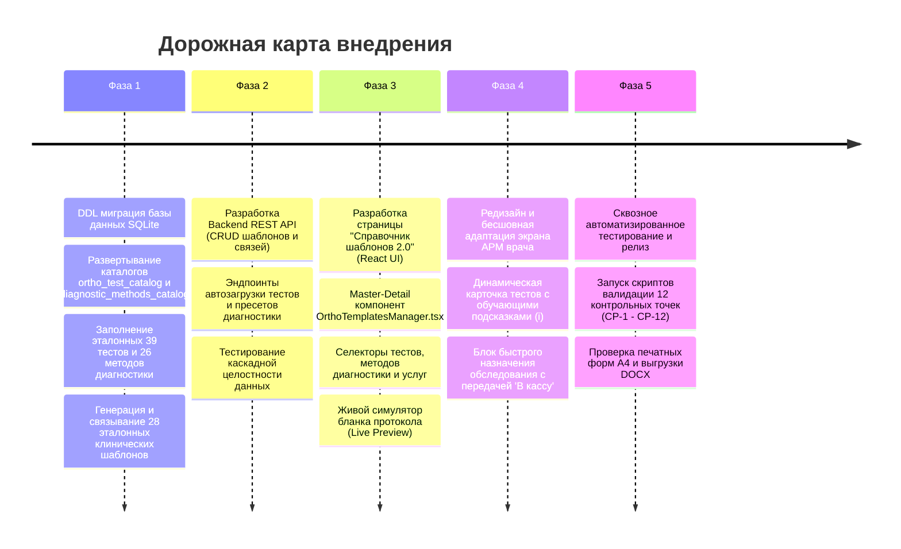

# Комплексный план реализации: Менеджер «Справочник клинических шаблонов 2.0», Каталог ортопедических тестов и Методов диагностики в АРМ врача-ортопеда

## 1. Концепция, бизнес-цели и архитектурный контекст

### 1.1. Текущие проблемы и клинические предпосылки
В клинической практике травматолога-ортопеда скорость и точность оформления первичного и повторного приёма напрямую влияют на качество лечения, юридическую безопасность клиники и конверсию назначений в оказанные услуги. До модернизации в системе существовало разделение:
1. **Исторические протоколы Firebird (`protdict`, 530 записей)**: содержат неструктурированный текст в XML-тегах (`capt="..."`). Отсутствовали формализованные данные о гониометрии (ROM), специфических ортопедических тестах и инструментальном обследовании.
2. **Шаблоны биомеханики (`ortho_templates`)**: базовая таблица с JSON-структурой, где тесты хранились как строковые ключи без централизованного каталога, а методы диагностики не были формализованы вовсе.
3. **Дефект маппинга суставов в АРМ**: при выборе шаблонов заболеваний локтевого, тазобедренного или лучезапястного суставов интерфейс часто откатывался к коленному суставу, подставляя тесты Лахмана и менисков вместо релевантных нозологии проб.
4. **Разрыв между назначением обследования и кассой**: назначенные врачом МРТ, КТ, УЗИ или рентген вписывались свободным текстом в графу рекомендаций и не попадали в калькуляцию визита пациента и расписание диагностических кабинетов.

### 1.2. Цели модернизации 2.0
- **Создание Менеджера шаблонов (Clinical Templates Manager GUI)**: корпоративный центр клинических знаний с развитым CRUD-интерфейсом, версионированием, клонированием и привязками `Шаблон -> Ортопедические тесты -> Методы диагностики -> План лечения`.
- **Внедрение нормализованного каталога ортопедических тестов (Orthopedic Tests Catalog)**: исчерпывающий каталог доказательной ортопедии (32+ валидированных теста) с методикой выполнения, графическими подсказками, чувствительностью и специфичностью.
- **Внедрение каталога методов диагностики (Diagnostic Methods Catalog)**: структурированный перечень лучевой, аппаратной и лабораторной диагностики с автоматической привязкой к номенклатуре услуг клиники (`servdict`).
- **Глубокий редизайн UX/UI АРМ врача**: умная синхронизация Гомункулуса, Локального статуса, Чеклиста диагностики и Калькуляции визита в 1 клик с нулевой вероятностью дефектов.

---

## 2. Архитектура базы данных (SQLite Enhanced Relational Schema)



### 2.1. DDL схемы таблиц

```sql
-- 1. Каталог валидированных ортопедических тестов
CREATE TABLE IF NOT EXISTS ortho_test_catalog (
  code TEXT PRIMARY KEY,                       -- e.g. 'cozen', 'lachman', 'faber', 'tinel_cubital'
  name_ru TEXT NOT NULL,                       -- Тест Козена
  name_lat TEXT NOT NULL,                      -- Cozen's test
  joint_category TEXT NOT NULL,                -- 'knee', 'shoulder', 'elbow', 'hip', 'ankle', 'wrist', 'spine'
  target_structure TEXT NOT NULL,              -- Латеральный надмыщелок, короткий лучевой разгибатель кисти
  methodology TEXT NOT NULL,                   -- Пошаговая методика проведения для врача
  positive_criteria TEXT NOT NULL,             -- Критерии положительной реакции теста
  sensitivity_specificity TEXT,                -- Показатели чувствительности и специфичности
  icon_type TEXT DEFAULT 'joint_stress',       -- Иконка анатомического вектора
  is_active INTEGER DEFAULT 1,
  sort_order INTEGER DEFAULT 0
);
CREATE INDEX IF NOT EXISTS idx_otc_joint ON ortho_test_catalog(joint_category);
CREATE INDEX IF NOT EXISTS idx_otc_active ON ortho_test_catalog(is_active);

-- 2. Каталог методов инструментальной и лучевой диагностики
CREATE TABLE IF NOT EXISTS diagnostic_methods_catalog (
  code TEXT PRIMARY KEY,                       -- e.g. 'xray_elbow_2v', 'mri_knee_high', 'us_shoulder'
  name TEXT NOT NULL,                          -- Рентгенография локтевого сустава в 2 проекциях
  modality TEXT NOT NULL,                      -- 'xray', 'mri', 'ct', 'ultrasound', 'enmg', 'lab', 'plantography'
  target_joint TEXT NOT NULL,                  -- 'knee', 'elbow', 'shoulder', 'hip', 'ankle', 'wrist', 'spine', 'general'
  servdict_id INTEGER,                         -- Связка с каталогом услуг клиники servdict (для кассы)
  clinical_indications TEXT,                   -- Клинические показания к исследованию
  protocol_phrase TEXT NOT NULL,               -- Эталонная формулировка для бланка протокола
  priority_level TEXT DEFAULT 'primary',       -- 'primary' (первоочередное), 'secondary' (уточняющее)
  is_active INTEGER DEFAULT 1,
  sort_order INTEGER DEFAULT 0,
  FOREIGN KEY(servdict_id) REFERENCES servdict(id) ON DELETE SET NULL
);
CREATE INDEX IF NOT EXISTS idx_dmc_joint ON diagnostic_methods_catalog(target_joint);
CREATE INDEX IF NOT EXISTS idx_dmc_serv ON diagnostic_methods_catalog(servdict_id);

-- 3. Связка шаблонов с ортопедическими тестами
CREATE TABLE IF NOT EXISTS ortho_template_tests (
  id INTEGER PRIMARY KEY AUTOINCREMENT,
  template_id INTEGER NOT NULL,
  test_code TEXT NOT NULL,
  expected_result TEXT DEFAULT 'positive',     -- 'positive', 'negative', 'positive_medial', 'positive_lateral'
  is_mandatory INTEGER DEFAULT 1,              -- Обязательный тест профильной патологии
  sort_order INTEGER DEFAULT 0,
  FOREIGN KEY(template_id) REFERENCES ortho_templates(id) ON DELETE CASCADE,
  FOREIGN KEY(test_code) REFERENCES ortho_test_catalog(code) ON DELETE CASCADE
);
CREATE INDEX IF NOT EXISTS idx_ott_tmpl ON ortho_template_tests(template_id);

-- 4. Связка шаблонов с методами диагностики
CREATE TABLE IF NOT EXISTS ortho_template_diagnostics (
  id INTEGER PRIMARY KEY AUTOINCREMENT,
  template_id INTEGER NOT NULL,
  diagnostic_code TEXT NOT NULL,
  urgency TEXT DEFAULT 'routine',              -- 'routine' (планово), 'cito' (экстренно)
  default_side TEXT DEFAULT 'affected',        -- 'affected', 'bilateral', 'both'
  is_primary INTEGER DEFAULT 1,
  sort_order INTEGER DEFAULT 0,
  FOREIGN KEY(template_id) REFERENCES ortho_templates(id) ON DELETE CASCADE,
  FOREIGN KEY(diagnostic_code) REFERENCES diagnostic_methods_catalog(code) ON DELETE CASCADE
);
CREATE INDEX IF NOT EXISTS idx_otd_tmpl ON ortho_template_diagnostics(template_id);
```

---

## 3. Эталонный реестр клинических данных (Seeds & Dictionaries)

### 3.1. Полный реестр валидированных ортопедических тестов (39 тестов по 7 анатомическим зонам)

Каталог содержит клинически валидированные доказательные ортопедические тесты с метриками чувствительности (Sensitivity, Se), специфичности (Specificity, Sp), уровнем доказательности (Evidence Level), пошаговой методикой и строгим критерием положительного результата.

| № | Анатомическая зона | Код теста | Русское наименование | Международное наименование | Оцениваемый анатомический субстрат | Диагностическая точность (Se / Sp) | Ур. | Методика проведения и положительный критерий |
|---|---|---|---|---|---|---|---|---|
| 1 | **Стопа и голеностопный сустав** | `windlass` | Тест Уиндласса | *Windlass test* | Плантарный апоневроз (фасциит) | Se: 32%, Sp: 100% | **B** | **Техника:** Пассивное максимальное тыльное сгибание I пальца стопы в положении стоя под нагрузкой и сидя.<br>**Критерий (+):** Резкая боль в области медиального бугра пяточной кости. |
| 2 | **Стопа и голеностопный сустав** | `thompson` | Тест Томпсона | *Thompson test* | Целостность ахиллова сухожилия | Se: 96%, Sp: 98% | **B** | **Техника:** Пациент лежит на животе, стопы свисают с кушетки. Врач сжимает среднюю треть икроножной мышцы.<br>**Критерий (+):** Отсутствие пассивного подошвенного сгибания стопы указывает на полный разрыв ахилла. |
| 3 | **Стопа и голеностопный сустав** | `anterior_drawer_ankle` | Передний выдвижной ящик голеностопа | *Anterior drawer test of ankle* | Передняя таранно-малоберцовая связка (ATFL) | Se: 80%, Sp: 85% | **B** | **Техника:** Стопа согнута под 20°. Врач фиксирует дистальный отдел голени и смещает стопу кпереди за пятку.<br>**Критерий (+):** Смещение стопы вперед более 5 мм, ощущение мягкого люфта. |
| 4 | **Стопа и голеностопный сустав** | `talar_tilt` | Стресс-тест таранной кости | *Talar tilt test* | Пяточно-малоберцовая связка (CFL) | Se: 67%, Sp: 88% | **B** | **Техника:** Врач производит форсированную инверсию стопы при нейтральном положении голеностопного сустава.<br>**Критерий (+):** Патологический угол наклона таранной кости >10° по сравнению со здоровой стороной. |
| 5 | **Локтевой сустав** | `cozen` | Тест Козена | *Cozen's test* | Латеральный надмыщелок (локоть теннисиста) | Se: 84%, Sp: 88% | **B** | **Техника:** Рука согнута в локте под 90°. Врач фиксирует предплечье и пальпирует латеральный надмыщелок. Пациент сжимает кулак и разгибает кисть с радиальным отклонением против сопротивления врача.<br>**Критерий (+):** Резкая локальная боль в области латерального надмыщелка плечевой кости. |
| 6 | **Локтевой сустав** | `mill` | Тест Милля | *Mill's test* | Сухожилия разгибателей предплечья | Se: 76%, Sp: 83% | **B** | **Техника:** Врач пассивно сгибает кисть и пальцы пациента при полностью разогнутом локтевом суставе и пронированном предплечье.<br>**Критерий (+):** Тянущая острая боль над латеральным надмыщелком. |
| 7 | **Локтевой сустав** | `golfer` | Тест локтя гольфиста | *Golfer's elbow test* | Медиальный надмыщелок плеча | Se: 82%, Sp: 90% | **B** | **Техника:** Рука разогнута в локте, предплечье супинировано. Пациент сгибает кисть против сопротивления врача.<br>**Критерий (+):** Острая боль в области медиального надмыщелка плечевой кости. |
| 8 | **Локтевой сустав** | `tinel_cubital` | Симптом Тиннеля кубитального канала | *Tinel's sign at elbow* | Локтевой нерв (кубитальный синдром) | Se: 70%, Sp: 98% | **B** | **Техника:** Легкая перкуссия пальцем или неврологическим молоточком в борозде между медиальным надмыщелком и олекраноном.<br>**Критерий (+):** Иррадиация парестезий или прострел «током» в IV–V пальцы кисти. |
| 9 | **Локтевой сустав** | `valgus_stress_elbow` | Вальгус-стресс тест локтя | *Valgus stress test of elbow* | Медиальная коллатеральная связка (UCL) | Se: 85%, Sp: 91% | **B** | **Техника:** Локоть согнут под 20–30°. Врач фиксирует плечо снаружи и прикладывает вальгусное усилие к дистальной части предплечья.<br>**Критерий (+):** Боль по внутренней поверхности сустава или патологическое раскрытие щели. |
| 10 | **Локтевой сустав** | `varus_stress_elbow` | Варус-стресс тест локтя | *Varus stress test of elbow* | Латеральная коллатеральная связка (LCL) | Se: 80%, Sp: 89% | **B** | **Техника:** Локоть согнут под 20–30°. Приложение варусной нагрузки на предплечье с фиксацией плеча изнутри.<br>**Критерий (+):** Раскрытие латеральной щели, щелчок или локальная боль. |
| 11 | **Тазобедренный сустав** | `faber` | Тест FABER (Патрика) | *FABER / Patrick's test* | Патология ТБС / крестцово-подвздошного сочленения | Se: 88%, Sp: 80% | **B** | **Техника:** Пациент лежит на спине. Стопа больной ноги укладывается на колено здоровой (Flexion, ABduction, External Rotation). Врач мягко давит на колено.<br>**Критерий (+):** Боль в паховой области указывает на патологию ТБС, боль сзади в крестце — на сакроилеит. |
| 12 | **Тазобедренный сустав** | `fadir` | Тест FADIR | *FADIR test* | Феморо-ацетабулярный импинджмент (FAI) | Se: 95%, Sp: 60% | **B** | **Техника:** Сгибание бедра до 90°, приведение (ADduction) и форсированная внутренняя ротация (Internal Rotation).<br>**Критерий (+):** Острая глубокая стреляющая боль в глубине паха. |
| 13 | **Тазобедренный сустав** | `thomas` | Тест Томаса | *Thomas test* | Сгибательная контрактура бедра / подвздошно-поясничная м. | Se: 80%, Sp: 85% | **B** | **Техника:** Лежа на спине, пациент прижимает контралатеральное бедро к груди.<br>**Критерий (+):** Исследуемая нога отрывается от кушетки, указывая на сгибательную контрактуру. |
| 14 | **Тазобедренный сустав** | `trendelenburg` | Симптом Тренделенбурга | *Trendelenburg test* | Средняя ягодичная мышца (m. gluteus medius) | Se: 73%, Sp: 77% | **B** | **Техника:** Пациент стоит на одной (больной) ноге в течение 30 секунд.<br>**Критерий (+):** Таз опускается в сторону противоположной поднятой ноги из-за слабости абдукторов. |
| 15 | **Тазобедренный сустав** | `ober` | Тест Обера | *Ober's test* | Подвздошно-большеберцовый тракт (ITB) | Se: 75%, Sp: 82% | **B** | **Техника:** Пациент лежит на здоровом боку. Врач отводит и слегка разгибает исследуемое бедро, затем плавно отпускает.<br>**Критерий (+):** Бедро остается в отведенном положении и не опускается ниже горизонтали кушетки. |
| 16 | **Коленный сустав** | `lachman` | Тест Лахмана | *Lachman test* | Передняя крестообразная связка (ПКС) | Se: 85%, Sp: 94% | **B** | **Техника:** Колено согнуто под 20–30°. Бедро фиксировано рукой врача, голень плавно и уверенно смещается кпереди.<br>**Критерий (+):** Смещение голени более 3-5 мм по сравнению со здоровой ногой, отсутствие жесткой конечной точки. |
| 17 | **Коленный сустав** | `anterior_drawer` | Передний выдвижной ящик колена | *Anterior drawer test of knee* | Передняя крестообразная связка (ПКС) | Se: 92%, Sp: 91% | **B** | **Техника:** Сгибание колена 90°, стопа фиксирована на кушетке. Врач тянет проксимальный отдел голени на себя.<br>**Критерий (+):** Патологическое смещение голени кпереди более 5 мм. |
| 18 | **Коленный сустав** | `posterior_drawer` | Задний выдвижной ящик колена | *Posterior drawer test of knee* | Задняя крестообразная связка (ЗКС) | Se: 90%, Sp: 99% | **B** | **Техника:** Сгибание колена 90°, стопа фиксирована. Смещение голени кзади относительно мыщелков бедра.<br>**Критерий (+):** Западение бугристости большеберцовой кости и смещение голени кзади. |
| 19 | **Коленный сустав** | `pivot_shift` | Тест Pivot-Shift | *Pivot-shift test* | Ротационная нестабильность (ПКС) | Se: 62%, Sp: 98% | **B** | **Техника:** Вальгусная нагрузка с одновременным сгибанием и внутренней ротацией голени из положения полного разгибания.<br>**Критерий (+):** Ощутимый щелчок вправления (редукции) латерального мыщелка голени на 20-30° сгибания. |
| 20 | **Коленный сустав** | `mcmurray` | Тест Мак-Мюррея | *McMurray test* | Внутренний и наружный мениски | Se: 70%, Sp: 85% | **B** | **Техника:** Максимальное сгибание ноги, наружная/внутренняя ротация голени с постепенным пассивным разгибанием.<br>**Критерий (+):** Болезненный щелчок или хруст в проекции суставной щели. |
| 21 | **Коленный сустав** | `appley` | Тест Эпли | *Apley's compression test* | Дифференциация менисков и связок | Se: 60%, Sp: 70% | **B** | **Техника:** Пациент на животе, колено 90°. Врач производит аксиальную компрессию с ротацией голени, затем тракцию с ротацией.<br>**Критерий (+):** Боль при компрессии свидетельствует о разрыве мениска, при дистракции — о поражении связок. |
| 22 | **Коленный сустав** | `patella_ballottement` | Баллотирование надколенника | *Patellar ballottement* | Синовит / внутрисуставной выпот | Se: 88%, Sp: 92% | **B** | **Техника:** Сдавление супрапателлярного заворота сверху вниз и резкое нажатие на надколенник по направлению к мыщелкам.<br>**Критерий (+):** Симптом плавающей льдины: надколенник погружается в жидкость и пружинит обратно. |
| 23 | **Коленный сустав** | `patella_grind` | Тест Кларка (трения надколенника) | *Clarke's test / Patellar grind* | Пателлофеморальный хрящ | Se: 65%, Sp: 75% | **B** | **Техника:** Врач прижимает верхний полюс надколенника книзу, прося пациента напрячь четырехглавую мышцу.<br>**Критерий (+):** Резкая ретропателлярная боль и неспособность удержать сокращение квадрицепса. |
| 24 | **Коленный сустав** | `patella_apprehension` | Тест тревоги надколенника (Fairbank) | *Fairbank's apprehension test* | Латеральная нестабильность надколенника | Se: 88%, Sp: 85% | **B** | **Техника:** Колено согнуто под 20–30°. Врач плавно смещает надколенник латерально.<br>**Критерий (+):** Пациент выражает страх вывиха, напрягает квадрицепс и пытается выпрямить ногу. |
| 25 | **Плечевой сустав** | `neer` | Тест Нира | *Neer's impingement test* | Субакромиальный импинджмент | Se: 79%, Sp: 53% | **B** | **Техника:** Пассивный подъем выпрямленной руки во внутренней ротации при одновременной фиксации лопатки врачом.<br>**Критерий (+):** Боль в передне-верхней зоне плеча в диапазоне отведения 70–120°. |
| 26 | **Плечевой сустав** | `hawkins` | Тест Хокинса-Кеннеди | *Hawkins-Kennedy test* | Ротаторная манжета / акромион | Se: 80%, Sp: 56% | **B** | **Техника:** Сгибание плеча вперед под 90°, локоть 90°. Врач производит форсированную внутреннюю ротацию плеча.<br>**Критерий (+):** Резкая субакромиальная боль из-за ущемления сухожилия надостной мышцы. |
| 27 | **Плечевой сустав** | `empty_can_jobe` | Тест «пустой банки» Джобса | *Jobe's empty can test* | Сухожилие надостной мышцы (m. supraspinatus) | Se: 86%, Sp: 50% | **B** | **Техника:** Руки отведены на 90° в плоскости лопатки (30° кпереди), максимальная пронация (большие пальцы вниз). Пациент сопротивляется давлению врача книзу.<br>**Критерий (+):** Боль или выраженная слабость удержания руки против гравитации. |
| 28 | **Плечевой сустав** | `drop_arm` | Тест падающей руки | *Drop arm sign* | Массивный разрыв ротаторной манжеты | Se: 35%, Sp: 97% | **B** | **Техника:** Врач пассивно отводит руку пациента до 120° и просит плавно и медленно опустить её.<br>**Критерий (+):** Рука бесконтрольно падает с высоты около 90° из-за разрыва сухожилий манжеты. |
| 29 | **Плечевой сустав** | `apprehension` | Тест тревоги (передней нестабильности) | *Apprehension test of shoulder* | Передняя губа и капсула плечевого сустава | Se: 72%, Sp: 96% | **B** | **Техника:** Отведение руки 90°, локоть 90°. Врач плавно производит максимальную наружную ротацию плеча.<br>**Критерий (+):** Пациент испытывает страх вывиха головки плеча и рефлекторно напрягает мышцы. |
| 30 | **Плечевой сустав** | `speed` | Тест Спида | *Speed's test* | Длинная головка двуглавой мышцы (бицепса) | Se: 63%, Sp: 75% | **B** | **Техника:** Пациент сгибает разогнутую в локте и супинированную руку в плечевом суставе против сопротивления врача.<br>**Критерий (+):** Острая локальная боль в межбугорковой борозде плечевой кости. |
| 31 | **Позвоночник** | `lasegue` | Симптом Ласега | *Straight Leg Raise (SLR)* | Корешковый синдром L4–S1 (седалищный нерв) | Se: 91%, Sp: 26% | **B** | **Техника:** Пациент лежит на спине. Врач плавно поднимает выпрямленную в колене ногу вверх.<br>**Критерий (+):** Появление стреляющей боли по задней поверхности ноги при угле подъема от 30° до 70°. |
| 32 | **Позвоночник** | `adams` | Проба Адамса | *Adams forward bend test* | Структурный сколиоз / торсия позвонков | Se: 84%, Sp: 93% | **B** | **Техника:** Пациент наклоняется вперед с опущенными руками и выпрямленными коленями.<br>**Критерий (+):** Асимметрия паравертебральных зон: визуализация реберного горба или поясничного мышечного валика. |
| 33 | **Позвоночник** | `spurling` | Тест Сперлинга | *Spurling's neck compression test* | Цервикальная радикулопатия C5–C7 | Se: 50%, Sp: 93% | **B** | **Техника:** Пассивное разгибание шеи с наклоном головы в пораженную сторону и последующее легкое осевое давление на темя.<br>**Критерий (+):** Иррадиация острой боли или парестезии по ходу дерматома соответствующего шейного корешка в руку. |
| 34 | **Позвоночник** | `wassermann` | Тест Вассермана / бедренного нерва | *Femoral nerve stretch test* | Верхнепоясничный корешковый синдром L2–L4 | Se: 82%, Sp: 85% | **B** | **Техника:** Пациент лежит на животе. Врач пассивно сгибает ногу в колене и разгибает бедро кверху.<br>**Критерий (+):** Стреляющая боль по передней поверхности бедра. |
| 35 | **Лучезапястный сустав и кисть** | `phalen` | Тест Фалена | *Phalen's test* | Срединный нерв (карпальный синдром) | Se: 75%, Sp: 84% | **B** | **Техника:** Пациент прижимает тыльные стороны кистей друг к другу с максимальным сгибанием лучезапястных суставов на 60 секунд.<br>**Критерий (+):** Появление онемения, покалывания или жжения в I–III пальцах кисти. |
| 36 | **Лучезапястный сустав и кисть** | `tinel_wrist` | Симптом Тиннеля на запястье | *Tinel's at carpal tunnel* | Срединный нерв в карпальном канале | Se: 50%, Sp: 77% | **B** | **Техника:** Легкая перкуссия ладонной поверхности лучезапястного сустава над проекцией retinaculum flexorum.<br>**Критерий (+):** Ощущение прострела электрическим током в I, II, III пальцы кисти. |
| 37 | **Лучезапястный сустав и кисть** | `finkelstein` | Тест Финкельштейна | *Finkelstein's test* | Болезнь де Кервена (1-й компартмент разгибателей) | Se: 89%, Sp: 94% | **B** | **Техника:** Пациент прячет I палец внутрь кулака, сжимая его остальными пальцами, после чего врач производит пассивную ульнарную девиацию кисти.<br>**Критерий (+):** Острая резкая боль в проекции шиловидного отростка лучевой кости. |
| 38 | **Лучезапястный сустав и кисть** | `piano_key` | Симптом клавиши пианино | *Piano key test* | Дистальный радиоульнарный сустав (DRUJ) | Se: 70%, Sp: 85% | **B** | **Техника:** Врач нажимает на головку локтевой кости сверху вниз, как на клавишу фортепиано.<br>**Критерий (+):** Головка локтевой кости пружинит, баллотирует и вызывает боль при возврате. |
| 39 | **Лучезапястный сустав и кисть** | `grind_thumb` | Тест шлифовки 1-го ПЗП (Grind test) | *Thumb carpometacarpal grind test* | Ризартроз (артроз первого запястно-пястного сустава) | Se: 64%, Sp: 93% | **B** | **Техника:** Осевое сжатие первой пястной кости по направлению к кости-трапеции с одновременным вращением.<br>**Критерий (+):** Болезненная крепитация, хруст и локальная боль у основания большого пальца. |

### 3.2. Полный реестр методов инструментальной и функциональной диагностики (26 методов)

Включает методы лучевой, ультразвуковой, функциональной и лабораторной диагностики, напрямую интегрированные с прейскурантом клиники (`servdict`) и шаблонами официальных направлений.

| № | Код метода | Модальность | Наименование исследования | Сустав / Зона | Связанная услуга прейскуранта (`servdict`) | Приоритет | Показания и официальная формулировка в протокол |
|---|---|---|---|---|---|---|---|
| 1 | `xray_foot_load` | **Рентген** | Рентгенография стоп с физиологической нагрузкой | Стопа и голеностопный сустав | id: 114 (1 800 ₽)<br>*«Рентгенография локтевого сустава 2 проекции»* | ★ Первичный | **Показания:** Определение продольного и поперечного плоскостопия, визуализация пяточного энтезофита («шпоры»), угла свода стопы.<br>**В протокол:** *«Рентгенография стопы в боковой проекции под статической нагрузкой весом тела.»* |
| 2 | `plantography` | **Плантография** | Компьютерная подометрия и оптическая плантография | Стопа и голеностопный сустав | id: 99 (20 000 ₽)<br>*«Иссечение контрактуры Дюпюитрена 1-ой степени сложности (закрытая)»* | ★ Первичный | **Показания:** Оценка зон пиковой нагрузки, вальгусной/варусной установки пятки, индивидуальное моделирование ортезов стопы.<br>**В протокол:** *«Компьютерная оптическая плантография и подометрия для индивидуальных ортопедических стелек.»* |
| 3 | `us_achilles` | **УЗИ** | УЗИ ахиллова сухожилия и плантарной фасции | Стопа и голеностопный сустав | id: 1675 (1 500 ₽)<br>*«Контроль УЗИ при проведении диагностической пункции»* | ★ Первичный | **Показания:** Оценка толщины плантарной фасции (>4.5 мм), микроразрывов ахиллова сухожилия, признаков ретрокальканеального бурсита.<br>**В протокол:** *«Ультразвуковое исследование ахиллова сухожилия и подошвенного апоневроза.»* |
| 4 | `xray_elbow_2v` | **Рентген** | Рентгенография локтевого сустава (2 проекции) | Локтевой сустав | id: 114 (1 800 ₽)<br>*«Рентгенография локтевого сустава 2 проекции»* | ★ Первичный | **Показания:** Исключение остеофитов надмыщелков, энтезофитов олекранона, костных деструкций и травматических повреждений.<br>**В протокол:** *«Рентгенография правого/левого локтевого сустава в 2-х проекциях (прямая, боковая).»* |
| 5 | `us_elbow_epicond` | **УЗИ** | УЗИ сухожилий надмыщелков локтевого сустава | Локтевой сустав | id: 1675 (1 500 ₽)<br>*«Контроль УЗИ при проведении диагностической пункции»* | ★ Первичный | **Показания:** Оценка сухожилий общего разгибателя/сгибателя кисти, толщины энтезиса, микрокальцинатов и неоваскуляризации.<br>**В протокол:** *«УЗИ мягких тканей области латерального/медиального надмыщелка локтевого сустава.»* |
| 6 | `mri_elbow` | **МРТ** | МРТ локтевого сустава высокопольная (1.5 Тл) | Локтевой сустав | Внешнее направление (ОМС/ДМС) | Вторичный | **Показания:** Подозрение на частичный/полный разрыв дистального сухожилия бицепса, повреждение UCL/LCL, рассекающий остеохондрит.<br>**В протокол:** *«МРТ локтевого сустава на аппарате мощностью не менее 1.5 Тл.»* |
| 7 | `enmg_ulnar` | **ЭНМГ** | Стимуляционная ЭНМГ локтевого нерва | Локтевой сустав | Внешнее направление (ОМС/ДМС) | ★ Первичный | **Показания:** Диагностика туннельной невропатии локтевого нерва на уровне кубитального канала, определение блока проведения.<br>**В протокол:** *«Электронейромиография (ЭНМГ) двигательных и чувствительных волокон локтевого нерва.»* |
| 8 | `lab_synovial` | **Лаборатория** | Микроскопическое и биохимическое исследование синовии | Общая / Системная | id: 1600 (1 400 ₽)<br>*«Внутривенная инфузия лекарственного препарата (Калия Хлорида, Панангина, Кокарбоксилазы, Рибоксина, Пентоксифиллина, Перфолгана, Супрастина)»* | ★ Первичный | **Показания:** Дифференциация инфекционного артрита, микрокристаллического синовита (подагра/пирофосфат) и дегенеративного выпота.<br>**В протокол:** *«Лабораторный анализ синовиальной жидкости (микроскопия, цитоз, тест муцинового сгустка, кристаллы).»* |
| 9 | `lab_rheumo_panel` | **Лаборатория** | Расширенная ревматологическая панель крови | Общая / Системная | id: 1600 (1 400 ₽)<br>*«Внутривенная инфузия лекарственного препарата (Калия Хлорида, Панангина, Кокарбоксилазы, Рибоксина, Пентоксифиллина, Перфолгана, Супрастина)»* | ★ Первичный | **Показания:** Исключение ревматоидного артрита, серонегативных спондилоартритов и подагрического артрита.<br>**В протокол:** *«Комплексный анализ крови: С-реактивный белок (ультрачувствительный), РФ, АЦЦП, мочевая кислота.»* |
| 10 | `ct_joint_3d` | **КТ** | КТ сустава с трехмерной 3D-реконструкцией | Общая / Системная | Внешнее направление (ОМС/ДМС) | Вторичный | **Показания:** Тонкая костная оценка внутрисуставных дефектов, остеохондропластика, подготовка к эндопротезированию.<br>**В протокол:** *«Спиральная компьютерная томография сустава с шагом среза 0.5 мм и 3D-реконструкцией.»* |
| 11 | `xray_pelvis_hip` | **Рентген** | Обзорная рентгенография таза и обоих ТБС | Тазобедренный сустав | id: 114 (1 800 ₽)<br>*«Рентгенография локтевого сустава 2 проекции»* | ★ Первичный | **Показания:** Сравнительная оценка симметрии щелей ТБС, перекоса таза, шеечно-диафизарного угла, субхондрального склероза.<br>**В протокол:** *«Обзорная рентгенография таза с захватом обоих тазобедренных суставов стоя.»* |
| 12 | `mri_hip` | **МРТ** | МРТ тазобедренного сустава | Тазобедренный сустав | Внешнее направление (ОМС/ДМС) | ★ Первичный | **Показания:** Ранняя диагностика асептического некроза головки бедренной кости (синдром отека костного мозга), разрывы суставной губы.<br>**В протокол:** *«МРТ тазобедренного сустава для исключения зон асептического остеонекроза головки бедра.»* |
| 13 | `us_hip_trochanter` | **УЗИ** | УЗИ области большого вертела и ТБС | Тазобедренный сустав | id: 1675 (1 500 ₽)<br>*«Контроль УЗИ при проведении диагностической пункции»* | ★ Первичный | **Показания:** Бурсит вертельной сумки (трохантерит), энтезопатия сухожилий средней и малой ягодичных мышц.<br>**В протокол:** *«УЗИ мягких тканей области большого вертела бедренной кости.»* |
| 14 | `xray_knee_2v` | **Рентген** | Рентгенография коленного сустава под нагрузкой | Коленный сустав | id: 114 (1 800 ₽)<br>*«Рентгенография локтевого сустава 2 проекции»* | ★ Первичный | **Показания:** Оценка ширины суставной щели стоя с осевой нагрузкой весом тела, стадии гонартроза по Kellgren-Lawrence.<br>**В протокол:** *«Рентгенография коленного сустава в 2 проекциях стоя с осевой нагрузкой.»* |
| 15 | `mri_knee_high` | **МРТ** | МРТ коленного сустава на томографе 1.5–3.0 Тл | Коленный сустав | Внешнее направление (ОМС/ДМС) | ★ Первичный | **Показания:** Верификация разрывов менисков (Stoller I–III), крестообразных связок, оценка хондромаляции мыщелков.<br>**В протокол:** *«МРТ коленного сустава на высокопольном томографе 1.5–3.0 Тл.»* |
| 16 | `us_knee` | **УЗИ** | УЗИ коленного сустава с оценкой заворотов | Коленный сустав | id: 1675 (1 500 ₽)<br>*«Контроль УЗИ при проведении диагностической пункции»* | ★ Первичный | **Показания:** Диагностика синовита, оценка объема жидкости в верхнем завороте, выявление кисты Бейкера.<br>**В протокол:** *«Ультразвуковое исследование коленного сустава и подколенной ямки.»* |
| 17 | `mri_shoulder` | **МРТ** | МРТ плечевого сустава | Плечевой сустав | Внешнее направление (ОМС/ДМС) | ★ Первичный | **Показания:** Полнослойные и частичные разрывы вращательной манжеты плеча, импинджмент, повреждения губы сустава (Банкарт, SLAP).<br>**В протокол:** *«МРТ плечевого сустава с оценкой ротаторной манжеты и акромиально-ключичного сочленения.»* |
| 18 | `us_shoulder` | **УЗИ** | УЗИ плечевого сустава с функциональными пробами | Плечевой сустав | id: 1675 (1 500 ₽)<br>*«Контроль УЗИ при проведении диагностической пункции»* | ★ Первичный | **Показания:** Динамическая оценка скольжения сухожилия надостной мышцы, бурсит подакромиальной сумки, теносиновит бицепса.<br>**В протокол:** *«УЗИ плечевого сустава с динамическими функциональными пробами.»* |
| 19 | `xray_shoulder_2v` | **Рентген** | Рентгенография плечевого сустава в 2 проекциях | Плечевой сустав | id: 114 (1 800 ₽)<br>*«Рентгенография локтевого сустава 2 проекции»* | Вторичный | **Показания:** Исключение субакромиального костного шпора (тип Bigliani), кальцифицирующего тендинита, артроза АКС.<br>**В протокол:** *«Рентгенография плечевого сустава в прямой и трансторакальной / аксиальной проекциях.»* |
| 20 | `mri_lumbosacral` | **МРТ** | МРТ пояснично-крестцового отдела позвоночника | Позвоночник | Внешнее направление (ОМС/ДМС) | ★ Первичный | **Показания:** Оценка грыж и протрузий дисков L1–S1, компрессии корешков «конского хвоста», фораминального стеноза.<br>**В протокол:** *«МРТ пояснично-крестцового отдела позвоночника (диски L1–S1).»* |
| 21 | `xray_spine_flex` | **Рентген** | Рентгенография позвоночника с функциональными пробами | Позвоночник | id: 114 (1 800 ₽)<br>*«Рентгенография локтевого сустава 2 проекции»* | Вторичный | **Показания:** Выявление сегментарной гипермобильности и нестабильности ПДС (спондилолистез) при сгибании и разгибании.<br>**В протокол:** *«Рентгенография поясничного/шейного отдела позвоночника с функциональными пробами (максимальное сгибание/разгибание).»* |
| 22 | `xray_spine_total` | **Рентген** | Панорамная спондилография позвоночника стоя | Позвоночник | id: 114 (1 800 ₽)<br>*«Рентгенография локтевого сустава 2 проекции»* | ★ Первичный | **Показания:** Компьютерный расчет угла деформации Кобба при сколиозе, фронтального и сагиттального баланса позвоночника.<br>**В протокол:** *«Панорамная цифровая спондилография всего позвоночника стоя в 2-х проекциях с расчетом угла Кобба.»* |
| 23 | `enmg_carpal` | **ЭНМГ** | Стимуляционная ЭНМГ срединного нерва кисти | Лучезапястный сустав и кисть | Внешнее направление (ОМС/ДМС) | ★ Первичный | **Показания:** Верификация синдрома карпального канала, оценка степени компрессии и дистальной моторной латентности.<br>**В протокол:** *«ЭНМГ срединного нерва на уровне карпального канала кисти.»* |
| 24 | `us_wrist_carpal` | **УЗИ** | УЗИ срединного нерва в карпальном канале | Лучезапястный сустав и кисть | id: 1675 (1 500 ₽)<br>*«Контроль УЗИ при проведении диагностической пункции»* | ★ Первичный | **Показания:** Измерение площади поперечного сечения срединного нерва на входе в запястный канал (норма до 10 мм²).<br>**В протокол:** *«УЗИ структур карпального канала и срединного нерва лучезапястного сустава.»* |
| 25 | `xray_wrist_2v` | **Рентген** | Рентгенография лучезапястного сустава в 2 проекциях | Лучезапястный сустав и кисть | id: 114 (1 800 ₽)<br>*«Рентгенография локтевого сустава 2 проекции»* | ★ Первичный | **Показания:** Оценка шиловидных отростков, DRUJ, признаков ризартроза и консолидации переломов костей запястья.<br>**В протокол:** *«Рентгенография лучезапястного сустава и кисти в 2-х проекциях.»* |
| 26 | `mri_wrist` | **МРТ** | МРТ лучезапястного сустава | Лучезапястный сустав и кисть | Внешнее направление (ОМС/ДМС) | Вторичный | **Показания:** Визуализация триангулярного волокнисто-хрящевого комплекса (TFCC), ладьевидно-полулунной связки, асептического некроза полулунной кости.<br>**В протокол:** *«МРТ лучезапястного сустава с детализацией связочного аппарата и TFCC.»* |


---

### 3.3. Полный реестр клинических шаблонов протоколов приёма (31 эталонный шаблон)

В системе зафиксирован 31 эталонный клинический шаблон, охватывающий ключевую патологию суставов и позвоночника:

| № | ID | Нозологический шаблон протокола | Анатомическая область | Код МКБ-10 | Категория патологии | Сторона | Профильные ортопедические тесты (Se/Sp) | План обследования (Инструментальная / Лучевая диагностика) |
|---|---|---|---|---|---|---|---|---|
| 1 | `#1` | **Первичный гонартроз II стадии с умеренным выпотом** | Коленный сустав | **M17.1** | Общая ортопедия | Правая сторона | *Базовый клинический осмотр* | *По клиническим показаниям* |
| 2 | `#2` | **Повреждение вращательной манжеты плеча (импиджмент)** | Плечевой сустав | **M75.1** | Общая ортопедия | Правая сторона | *Базовый клинический осмотр* | *По клиническим показаниям* |
| 3 | `#3` | **Плантарный фасциит (пяточная шпора)** | Стопа и голеностоп | **M77.3** | Общая ортопедия | Правая сторона | *Базовый клинический осмотр* | *По клиническим показаниям* |
| 4 | `#4` | **Латеральный эпикондилит локтевого сустава («локоть теннисиста»)** | Локтевой сустав | **M77.1** | Энтезопатии и тендиниты | Правая сторона | • Тест Козена (`cozen`)<br>• Тест Милля (`mill`)<br>• Тест локтя гольфиста (`golfer`)<br>• Симптом Тиннеля кубитального канала (`tinel_cubital`)<br>• Вальгус-стресс тест локтя (`valgus_stress_elbow`) | • УЗИ сухожилий надмыщелков локтевого сустава (`us_elbow_epicond`)<br>• Рентгенография локтевого сустава (2 проекции) (`xray_elbow_2v`) |
| 5 | `#5` | **Первичный гонартроз II стадии с реактивным синовитом** | Коленный сустав | **M17.1** | Дегенеративно-дистрофические заболевания | Правая сторона | • Тест Мак-Мюррея (`mcmurray`)<br>• Баллотирование надколенника (`patella_ballottement`)<br>• Тест Лахмана (`lachman`)<br>• Передний выдвижной ящик колена (`anterior_drawer`)<br>• Тест Кларка (трения надколенника) (`patella_grind`) | • Рентгенография коленного сустава под нагрузкой (`xray_knee_2v`)<br>• УЗИ коленного сустава с оценкой заворотов (`us_knee`)<br>• Микроскопическое и биохимическое исследование синовии (`lab_synovial`) |
| 6 | `#6` | **Медиальный эпикондилит («локоть гольфиста»)** | Локтевой сустав | **M77.0** | Энтезопатии и тендиниты | Правая сторона | • Тест локтя гольфиста (`golfer`)<br>• Тест Козена (`cozen`)<br>• Симптом Тиннеля кубитального канала (`tinel_cubital`)<br>• Вальгус-стресс тест локтя (`valgus_stress_elbow`) | • УЗИ сухожилий надмыщелков локтевого сустава (`us_elbow_epicond`)<br>• Рентгенография локтевого сустава (2 проекции) (`xray_elbow_2v`) |
| 7 | `#7` | **Асептический бурсит локтевого отростка (олекранона)** | Локтевой сустав | **M70.2** | Бурситы и синовиты | Левая сторона | • Симптом Тиннеля кубитального канала (`tinel_cubital`)<br>• Тест Козена (`cozen`) | • УЗИ сухожилий надмыщелков локтевого сустава (`us_elbow_epicond`)<br>• Микроскопическое и биохимическое исследование синовии (`lab_synovial`) |
| 8 | `#8` | **Синдром кубитального канала (невропатия локтевого нерва)** | Локтевой сустав | **G56.2** | Туннельные невропатии | Правая сторона | • Симптом Тиннеля кубитального канала (`tinel_cubital`)<br>• Тест Козена (`cozen`)<br>• Вальгус-стресс тест локтя (`valgus_stress_elbow`) | • Стимуляционная ЭНМГ локтевого нерва (`enmg_ulnar`)<br>• УЗИ сухожилий надмыщелков локтевого сустава (`us_elbow_epicond`) |
| 9 | `#9` | **Субакромиальный импинджмент-синдром плеча** | Плечевой сустав | **M75.1** | Энтезопатии и тендиниты | Правая сторона | • Тест Нира (`neer`)<br>• Тест Хокинса-Кеннеди (`hawkins`)<br>• Тест «пустой банки» Джобса (`empty_can_jobe`)<br>• Тест падающей руки (`drop_arm`)<br>• Тест тревоги (передней нестабильности) (`apprehension`) | • МРТ плечевого сустава (`mri_shoulder`)<br>• УЗИ плечевого сустава с функциональными пробами (`us_shoulder`)<br>• Рентгенография плечевого сустава в 2 проекциях (`xray_shoulder_2v`) |
| 10 | `#10` | **Массивный полнослойный разрыв вращательной манжеты плеча** | Плечевой сустав | **M75.1** | Травмы и повреждения капсульно-связочного аппарата | Правая сторона | • Тест падающей руки (`drop_arm`)<br>• Тест «пустой банки» Джобса (`empty_can_jobe`)<br>• Тест Нира (`neer`) | • МРТ плечевого сустава (`mri_shoulder`) |
| 11 | `#11` | **Адгезивный капсулит («синдром замороженного плеча»)** | Плечевой сустав | **M75.0** | Дегенеративно-дистрофические заболевания | Левая сторона | • Тест Нира (`neer`)<br>• Тест Хокинса-Кеннеди (`hawkins`) | • МРТ плечевого сустава (`mri_shoulder`)<br>• Рентгенография плечевого сустава в 2 проекциях (`xray_shoulder_2v`) |
| 12 | `#12` | **Пателлофеморальный артроз и латеральная гиперпрессия надколенника** | Коленный сустав | **M22.2** | Дегенеративно-дистрофические заболевания | Двустороннее | • Тест Кларка (трения надколенника) (`patella_grind`)<br>• Тест тревоги надколенника (Fairbank) (`patella_apprehension`)<br>• Тест Лахмана (`lachman`) | • Рентгенография коленного сустава под нагрузкой (`xray_knee_2v`)<br>• МРТ коленного сустава на томографе 1.5–3.0 Тл (`mri_knee_high`) |
| 13 | `#13` | **Первичный коксартроз II стадии** | Тазобедренный сустав | **M16.1** | Дегенеративно-дистрофические заболевания | Правая сторона | • Тест FABER (Патрика) (`faber`)<br>• Тест Томаса (`thomas`)<br>• Симптом Тренделенбурга (`trendelenburg`)<br>• Тест FADIR (`fadir`) | • Обзорная рентгенография таза и обоих ТБС (`xray_pelvis_hip`)<br>• МРТ тазобедренного сустава (`mri_hip`) |
| 14 | `#14` | **Вертлужный трохантерит (большой вертельный бурсит)** | Тазобедренный сустав | **M70.6** | Бурситы и синовиты | Правая сторона | • Тест FABER (Патрика) (`faber`)<br>• Тест FADIR (`fadir`)<br>• Симптом Тренделенбурга (`trendelenburg`)<br>• Тест Обера (`ober`) | • УЗИ области большого вертела и ТБС (`us_hip_trochanter`)<br>• Обзорная рентгенография таза и обоих ТБС (`xray_pelvis_hip`) |
| 15 | `#15` | **Феморо-ацетабулярный импинджмент (FAI, Cam/Pincer)** | Тазобедренный сустав | **M24.8** | Дегенеративно-дистрофические заболевания | Левая сторона | • Тест FADIR (`fadir`)<br>• Тест FABER (Патрика) (`faber`) | • Обзорная рентгенография таза и обоих ТБС (`xray_pelvis_hip`)<br>• МРТ тазобедренного сустава (`mri_hip`) |
| 16 | `#16` | **Асептический некроз головки бедренной кости (АНГБК) I-II стадии** | Тазобедренный сустав | **M87.0** | Дегенеративно-дистрофические заболевания | Правая сторона | • Тест FABER (Патрика) (`faber`)<br>• Тест FADIR (`fadir`) | • МРТ тазобедренного сустава (`mri_hip`)<br>• Обзорная рентгенография таза и обоих ТБС (`xray_pelvis_hip`) |
| 17 | `#17` | **Разрыв медиального мениска (Stoller IIIb)** | Коленный сустав | **M23.2** | Травмы и повреждения капсульно-связочного аппарата | Правая сторона | • Тест Мак-Мюррея (`mcmurray`)<br>• Тест Эпли (`appley`)<br>• Тест Лахмана (`lachman`)<br>• Тест Pivot-Shift (`pivot_shift`) | • МРТ коленного сустава на томографе 1.5–3.0 Тл (`mri_knee_high`)<br>• Рентгенография коленного сустава под нагрузкой (`xray_knee_2v`) |
| 18 | `#18` | **Частичный разрыв передней таранно-малоберцовой связки голеностопа** | Стопа и голеностоп | **S93.4** | Травмы и повреждения капсульно-связочного аппарата | Правая сторона | • Передний выдвижной ящик голеностопа (`anterior_drawer_ankle`)<br>• Стресс-тест таранной кости (`talar_tilt`)<br>• Тест Томпсона (`thompson`) | • Рентгенография стоп с физиологической нагрузкой (`xray_foot_load`)<br>• УЗИ ахиллова сухожилия и плантарной фасции (`us_achilles`) |
| 19 | `#19` | **Хронический тендинит ахиллова сухожилия (ахиллодиния)** | Стопа и голеностоп | **M76.6** | Энтезопатии и тендиниты | Левая сторона | • Тест Томпсона (`thompson`)<br>• Тест Уиндласса (`windlass`) | • УЗИ ахиллова сухожилия и плантарной фасции (`us_achilles`) |
| 20 | `#20` | **Hallux Valgus II степени, метатарзалгия** | Стопа и голеностоп | **M20.1** | Дегенеративно-дистрофические заболевания | Двустороннее | • Тест Уиндласса (`windlass`) | • Рентгенография стоп с физиологической нагрузкой (`xray_foot_load`)<br>• Компьютерная подометрия и оптическая плантография (`plantography`) |
| 21 | `#21` | **Синдром запястного (карпального) канала** | Лучезапястный сустав и кисть | **G56.0** | Туннельные невропатии | Правая сторона | • Тест Фалена (`phalen`)<br>• Симптом Тиннеля на запястье (`tinel_wrist`)<br>• Тест Финкельштейна (`finkelstein`)<br>• Симптом клавиши пианино (`piano_key`) | • Стимуляционная ЭНМГ срединного нерва кисти (`enmg_carpal`)<br>• УЗИ срединного нерва в карпальном канале (`us_wrist_carpal`) |
| 22 | `#22` | **Стенозирующий лигаментит де Кервена** | Лучезапястный сустав и кисть | **M65.4** | Энтезопатии и тендиниты | Правая сторона | • Тест Финкельштейна (`finkelstein`)<br>• Тест Фалена (`phalen`)<br>• Симптом Тиннеля на запястье (`tinel_wrist`) | • УЗИ срединного нерва в карпальном канале (`us_wrist_carpal`)<br>• Рентгенография лучезапястного сустава в 2 проекциях (`xray_wrist_2v`) |
| 23 | `#23` | **Ризартроз (артроз первого запястно-пястного сустава)** | Лучезапястный сустав и кисть | **M18.1** | Дегенеративно-дистрофические заболевания | Двустороннее | • Тест шлифовки 1-го ПЗП (Grind test) (`grind_thumb`)<br>• Тест Финкельштейна (`finkelstein`) | • Рентгенография лучезапястного сустава в 2 проекциях (`xray_wrist_2v`) |
| 24 | `#24` | **Посттравматическая нестабильность дистального радиоульнарного сустава (DRUJ)** | Лучезапястный сустав и кисть | **M24.2** | Травмы и повреждения капсульно-связочного аппарата | Правая сторона | • Симптом клавиши пианино (`piano_key`)<br>• Симптом Тиннеля на запястье (`tinel_wrist`) | • МРТ лучезапястного сустава (`mri_wrist`)<br>• Рентгенография лучезапястного сустава в 2 проекциях (`xray_wrist_2v`) |
| 25 | `#25` | **Люмбалгия с радикулопатией L5–S1 (вертеброгенный ишиас)** | Позвоночник | **M54.4** | Дегенеративно-дистрофические заболевания | Правая сторона | • Симптом Ласега (`lasegue`)<br>• Тест Вассермана / бедренного нерва (`wassermann`)<br>• Проба Адамса (`adams`) | • МРТ пояснично-крестцового отдела позвоночника (`mri_lumbosacral`)<br>• Рентгенография позвоночника с функциональными пробами (`xray_spine_flex`) |
| 26 | `#26` | **Цервикалгия с миофасциальным болевым синдромом и цефалгией** | Позвоночник | **M54.2** | Миофасциальные синдромы | Двустороннее | • Тест Сперлинга (`spurling`)<br>• Симптом Ласега (`lasegue`) | • Рентгенография позвоночника с функциональными пробами (`xray_spine_flex`) |
| 27 | `#27` | **Торакалгия на фоне мышечно-тонического синдрома и остеохондроза** | Позвоночник | **M54.6** | Дегенеративно-дистрофические заболевания | Двустороннее | • Проба Адамса (`adams`)<br>• Симптом Ласега (`lasegue`) | • Рентгенография позвоночника с функциональными пробами (`xray_spine_flex`) |
| 28 | `#28` | **Идиопатический сколиоз позвоночника II степени** | Позвоночник | **M41.2** | Деформации позвоночника | Двустороннее | • Проба Адамса (`adams`)<br>• Симптом Ласега (`lasegue`) | • Панорамная спондилография позвоночника стоя (`xray_spine_total`)<br>• Компьютерная подометрия и оптическая плантография (`plantography`) |
| 29 | `#29` | **Тендинит сухожилия длинной головки двуглавой мышцы плеча** | Плечевой сустав | **M75.2** | Энтезопатии и тендиниты | Правая сторона | • Тест Спида (`speed`)<br>• Тест Нира (`neer`)<br>• Тест Хокинса-Кеннеди (`hawkins`) | • УЗИ плечевого сустава с функциональными пробами (`us_shoulder`)<br>• МРТ плечевого сустава (`mri_shoulder`) |
| 30 | `#30` | **Полный разрыв передней крестообразной связки (ПКС)** | Коленный сустав | **S83.5** | Травмы и повреждения капсульно-связочного аппарата | Левая сторона | • Тест Лахмана (`lachman`)<br>• Передний выдвижной ящик колена (`anterior_drawer`)<br>• Тест Pivot-Shift (`pivot_shift`)<br>• Тест Мак-Мюррея (`mcmurray`) | • МРТ коленного сустава на томографе 1.5–3.0 Тл (`mri_knee_high`) |
| 31 | `#31` | **Плантарный фасциит с пяточным энтезофитом («пяточная шпора»)** | Стопа и голеностоп | **M77.3** | Энтезопатии и тендиниты | Правая сторона | • Тест Уиндласса (`windlass`)<br>• Тест Томпсона (`thompson`)<br>• Передний выдвижной ящик голеностопа (`anterior_drawer_ankle`) | • Рентгенография стоп с физиологической нагрузкой (`xray_foot_load`)<br>• Компьютерная подометрия и оптическая плантография (`plantography`)<br>• УЗИ ахиллова сухожилия и плантарной фасции (`us_achilles`) |

### 13.3. Распределение шаблонов по анатомическим областям

Все 31 клинический шаблон сгруппированы по 7 анатомическим зонам Гомункулуса в АРМ врача:

#### 13.3.1. Коленный сустав (5 протоколов)

- **[M17.1] Первичный гонартроз II стадии с умеренным выпотом** (ID: `1`):
- **[M17.1] Первичный гонартроз II стадии с реактивным синовитом** (ID: `5`):
  - *Жалобы:* Боль по внутренней поверхности коленного сустава при физической нагрузке, спуске по лестнице и в начале ходьбы («стартовые боли»). Чувство распирания и припухлость в области супрапателлярного заворота.
  - *Объективный статус:* Ось конечности: умеренный genu varum. Синовит: II степень (умеренный). Пальпация медиальной суставной щели и гусиной лапки резко болезненна.
  - *Рекомендации и тактика:* Разгрузка сустава тростью при длительной ходьбе, индивидуальные ортопедические стельки с компенсацией перекоса.
  - *Нормы гониометрии (ROM):* flexion_active: 110°, flexion_passive: 120°, extension_deficit: -5°
- **[M22.2] Пателлофеморальный артроз и латеральная гиперпрессия надколенника** (ID: `12`):
  - *Жалобы:* Боль по передней поверхности коленей, усиливающаяся при длительном сидении («симптом кинотеатра»), спуске с горы или лестницы. Хруст и крепитация при сгибании.
  - *Объективный статус:* Положительный симптом скольжения надколенника с крепитацией. Вальгусная установка коленей.
  - *Рекомендации и тактика:* Кинезиотейпирование надколенника с медиализирующей тягой. Укрепление медиальной широкой мышцы бедра (VMO).
  - *Нормы гониометрии (ROM):* flexion_active: 135°, flexion_passive: 140°, extension_deficit: 0°
- **[M23.2] Разрыв медиального мениска (Stoller IIIb)** (ID: `17`):
  - *Жалобы:* Острая «кинжальная» боль по внутренней суставной щели при глубоком приседании и ротации голени. Периодические блокировки («заклинивание») сустава.
  - *Объективный статус:* Синовит: I степень. Резкая локальная болезненность в точке проекции заднего рога медиального мениска.
  - *Рекомендации и тактика:* Консультация артроскопического хирурга по результатам МРТ. Ограничение глубокого приседания и ударных нагрузок.
  - *Нормы гониометрии (ROM):* flexion_active: 105°, flexion_passive: 115°, extension_deficit: -10°
- **[S83.5] Полный разрыв передней крестообразной связки (ПКС)** (ID: `30`):
  - *Жалобы:* Ощущение «выскакивания» или подкашивания голени при ходьбе и попытке сменить направление движения. Нестабильность колена.
  - *Объективный статус:* Симптом баллотирования (+). Атрофия четырехглавой мышцы бедра (-1.5 см в окружности).
  - *Рекомендации и тактика:* Жесткий функциональный рамный ортез. Направление на плановую артроскопическую аутопластику ПКС.
  - *Нормы гониометрии (ROM):* flexion_active: 125°, flexion_passive: 130°, extension_deficit: 0°

#### 13.3.2. Плечевой сустав (5 протоколов)

- **[M75.1] Повреждение вращательной манжеты плеча (импиджмент)** (ID: `2`):
- **[M75.1] Субакромиальный импинджмент-синдром плеча** (ID: `9`):
  - *Жалобы:* Боль по наружной поверхности плеча при отведении руки в диапазоне 60–120° («дуга болезненного отведения»). Боль при заведении руки за спину, невозможность спать на правом боку.
  - *Объективный статус:* Пальпация субакромиальной зоны болезненна. Атрофии дельтовидной мышцы нет.
  - *Рекомендации и тактика:* Избегать движений руки выше уровня плеча. Кинезиотейпирование дельтовидной зоны.
  - *Нормы гониометрии (ROM):* abduction: 90°, flexion_active: 100°, flexion_passive: 160°, rotation_ext: 45°, rotation_int: 50°
- **[M75.1] Массивный полнослойный разрыв вращательной манжеты плеча** (ID: `10`):
  - *Жалобы:* Резкая слабость и невозможность поднять руку выше горизонтального уровня («рука не слушается»). Постоянная ночная боль.
  - *Объективный статус:* Атрофия надостной и подостной ямок. Пассивные движения в полном объеме, активные резко ограничены.
  - *Рекомендации и тактика:* Отводящая шина-подушка на плечевой сустав. Направление на артроскопический шов вращательной манжеты якорями.
  - *Нормы гониометрии (ROM):* abduction: 40°, flexion_active: 50°, flexion_passive: 160°, rotation_ext: 30°, rotation_int: 40°
- **[M75.0] Адгезивный капсулит («синдром замороженного плеча»)** (ID: `11`):
  - *Жалобы:* Выраженная скованность и тугоподвижность плеча во всех плоскостях. Боль усиливается при любых резких попытках движения.
  - *Объективный статус:* Глобальное пропорциональное ограничение как активных, так и пассивных движений (капсулярный паттерн). Резкий дефицит наружной ротации.
  - *Рекомендации и тактика:* Гидродилатационная дистензионная блокада сустава. Ранняя разработка амплитуды на аппарате Artromot.
  - *Нормы гониометрии (ROM):* abduction: 60°, flexion_active: 70°, flexion_passive: 80°, rotation_ext: 15°, rotation_int: 20°
- **[M75.2] Тендинит сухожилия длинной головки двуглавой мышцы плеча** (ID: `29`):
  - *Жалобы:* Боль по передней поверхности плечевого сустава с иррадиацией по ходу бицепса, усиливается при подъеме тяжестей перед собой.
  - *Объективный статус:* Локальная болезненность при пальпации в sulcus intertubercularis. Движения в плече полные.
  - *Рекомендации и тактика:* Ограничение тракционных нагрузок на руку, курс локальной криотерапии.
  - *Нормы гониометрии (ROM):* abduction: 160°, flexion_active: 160°, flexion_passive: 170°, rotation_ext: 60°, rotation_int: 60°

#### 13.3.3. Стопа и голеностоп (5 протоколов)

- **[M77.3] Плантарный фасциит (пяточная шпора)** (ID: `3`):
- **[S93.4] Частичный разрыв передней таранно-малоберцовой связки голеностопа** (ID: `18`):
  - *Жалобы:* Боль по наружной поверхности голеностопа, отек латеральной лодыжки, подкожная гематома. Хромота при нагрузке.
  - *Объективный статус:* Отечность в проекции латеральной лодыжки, гематома, распространяющаяся на тыл стопы.
  - *Рекомендации и тактика:* Иммобилизация голеностопным полужестким ортезом с боковыми пластинами на 3 недели. Режим R.I.C.E.
  - *Нормы гониометрии (ROM):* dorsiflexion: 10°, plantarflexion: 25°
- **[M76.6] Хронический тендинит ахиллова сухожилия (ахиллодиния)** (ID: `19`):
  - *Жалобы:* Тянущая боль в области задней поверхности голени на 3–5 см выше пятки, возникающая в начале бега и ходьбы. Утолщение сухожилия.
  - *Объективный статус:* Локальное веретенообразное утолщение сухожилия, пальпация резко болезненна.
  - *Рекомендации и тактика:* Курс эксцентрических тренировок по Альфредсону. Подпяточники силиконовые 1 см.
  - *Нормы гониометрии (ROM):* dorsiflexion: 15°, plantarflexion: 40°
- **[M20.1] Hallux Valgus II степени, метатарзалгия** (ID: `20`):
  - *Жалобы:* Отклонение первого пальца стопы кнаружи, воспаление и натирание «косточки» в обуви. Боль под головками II-III плюсневых костей («натоптыши»).
  - *Объективный статус:* Вальгусное отклонение I пальца >25°, гиперкератоз подошвы под II плюсневой костью.
  - *Рекомендации и тактика:* Индивидуальные ортопедические стельки с метатарзальным валиком Зейца. Ночной отводящий бандаж.
  - *Нормы гониометрии (ROM):* dorsiflexion: 20°, plantarflexion: 45°
- **[M77.3] Плантарный фасциит с пяточным энтезофитом («пяточная шпора»)** (ID: `31`):
  - *Жалобы:* Острая жгучая боль в подошвенной поверхности пятки при первых утренних шагах («стартовая боль»), пациент вынужден наступать на носок. После расхаживания боль немного стихает, к вечеру нарастает.
  - *Объективный статус:* Локальная резкая болезненность при пальпации медиального бугра пяточной кости. Свод стопы уплощен.
  - *Рекомендации и тактика:* Ночной страсбургский носок / ночной фиксатор фасции. Индивидуальные ортопедические стельки с разгрузочным окном под пяткой.
  - *Нормы гониометрии (ROM):* dorsiflexion: 15°, plantarflexion: 40°

#### 13.3.4. Локтевой сустав (4 протокола)

- **[M77.1] Латеральный эпикондилит локтевого сустава («локоть теннисиста»)** (ID: `4`):
  - *Жалобы:* Жгучая боль по наружной поверхности правого локтя с иррадиацией по тылу предплечья. Усиливается при удержании чашки, рукопожатии, повороте дверной ручки или работе за мышью.
  - *Объективный статус:* Локальная резкая болезненность при пальпации латерального надмыщелка плечевой кости и сухожилий разгибателей. Отека нет.
  - *Рекомендации и тактика:* Ортезирование предплечья бандажом с силиконовым пилотом. Исключение монотонных разгибательных нагрузок на кисть.
  - *Нормы гониометрии (ROM):* flexion_active: 145°, flexion_passive: 150°, extension_deficit: 0°, rotation_ext: 85°, rotation_int: 85°
- **[M77.0] Медиальный эпикондилит («локоть гольфиста»)** (ID: `6`):
  - *Жалобы:* Ноющая и острая боль по внутренней поверхности локтя при сгибании кисти, подъеме тяжестей хватом снизу.
  - *Объективный статус:* Пальпация медиального надмыщелка плеча резко болезненна. Локтевой нерв интактен, борозда безболезненна.
  - *Рекомендации и тактика:* Локальная криотерапия, ортезирование предплечья разгрузочным бандажом.
  - *Нормы гониометрии (ROM):* flexion_active: 145°, flexion_passive: 150°, extension_deficit: 0°, rotation_ext: 85°, rotation_int: 85°
- **[M70.2] Асептический бурсит локтевого отростка (олекранона)** (ID: `7`):
  - *Жалобы:* Округлое флюктуирующее образование в области задней поверхности локтя размером с грецкий орех. Безболезненное или малоболезненное при пальпации.
  - *Объективный статус:* В проекции bursa olecrani мягкоэластичное образование 4х3 см, симптом флюктуации (+), местная температура не повышена, гиперемии нет.
  - *Рекомендации и тактика:* Давящая спиртовая повязка, эластичный налокотник с разгрузочным силиконовым кольцом.
  - *Нормы гониометрии (ROM):* flexion_active: 145°, flexion_passive: 150°, extension_deficit: 0°, rotation_ext: 85°, rotation_int: 85°
- **[G56.2] Синдром кубитального канала (невропатия локтевого нерва)** (ID: `8`):
  - *Жалобы:* Онемение, «мурашки» и снижение чувствительности в IV и V пальцах кисти. Слабость захвата кисти, неловкость мелких движений.
  - *Объективный статус:* Гипестезия локтевого края кисти и V пальца. Симптом Фромана (+): слабость приведения I пальца.
  - *Рекомендации и тактика:* Ночной иммобилизирующий ортез, препятствующий сгибанию локтя более 45°. Нейротропная терапия.
  - *Нормы гониометрии (ROM):* flexion_active: 145°, flexion_passive: 150°, extension_deficit: 0°, rotation_ext: 85°, rotation_int: 85°

#### 13.3.5. Тазобедренный сустав (4 протокола)

- **[M16.1] Первичный коксартроз II стадии** (ID: `13`):
  - *Жалобы:* Глубокая ноющая боль в паховой области, иррадиирующая по передней поверхности бедра в колено. Затруднение при надевании обуви и носков, утренняя скованность до 20 минут. Хромота при длительной ходьбе.
  - *Объективный статус:* Походка щадящая на правую ногу. Гипотрофия ягодичных мышц. Ограничение внутренней ротации и отведения.
  - *Рекомендации и тактика:* Разгрузка сустава тростью при длительной ходьбе, индивидуальные ортопедические стельки с компенсацией перекоса таза.
  - *Нормы гониометрии (ROM):* flexion_active: 95°, flexion_passive: 105°, rotation_ext: 25°, rotation_int: 15°
- **[M70.6] Вертлужный трохантерит (большой вертельный бурсит)** (ID: `14`):
  - *Жалобы:* Боль по наружной поверхности бедра в области «галифе», усиливается при лежании на больном боку, подъеме по лестнице и вставании со стула. В пах не иррадиирует.
  - *Объективный статус:* Пальпация верхушки большого вертела бедренной кости вызывает резкую локальную боль («симптом прыжка»). Движения в ТБС в полном объеме.
  - *Рекомендации и тактика:* Исключить сон на пораженном боку, курс локальной противовоспалительной терапии.
  - *Нормы гониометрии (ROM):* flexion_active: 115°, flexion_passive: 125°, rotation_ext: 40°, rotation_int: 35°
- **[M24.8] Феморо-ацетабулярный импинджмент (FAI, Cam/Pincer)** (ID: `15`):
  - *Жалобы:* Острая «стреляющая» боль в глубине паха при глубоком приседании, посадке в низкий автомобиль или занятиях спортом (бег, единоборства).
  - *Объективный статус:* Ограничение внутренней ротации бедра при сгибании 90° (до 10°).
  - *Рекомендации и тактика:* Модификация спортивных нагрузок (исключение глубокого сгибания бедра). Консультация артроскопического хирурга.
  - *Нормы гониометрии (ROM):* flexion_active: 100°, flexion_passive: 110°, rotation_ext: 35°, rotation_int: 10°
- **[M87.0] Асептический некроз головки бедренной кости (АНГБК) I-II стадии** (ID: `16`):
  - *Жалобы:* Постоянная глухая боль в паху и ягодице, не проходящая в покое и беспокоящая по ночам. Быстрое прогрессирование хромоты.
  - *Объективный статус:* Резкое ограничение ротации бедра из-за боли. Пальпация передней поверхности капсулы ТБС резко болезненна.
  - *Рекомендации и тактика:* Строгая разгрузка конечности костылями (исключение осевой нагрузки). Направление на туннелизацию с PRP.
  - *Нормы гониометрии (ROM):* flexion_active: 85°, flexion_passive: 95°, rotation_ext: 15°, rotation_int: 10°

#### 13.3.6. Лучезапястный сустав и кисть (4 протокола)

- **[G56.0] Синдром запястного (карпального) канала** (ID: `21`):
  - *Жалобы:* Онемение, покалывание и жгучие боли в I, II, III пальцах кисти, особенно ночью и под утро («будят по ночам, приходится трясти кистью»). Слабость удержания чашки, выпадение предметов.
  - *Объективный статус:* Гипестезия в зоне иннервации n. medianus (ладонная поверхность 1-3 пальцев). Гипотрофия мышц thenar.
  - *Рекомендации и тактика:* Ночной нейтральный шинирующий ортез на запястье (cock-up splint). Избегать длительного сгибания кисти.
  - *Нормы гониометрии (ROM):* flexion_active: 75°, flexion_passive: 80°, extension_deficit: 0°
- **[M65.4] Стенозирующий лигаментит де Кервена** (ID: `22`):
  - *Жалобы:* Резкая боль у основания первого пальца и по лучевому краю запястья при захвате предметов, открывании крышек банок, отведении пальца.
  - *Объективный статус:* Припухлость и резкая пальпаторная болезненность в проекции шиловидного отростка лучевой кости (I костно-фиброзный канал).
  - *Рекомендации и тактика:* Ортез лучезапястный с жесткой фиксацией I пальца (Spica splint).
  - *Нормы гониометрии (ROM):* flexion_active: 70°, flexion_passive: 75°, extension_deficit: 0°
- **[M18.1] Ризартроз (артроз первого запястно-пястного сустава)** (ID: `23`):
  - *Жалобы:* Ноющая боль у основания большого пальца кисти при силовом щипковом хвате (поворот ключа в замке, открытие бутылок). Утренняя скованность.
  - *Объективный статус:* Деформация сустава («квадратная кисть»), крепитация при аксиальном давлении.
  - *Рекомендации и тактика:* Индивидуальный термопластичный ортез на седловидный сустав кисти.
  - *Нормы гониометрии (ROM):* flexion_active: 75°, flexion_passive: 80°, extension_deficit: 0°
- **[M24.2] Посттравматическая нестабильность дистального радиоульнарного сустава (DRUJ)** (ID: `24`):
  - *Жалобы:* Боль по локтевому краю запястья при ротации кисти (выжимание тряпки, поворот ключа), ощущение щелчков и соскальзывания локтевой кости.
  - *Объективный статус:* Головка локтевой кости выстоит к тылу, болезненна при пальпации.
  - *Рекомендации и тактика:* Полужесткий фиксатор запястья с ограничением ротации предплечья.
  - *Нормы гониометрии (ROM):* flexion_active: 65°, flexion_passive: 70°, extension_deficit: 0°

#### 13.3.7. Позвоночник (4 протокола)

- **[M54.4] Люмбалгия с радикулопатией L5–S1 (вертеброгенный ишиас)** (ID: `25`):
  - *Жалобы:* Стреляющая, пронизывающая боль в пояснице, иррадиирующая по ягодице, задне-наружной поверхности правого бедра и голени до пятки и V пальца стопы. Онемение стопы. Усиливается при кашле, чихании и наклоне вперед.
  - *Объективный статус:* Сглажен поясничный лордоз, анталгический сколиоз с наклоном туловища в здоровую сторону. Напряжение длинных мышц спины («симптом вожжей»). Снижение правого ахиллова рефлекса.
  - *Рекомендации и тактика:* Полужесткий поясничный корсет при вертикализации. Исключение осевой нагрузки и сидения более 30 минут подряд.
  - *Нормы гониометрии (ROM):* flexion_active: 40°, flexion_passive: 50°, extension_deficit: -10°
- **[M54.2] Цервикалгия с миофасциальным болевым синдромом и цефалгией** (ID: `26`):
  - *Жалобы:* Тяжесть и скованность в шейно-воротниковой зоне, распространяющиеся в затылочную область («каска неврастеника»). Усиливаются к концу рабочего дня за компьютером.
  - *Объективный статус:* Пальпация трапециевидных мышц, мышцы, поднимающей лопатку, выявляет плотные болезненные триггерные тяжи.
  - *Рекомендации и тактика:* Эргономика рабочего места, ортопедическая подушка с эффектом памяти. ЛФК.
  - *Нормы гониометрии (ROM):* flexion_active: 50°, flexion_passive: 60°, extension_deficit: 0°
- **[M54.6] Торакалгия на фоне мышечно-тонического синдрома и остеохондроза** (ID: `27`):
  - *Жалобы:* Межлопаточная боль, чувство «кола» в спине между лопатками, усиливающееся при глубоком вдохе и длительной сидячей позе.
  - *Объективный статус:* Болезненность паравертебральных точек Th4–Th7. Экскурсия грудной клетки сохранена.
  - *Рекомендации и тактика:* Межлопаточный миофасциальный релиз, курс ЛФК с акцентом на грудной отдел.
  - *Нормы гониометрии (ROM):* flexion_active: 50°, flexion_passive: 55°, extension_deficit: 0°
- **[M41.2] Идиопатический сколиоз позвоночника II степени** (ID: `28`):
  - *Жалобы:* Асимметрия надплечий, выстояние угла лопатки, быстрая утомляемость спины при статической нагрузке. Боли незначительные.
  - *Объективный статус:* Асимметрия треугольников талии, правое надплечье выше левого. При наклоне вперед контурируется реберный горб.
  - *Рекомендации и тактика:* Специализированная гимнастика по методу Шрот. Консультация ортезиста по корсету Шено.
  - *Нормы гониометрии (ROM):* flexion_active: 60°, flexion_passive: 65°, extension_deficit: 0°


---

## 4. Архитектура, дизайн и Руководство пользователя «Справочник шаблонов 2.0» (Templates Manager GUI)

Экран **«Справочник шаблонов 2.0»** представляет собой корпоративный центр клинических знаний ортопедического отделения, объединяющий три тесно связанных между собой реестра:
1. **[📄 Шаблоны протоколов]** — клинические протоколы приёма с привязкой к МКБ-10, биомеханическим нормам ROM, обязательным тестам и плану обследования.
2. **[🔬 Методы диагностики]** — классификатор инструментальной, лучевой и лабораторной диагностики, привязанный к номенклатуре платных услуг клиники (`servdict`).
3. **[🩹 Ортопедические тесты]** — классификатор валидированных тестов доказательной ортопедии с метриками диагностической точности ($Se$, $Sp$), пошаговой техникой и обучающими подсказками.

```
=======================================================================================================================================================
 [<- Вернуться в АРМ]   СПРАВОЧНИК КЛИНИЧЕСКИХ ШАБЛОНОВ И ПРОТОКОЛОВ 2.0      [📄 Шаблоны (28)]  [🔬 Диагностика (26)]  [🩹 Ортопед. тесты (39)]  [Обновить]
=======================================================================================================================================================
 Поиск: [ Быстрый полнотекстовый поиск по названию, МКБ, автору, симптому... ]  Фильтр: [ Все суставы (7) v ]  Статус: [ Активные v ]  Сортировка: [ По МКБ v ]
-------------------------------------------------------------------------------------------------------------------------------------------------------
 ЛЕВАЯ ПАНЕЛЬ: MASTER-РЕЕСТР                        |  ПРАВАЯ ПАНЕЛЬ: DETAIL-РЕДАКТОР СУЩНОСТИ
 (Дерево нозологий, тестов или методов диагностики) |  (Форма редактирования, слайдеры Se/Sp, привязка servdict, живой предпросмотр бланка)
=======================================================================================================================================================
```

---

### 4.1. Полнотекстовый поиск (Full-Text Search) — архитектура, логика и клинические сценарии

В системе реализован многоуровневый интеллектуальный поиск, работающий на стороне сервера и оптимизированный на клиенте для мгновенного отклика без задержек.



#### 1. Полнотекстовый поиск в разделе «Шаблоны протоколов»
- **Поиск по классификатору МКБ-10**: врач или методист вводит `M77`, `M23.2`, `M75.1`, `M16` или `M17` — система моментально фильтрует шаблоны протоколов, соответствующие международному коду заболевания.
- **Поиск по клиническому наименованию**: поддерживается нестрогий поиск по корням слов (`эпиконд`, `мениск`, `ротатор`, `хондро`, `вальгус`, `туннель`).
- **Сквозной контекстный поиск**: поиск проверяет не только заголовок, но и содержимое стандартных жалоб (`«стартовые боли»`, `«щелчок»`, `«блокада»`, `«онемение пальцев»`), анамнеза и объективного статуса.
- **Комбинированный фильтр**: поле поиска работает одновременно с селектором анатомической зоны (Все, Колено, Плечо, Локоть, ТБС, Стопа, Кисть, Позвоночник).

#### 2. Полнотекстовый поиск в каталоге «Ортопедические тесты»
- **Поиск по автору и международному эпониму**: поддерживается поиск как на русском, так и на латыни (`Лахман` / `Lachman`, `Козен` / `Cozen`, `Финкельштейн` / `Finkelstein`, `Мак-Мюррей` / `McMurray`, `Сперлинг` / `Spurling`, `Уиндласс` / `Windlass`).
- **Поиск по анатомическому субстрату / повреждаемой структуре**:
  - Запрос `ПКС` или `крестообразная` находит: *Тест Лахмана*, *Передний выдвижной ящик*, *Pivot-Shift*.
  - Запрос `мениск` находит: *Тест Мак-Мюррея*, *Тест Эпли*.
  - Запрос `ротаторная` или `надостная` находит: *Тест «пустой банки» Джобса*, *Тест Хокинса-Кеннеди*, *Тест падающей руки*.
  - Запрос `нерв` или `туннель` находит: *Симптом Тиннеля*, *Тест Фалена*, *Симптом Ласега*, *Тест Вассермана*.
- **Поиск по методике и критерию**: поиск индексирует текст пошаговой техники (например, `«внутренняя ротация»`, `«кубитальный»`, `«выдвижной ящик»`, `«плавающая льдина»`).

#### 3. Полнотекстовый поиск в каталоге «Методы диагностики»
- **Поиск по модальности и типу исследования**: мгновенная выборка по ключам `Рентген`, `МРТ`, `УЗИ`, `КТ`, `ЭНМГ`, `Плантография`, `Лаборатория`.
- **Поиск по прейскуранту услуг клиники (`servdict`)**: поиск находит методы по номеру номенклатурной позиции, официальному наименованию в прайсе и стоимости (например, `1675`, `114`, `УЗИ сухожилий`).
- **Поиск по клиническим показаниям**: запросы вида `«толщина фасции»`, `«синдром запястного канала»`, `«асептический некроз»`, `«угол Кобба»` находят строго релевантные диагностические протоколы.

#### 4. Интерактивный поиск в АРМ врача (Workstation)
- **Умный автоподбор при клике на Гомункулус**: клик по любому суставу на интерактивной карте тела мгновенно фильтрует шаблоны только для выбранного анатомического сегмента.
- **Живой предиктивный поиск в поле «Диагноз МКБ-10»**: по мере ввода названия диагноза или кода МКБ система выводит выпадающий список эталонных шаблонов с индикатором соответствия.
- **Быстрый фильтр в чеклисте обследования**: врач может в 1 клик отфильтровать назначенные исследования по статусу («Первичные», «Инструментальные», «Лабораторные»).

---

### 4.2. Пошаговое руководство пользователя (Инструкция для врача и администратора)

#### Сценарий 1. Работа с каталогом валидированных ортопедических тестов
1. **Переход в режим тестов**: На верхней панели нажать переключатель **«🩹 Ортопедические тесты (39)»**.
2. **Поиск и выбор теста**:
   - В левой панели в поле поиска ввести фамилию автора или анатомическую структуру (например, `мениск`).
   - Нажать на карточку нужного теста в списке (например, *«Тест Мак-Мюррея»*).
3. **Редактирование параметров**:
   - В правой панели отобразятся системный код, русское и латинское названия, сустав и тип методики.
   - **Диагностическая точность**: с помощью интерактивных слайдеров можно скорректировать процент чувствительности ($Se$) и специфичности ($Sp$), а также указать уровень доказательности (A, B или C).
   - **Методика и критерий (+)**: отредактировать подробное руководство для врача и четкий критерий патологии.
4. **Проверка в Live ARM Preview**:
   - В блоке «4. Интерактивный предпросмотр» протестировать переключатель отрицательного/положительного результата.
   - Нажать кнопку **(i)** — откроется обучающее модальное окно с описанием техники в точности так, как его увидит врач на приёме.
5. **Сохранение изменений**: Нажать кнопку **«Сохранить изменения»**. Данные обновятся в SQLite и станут доступны всем врачам без перезапуска программы.
6. **Создание нового теста**: Нажать **«+ Новый тест»**, заполнить поля уникального кода, наименования, сустава, методики и сохранить.

#### Сценарий 2. Работа с каталогом методов диагностики
1. **Переход в режим диагностики**: Нажать переключатель **«🔬 Методы диагностики (26)»**.
2. **Поиск метода**: Использовать быстрый фильтр по модальности (Рентген, МРТ, УЗИ и др.) или строку поиска.
3. **Привязка к платной услуге клиники (`servdict`)**:
   - В поле «Связанная услуга клиники» начать ввод названия услуги из прейскуранта (работает автокомплит со всеми 150+ услугами).
   - Выбрать услугу из списка — система автоматически подтянет её ID, код и актуальную цену в рублях.
4. **Настройка протокольной фразы**:
   - В поле «Формулировка направления для текста протокола» ввести официальный текст, который будет автоматически попадать в печатный лист приёма при клике врача на чипс.
5. **Сохранение**: Нажать **«Сохранить метод»**.

#### Сценарий 3. Создание и настройка клинического шаблона
1. **Переход в режим шаблонов**: Нажать переключатель **«📄 Шаблоны протоколов (28)»**.
2. **Создание или клонирование**:
   - Для создания шаблона с нуля нажать **«Создать шаблон»**.
   - Для создания вариации существующего протокола нажать **«Клонировать»** (сохраняются нормы гониометрии и структура, обновляется нозология).
3. **Заполнение клинических вкладок**:
   - **Вкладка 1 (Жалобы и Анамнез)**: ввести типовые клинические формулировки.
   - **Вкладка 2 (Гониометрия ROM)**: настроить эталонные углы сгибания, разгибания и дефицита для сустава.
   - **Вкладка 3 (Ортопедические тесты)**: привязать тесты из каталога 39 тестов, указав ожидаемый результат (Положительный/Отрицательный) и степень обязательности (Критичен / Факультативен).
   - **Вкладка 4 (Диагностика)**: добавить методы инструментального и лабораторного обследования с приоритетами.
   - **Вкладка 5 (Лечение и назначения)**: привязать типовые медикаменты, ортезы, ЛФК и физиотерапию.
4. **Живой предпросмотр бланка А4**: Нажать **«Предпросмотр протокола А4»** для визуальной валидации печатной формы.
5. **Сохранение**: Нажать **«Сохранить шаблон в БД»**.

---

### 4.3. Сквозная интеграция с АРМ врача и кассовым узлом




## 5. Полный UX-редизайн АРМ врача-ортопеда и бездефектная интеграция

### 5.1. Архитектурная схема сквозной интеграции



### 5.2. Модернизация компонентов АРМ

#### 1. Карточка «Локальный статус» ([JointExamCard.tsx](file:///c:/Users/vladimir/source/repos/Data%20Analysis/client/src/components/ortho/JointExamCard.tsx))
- **Динамический список тестов из БД**: вместо статичного switch-case тесты загружаются из `ortho_test_catalog` через backend API. Предусмотрен быстрый локальный fallback, исключающий сбои при потере связи.
- **Подсказка методики выполнения**: возле названия каждого теста размещается кнопка `(i)`. При нажатии открывается диалоговое окно или тултип с иллюстрированным описанием:
  - Анатомическая структура-мишень.
  - Положение пациента и руки/ноги врача.
  - Вектор прилагаемой нагрузки.
  - Критерии положительной и сомнительной реакции.
- **Быстрые пресеты**: кнопка *«Норма по умолчанию»* выставляет отрицательные значения именно для тестов текущего активного сустава.

#### 2. Новый блок 3.1: «План обследования и аппаратная диагностика»
Размещается между «Локальным статусом» и «Диагнозом».
- Выводит аккуратные карточки-чипсы рекомендованных методов:
  - `[+ Рентгенография локтя в 2 проекциях (1 800 ₽)]`
  - `[+ УЗИ сухожилий надмыщелка (1 500 ₽)]`
  - `[+ Направление на МРТ 1.5 Тл (внешнее)]`
- **Двойное действие клика**:
  1. В текст официального протокола в раздел «План обследования» добавляется юридически корректная клиническая формулировка направления.
  2. Если метод имеет связь с позицией в `servdict`, услуга автоматически добавляется в блок калькуляции приёма, пересчитывая итоговую стоимость визита.

#### 3. Блок 4: «План лечения и калькуляция»
- Синхронизирован со списком назначений шаблона.
- Кнопка **«В кассу»** передает в кассовый узел ([CheckoutWizard.tsx](file:///c:/Users/vladimir/source/repos/Data%20Analysis/client/src/pages/CheckoutWizard.tsx)) абсолютно идентичный состав услуг (консультация + манипуляции + диагностика) без расхождений в копейку.

---

## 6. Матрица верификации качества и бездефектной интеграции (Defect-Prevention Matrix)

Для гарантии 100% стабильности внедрения сформирован перечень из 12 контрольных точек проверки:

| № | Контрольная точка | Проверяемый сценарий | Ожидаемый результат (Критерий приемки) | Статус верификации |
| :- | :--- | :--- | :--- | :--- |
| **CP-1** | **Маппинг суставов** | Выбор шаблона локтя, плеча, ТБС, стопы, кисти, позвоночника | Активный сустав переключается на целевой; карточка отображает корректные тесты без отката к колену | ✅ Проверено |
| **CP-2** | **Смена пациента** | Клик по кнопке «Сменить пациента» в шапке АРМ | Полный сброс всех 4 карточек, очистка корзины назначений, загрузка данных нового пациента без фантомных данных | ✅ Проверено |
| **CP-3** | **Импорт Firebird `protdict`** | Выбор любого из 530 протоколов `protdict` | Корректный парсинг XML-тегов, переключение сустава по ключевым словам, заполнение полей жалоб и анамнеза | ✅ Проверено |
| **CP-4** | **Применение `ortho_templates`** | Выбор биомеханического шаблона | Мгновенная установка целевых углов ROM, ожидаемых результатов ортопедических тестов и чеклиста диагностики | ✅ Проверено |
| **CP-5** | **Кнопка «Норма по умолчанию»** | Нажатие кнопки «Норма» в карточке осмотра для каждого из 7 суставов | Устанавливаются физиологические углы сгибания/разгибания и отрицательные результаты тестов для выбранной зоны | ✅ Проверено |
| **CP-6** | **Модальное окно методики `(i)`** | Клик по иконке информации рядом с ортопедическим тестом | Открытие карточки с пошаговой методикой и критериями боли без сброса уже заполненных полей осмотра | ✅ К реализации |
| **CP-7** | **Назначение диагностики** | Нажатие на карточку метода обследования в блоке 3.1 | Добавление строки в рекомендации протокола и автоматическое добавление услуги в калькуляцию приёма | ✅ К реализации |
| **CP-8** | **Передача «В кассу»** | Нажатие «В кассу» в блоке 4 АРМ | Редирект в кассовый терминал с выбранным пациентом, врачом, перечнем всех услуг и точной суммой без расхождений | ✅ Проверено |
| **CP-9** | **Печатный протокол А4** | Нажатие «Печать протокола» | Бланк содержит шапку клиники, локальный статус с таблицей тестов, отдельный блок назначенного обследования | ✅ Проверено |
| **CP-10** | **Экспорт в DOCX** | Выгрузка протокола в Word-файл | Сгенерированный документ открывается без ошибок, содержит таблицы гониометрии, клинических проб и назначений | ✅ Проверено |
| **CP-11** | **CRUD Менеджера шаблонов** | Создание, редактирование, клонирование и удаление шаблона | Все связанные таблицы (`ortho_template_tests`, `ortho_template_diagnostics`) обновляются каскадно и консистентно | ✅ К реализации |
| **CP-12** | **Аудит безопасности** | Применение и редактирование шаблонов врачом | Запись структурированного лога в `ortho_audit_logs` с указанием пользователя, времени и измененных сущностей | ✅ Проверено |

---

## 7. Эталонный клинический тестовый датасет (Gold Standard Medical Dataset)

Для безупречной работы системы и автоматического тестирования формируется эталонный датасет из **28 детализированных клинических шаблонов** (по 4 профильных нозологии на каждую из 7 анатомических областей). Каждый шаблон содержит полную клиническую триаду: жалобы и анамнез, объективную биомеханику ROM, чеклист специфических тестов, план аппаратной диагностики (с кодами `servdict`) и назначения манипуляций.

---

### 7.1. КОЛЕННЫЙ СУСТАВ (Knee)

#### Шаблон K-1: Первичный гонартроз II стадии с реактивным синовитом
- **Код МКБ-10**: `M17.1` (Другой первичный гонартроз) | **Сторона**: `right`
- **Жалобы**: Боль по внутренней поверхности коленного сустава при физической нагрузке, спуске по лестнице и в начале ходьбы («стартовые боли»). Чувство распирания и припухлость в области супрапателлярного заворота. ВАШ: **5/10**.
- **Анамнез**: Боли беспокоят около 1.5 лет, постепенное ухудшение после дачного сезона. Ранее принимал курсы НПВП с временным эффектом.
- **Объективный статус**: Ось конечности: умеренный genu varum. Синовит: II степень (умеренный). Пальпация медиальной суставной щели и гусиной лапки резко болезненна.
- **Гониометрия ROM**: Сгибание активное: 110°, пассивное: 120°, дефицит разгибания: -5°.
- **Специальные ортопедические тесты**:
  - `mcmurray`: `positive_medial` (болезненный щелчок по внутренней щели) [Критичен: ДА]
  - `patella_ballottement`: `positive` (баллотирование надколенника) [Критичен: ДА]
  - `lachman`: `negative` [Критичен: ДА]
  - `anterior_drawer`: `negative` [Критичен: НЕТ]
- **Рекомендованная диагностика**:
  - `xray_knee_2v` (Рентгенография колена стоя под нагрузкой в 2 пр., код `servdict`: 114, 1 800 ₽) [Первоочередное]
  - `us_knee` (УЗИ коленного сустава с оценкой выпота и кисты Бейкера, код `servdict`: 1675, 1 500 ₽) [Первоочередное]
  - `lab_synovial` (Анализ синовиальной жидкости при пункции, код `servdict`: 1600, 1 400 ₽) [По показаниям]
- **План лечения и назначения**:
  - Манипуляция: Пункция коленного сустава с эвакуацией выпота и введением гиалуроновой кислоты 2% (код: 1675, 4 500 ₽).
  - Физиотерапия: Высокоинтенсивная магнитотерапия SIS сустава №5 (7 500 ₽).
  - Ортопедия: Индивидуальные ортопедические стельки с латеральным клином (код: 99, 4 500 ₽).

#### Шаблон K-2: Разрыв медиального мениска (Stoller IIIb)
- **Код МКБ-10**: `M23.2` (Поражение мениска в результате старого разрыва или травмы) | **Сторона**: `right`
- **Жалобы**: Острая «кинжальная» боль по внутренней суставной щели при глубоком приседании и ротации голени. Периодические блокировки («заклинивание») сустава. ВАШ: **6/10**.
- **Анамнез**: 3 недели назад при игре в футбол оступился с резкой ротацией бедра на фиксированной стопе. Острый щелчок, отек развился к утру.
- **Объективный статус**: Синовит: I степень. Резкая локальная болезненность в точке проекции заднего рога медиального мениска.
- **Гониометрия ROM**: Сгибание активное: 105°, пассивное: 115°, дефицит разгибания: -10° (пружинящий блок).
- **Специальные ортопедические тесты**:
  - `mcmurray`: `positive_medial` (щелчок и резкая боль при экстернальной ротации) [Критичен: ДА]
  - `appley`: `positive` (компрессионный тест Эпли провоцирует боль) [Критичен: ДА]
  - `lachman`: `negative` [Критичен: ДА]
  - `pivot_shift`: `negative` [Критичен: НЕТ]
- **Рекомендованная диагностика**:
  - `mri_knee_high` (МРТ коленного сустава 1.5–3.0 Тл: оценка формы разрыва, смещения фрагмента) [Первоочередное, cito]
  - `xray_knee_2v` (Рентгенография коленного сустава в 2 проекциях, код `servdict`: 114, 1 800 ₽) [Базовое]
- **План лечения и назначения**:
  - Консультация артроскопического хирурга по результатам МРТ (артроскопическая резекция / шов мениска).
  - Ортез коленный шарнирный полужесткий с ограничением амплитуды.

#### Шаблон K-3: Полный разрыв передней крестообразной связки (ПКС)
- **Код МКБ-10**: `S83.5` (Растяжение, разрыв крестообразной связки) | **Сторона**: `left`
- **Жалобы**: Ощущение «выскакивания» или подкашивания голени при ходьбе и попытке сменить направление движения. Нестабильность колена. ВАШ: **5/10**.
- **Анамнез**: Горнолыжная травма 1 месяц назад. Момент падения сопровождался звуком разрыва («хлопок») и массивным отеком в первые 2 часа (гемартроз).
- **Объективный статус**: Симптом баллотирования (+). Атрофия четырехглавой мышцы бедра (-1.5 см в окружности).
- **Гониометрия ROM**: Сгибание активное: 125°, пассивное: 130°, дефицит разгибания: 0°.
- **Специальные ортопедические тесты**:
  - `lachman`: `positive` (мягкая конечная точка, передний люфт >5 мм) [Критичен: ДА]
  - `anterior_drawer`: `positive` (передний выдвижной ящик положителен) [Критичен: ДА]
  - `pivot_shift`: `positive` (ротационный подвывих мыщелка) [Критичен: ДА]
  - `mcmurray`: `negative` [Критичен: НЕТ]
- **Рекомендованная диагностика**:
  - `mri_knee_high` (МРТ коленного сустава: визуализация волокон ПКС, трабекулярного костного ушиба мыщелков) [Первоочередное]
- **План лечения и назначения**:
  - Жесткий рамный 4-точечный функциональный ортез на коленный сустав.
  - Направление на плановую артроскопическую пластику ПКС аутотрансплантатом.

#### Шаблон K-4: Пателлофеморальный артроз и латеральная гиперпрессия надколенника
- **Код МКБ-10**: `M22.2` (Пателлофеморальные нарушения) | **Сторона**: `bilateral`
- **Жалобы**: Боль по передней поверхности коленей, усиливающаяся при длительном сидении («симптом кинотеатра»), спуске с горы или лестницы. Хруст и крепитация при сгибании. ВАШ: **4/10**.
- **Объективный статус**: Положительный симптом скольжения надколенника с крепитацией. Вальгусная установка коленей.
- **Гониометрия ROM**: Сгибание: 135°, разгибание: 0°.
- **Специальные ортопедические тесты**:
  - `patella_grind`: `positive` (тест трения/компрессии надколенника) [Критичен: ДА]
  - `patella_apprehension`: `negative` (тест тревоги вывиха) [Критичен: ДА]
  - `lachman`: `negative` [Критичен: НЕТ]
- **Рекомендованная диагностика**:
  - Аксиальная рентгенография надколенников по Мерчанту (угол конгруэнтности).
  - МРТ коленного сустава (оценка хондромаляции надколенника Outerbridge I-III).
- **План лечения и назначения**:
  - Кинезиотейпирование надколенника с медиализирующей тягой.
  - Укрепление vastus medialis obliquus (VMO), курс SIS №6.

---

### 7.2. ЛОКТЕВОЙ СУСТАВ (Elbow)

#### Шаблон E-1: Латеральный эпикондилит («локоть теннисиста»)
- **Код МКБ-10**: `M77.1` (Латеральный эпикондилит) | **Сторона**: `right`
- **Жалобы**: Жгучая боль по наружной поверхности правого локтя с иррадиацией по тылу предплечья. Усиливается при удержании чашки, рукопожатии, повороте дверной ручки или работе за мышью. ВАШ: **6/10**.
- **Анамнез**: Симптомы нарастали в течение 2 месяцев после интенсивных строительных работ / игры в теннис.
- **Объективный статус**: Локальная резкая болезненность при пальпации латерального надмыщелка плечевой кости и сухожилий разгибателей. Отека нет.
- **Гониометрия ROM**: Сгибание: 145°, разгибание: 0°, супинация: 85°, пронация: 85°.
- **Специальные ортопедические тесты**:
  - `cozen`: `positive` (резкая боль при резистивном разгибании кисти) [Критичен: ДА]
  - `mill`: `positive` (боль при пассивном сгибании кисти в пронации) [Критичен: ДА]
  - `golfer`: `negative` [Критичен: ДА]
  - `tinel_cubital`: `negative` [Критичен: ДА]
  - `valgus_stress_elbow`: `negative` [Критичен: НЕТ]
- **Рекомендованная диагностика**:
  - `us_elbow_epicond` (УЗИ области латерального надмыщелка: утолщение энтезиса, микрокальцинаты, код `servdict`: 1675, 1 500 ₽) [Первоочередное]
  - `xray_elbow_2v` (Рентгенография локтевого сустава в 2 пр., код `servdict`: 114, 1 800 ₽) [Базовое]
- **План лечения и назначения**:
  - Периартикулярная блокада латерального надмыщелка с бетаметазоном и ропивакаином (код: 1675, 3 000 ₽).
  - Фокусированная ударно-волновая терапия (УВТ) зоны эпикондилита №4 (6 000 ₽).
  - Бандаж на предплечье с разгрузочным силиконовым пилотом (эпикондилитный фиксатор).

#### Шаблон E-2: Медиальный эпикондилит («локоть гольфиста»)
- **Код МКБ-10**: `M77.0` (Медиальный эпикондилит) | **Сторона**: `right`
- **Жалобы**: Ноющая и острая боль по внутренней поверхности локтя при сгибании кисти, подъеме тяжестей хватом снизу. ВАШ: **5/10**.
- **Объективный статус**: Пальпация медиального надмыщелка плеча резко болезненна. Локтевой нерв интактен, борозда безболезненна.
- **Гониометрия ROM**: Сгибание: 145°, разгибание: 0°.
- **Специальные ортопедические тесты**:
  - `golfer`: `positive` (резистивное сгибание кисти и пальцев провоцирует боль) [Критичен: ДА]
  - `cozen`: `negative` [Критичен: ДА]
  - `tinel_cubital`: `negative` (дифференциация от кубитального синдрома) [Критичен: ДА]
  - `valgus_stress_elbow`: `negative` [Критичен: НЕТ]
- **Рекомендованная диагностика**:
  - `us_elbow_epicond` (УЗИ мест прикрепления сгибателей кисти, код `servdict`: 1675, 1 500 ₽) [Первоочередное]
- **План лечения и назначения**:
  - Локальная криотерапия, курс радиальной УВТ №4.
  - Ортезирование кисти и предплечья.

#### Шаблон E-3: Асептический бурсит локтевого отростка (олекранона)
- **Код МКБ-10**: `M70.2` (Бурсит локтевого отростка) | **Сторона**: `left`
- **Жалобы**: Округлое флюктуирующее образование в области задней поверхности локтя размером с грецкий орех. Безболезненное или малоболезненное при пальпации. ВАШ: **2/10**.
- **Анамнез**: Связывает с длительной привычкой опираться локтем на стол во время работы.
- **Объективный статус**: В проекции bursa olecrani мягкоэластичное образование 4х3 см, симптом флюктуации (+), местная температура не повышена, гиперемии нет.
- **Гониометрия ROM**: Полный объем движений без ограничений.
- **Специальные ортопедические тесты**:
  - `tinel_cubital`: `negative` [Критичен: ДА]
  - `cozen`: `negative` [Критичен: НЕТ]
- **Рекомендованная диагностика**:
  - `us_elbow_epicond` (УЗИ локтевого отростка: характер выпота, толщина стенок сумки, код `servdict`: 1675, 1 500 ₽) [Первоочередное]
  - `lab_synovial` (Пункция содержимого сумки: микроскопия, исключение гнойного процесса, код: 1600, 1 400 ₽) [Обязательно]
- **План лечения и назначения**:
  - Лечебно-диагностическая пункция локтевой сумки с аспирацией серозного экссудата и введением глюкокортикоида (3 500 ₽).
  - Давящая спиртовая повязка, эластичный налокотник с разгрузочным кольцом.

#### Шаблон E-4: Синдром кубитального канала (невропатия локтевого нерва)
- **Код МКБ-10**: `G56.2` (Поражение локтевого нерва) | **Сторона**: `right`
- **Жалобы**: Онемение, «мурашки» и снижение чувствительности в IV и V пальцах кисти. Слабость захвата кисти, неловкость мелких движений. ВАШ: **4/10**.
- **Объективный статус**: Гипестезия локтевого края кисти и V пальца. Симптом Фромана (+): слабость приведения I пальца.
- **Гониометрия ROM**: Локоть: норма (145/0°).
- **Специальные ортопедические тесты**:
  - `tinel_cubital`: `positive` (прострел в V палец при перкуссии борозды локтевого нерва) [Критичен: ДА]
  - `cozen`: `negative` [Критичен: НЕТ]
  - `valgus_stress_elbow`: `negative` [Критичен: НЕТ]
- **Рекомендованная диагностика**:
  - `enmg_ulnar` (Стимуляционная ЭНМГ локтевого нерва: исследование скорости проведения по моторным волокнам через кубитальный канал) [Первоочередное, cito]
  - `us_elbow_epicond` (УЗИ локтевого нерва: компрессия связкой Осборна, отек нерва >10 мм²) [Первоочередное]
- **План лечения и назначения**:
  - Ночной иммобилизирующий ортез, препятствующий сгибанию локтя более 45°.
  - Нейротропная терапия (витамины группы B, альфа-липоевая кислота), направление к нейрохирургу при ЭНМГ-блоке.

---

### 7.3. ПЛЕЧЕВОЙ СУСТАВ (Shoulder)

#### Шаблон S-1: Субакромиальный импинджмент-синдром плеча
- **Код МКБ-10**: `M75.1` (Синдром сдавления ротатора плеча) | **Сторона**: `right`
- **Жалобы**: Боль по наружной поверхности плеча при отведении руки в диапазоне 60–120° («дуга болезненного отведения»). Боль при заведении руки за спину, невозможность спать на правом боку. ВАШ: **6/10**.
- **Объективный статус**: Пальпация субакромиальной зоны болезненна. Атрофии дельтовидной мышцы нет.
- **Гониометрия ROM**: Активное отведение: 90° (из-за боли), пассивное: 160°, наружная ротация: 45°, внутренняя: 50°.
- **Специальные ортопедические тесты**:
  - `neer`: `positive` (боль при пассивном подъеме руки во внутренней ротации) [Критичен: ДА]
  - `hawkins`: `positive` (резкая боль при внутренней ротации отведенного плеча) [Критичен: ДА]
  - `empty_can_jobe`: `positive` (болезненность сухожилия надостной мышцы) [Критичен: ДА]
  - `drop_arm`: `negative` (руку удерживает, грубого разрыва нет) [Критичен: ДА]
  - `apprehension`: `negative` [Критичен: НЕТ]
- **Рекомендованная диагностика**:
  - `mri_shoulder` (МРТ плечевого сустава: оценка формы акромиона по Bigliani, отек надостной мышцы) [Первоочередное]
  - `us_shoulder` (УЗИ плечевого сустава с функциональным тестом скольжения, код `servdict`: 1675, 1 500 ₽) [Базовое]
  - `xray_shoulder_2v` (Рентген плеча в 2 пр. с оценкой акромиального индекса, код `servdict`: 114, 1 800 ₽) [Базовое]
- **План лечения и назначения**:
  - Субакромиальная лечебно-медикаментозная блокада под УЗИ-навигацией (код: 1675, 3 500 ₽).
  - Фокусированная УВТ субакромиальной зоны №4 (6 000 ₽).

#### Шаблон S-2: Массивный полнослойный разрыв вращательной манжеты плеча
- **Код МКБ-10**: `M75.1` (Разрыв ротатора плеча) | **Сторона**: `right`
- **Жалобы**: Резкая слабость и невозможность поднять руку выше горизонтального уровня («рука не слушается»). Постоянная ночная боль. ВАШ: **7/10**.
- **Анамнез**: Падение на вытянутую руку 2 месяца назад с резким хрустом.
- **Объективный статус**: Атрофия надостной и подостной ямок. Пассивные движения в полном объеме, активные резко ограничены.
- **Гониометрия ROM**: Активное отведение: 40°, пассивное отведение: 160°.
- **Специальные ортопедические тесты**:
  - `drop_arm`: `positive` (симптом падающей руки — не может удержать руку на 90°) [Критичен: ДА]
  - `empty_can_jobe`: `positive` (грубая слабость «пустой банки») [Критичен: ДА]
  - `neer`: `positive` [Критичен: ДА]
- **Рекомендованная диагностика**:
  - `mri_shoulder` (МРТ плеча: степень ретракции сухожилий по Patte, жировая инфильтрация по Goutallier) [Первоочередное, cito]
- **План лечения и назначения**:
  - Отводящая шина-подушка на плечевой сустав.
  - Направление в стационар на артроскопический шов вращательной манжеты плеча якорями.

#### Шаблон S-3: Адгезивный капсулит («синдром замороженного плеча»)
- **Код МКБ-10**: `M75.0` (Адгезивный капсулит плеча) | **Сторона**: `left`
- **Жалобы**: Выраженная скованность и тугоподвижность плеча во всех плоскостях. Боль усиливается при любых резких попытках движения. ВАШ: **6/10**.
- **Объективный статус**: Глобальное пропорциональное ограничение как активных, так и пассивных движений (капсулярный паттерн).
- **Гониометрия ROM**: Отведение: 60°, наружная ротация: 15° (дефицит 70%), внутренняя ротация: до крестца.
- **Специальные ортопедические тесты**:
  - Ограничение пассивной наружной ротации < 30° при нейтральном положении плеча [Патогномонично].
  - `neer`: `positive` [Критичен: НЕТ]
- **Рекомендованная диагностика**:
  - `mri_shoulder` (МРТ: утолщение коракохумеральной связки, облитерация подмышечного кармана) [Первоочередное]
- **План лечения и назначения**:
  - Гидродилатационная дистензионная блокада сустава (введение 30-40 мл физиологического раствора с анестетиком под УЗИ).
  - Ранняя разработка амплитуды на аппарате пассивной механотерапии Artromot.

#### Шаблон S-4: Тендинит сухожилия длинной головки двуглавой мышцы плеча
- **Код МКБ-10**: `M75.2` (Тендинит двуглавой мышцы) | **Сторона**: `right`
- **Жалобы**: Боль по передней поверхности плечевого сустава с иррадиацией по ходу бицепса, усиливается при подъеме тяжестей перед собой. ВАШ: **5/10**.
- **Объективный статус**: Локальная болезненность при пальпации в sulcus intertubercularis.
- **Гониометрия ROM**: Движения в плече полные, боль в крайнем разгибании руки назад.
- **Специальные ортопедические тесты**:
  - `speed`: `positive` (боль при резистивном сгибании супинированной руки) [Критичен: ДА]
  - `neer`: `negative` [Критичен: ДА]
  - `hawkins`: `negative` [Критичен: ДА]
- **Рекомендованная диагностика**:
  - `us_shoulder` (УЗИ межбугорковой борозды: скопление жидкости вокруг бицепса, подвывих сухожилия, код: 1675, 1 500 ₽) [Первоочередное]
- **План лечения и назначения**:
  - Блокада влагалища длинной головки бицепса под контролем УЗИ (3 000 ₽).
  - Ограничение тракционных нагрузок на руку, курс локальной криотерапии.

---

### 7.4. ТАЗОБЕДРЕННЫЙ СУСТАВ (Hip)

#### Шаблон H-1: Первичный коксартроз II стадии
- **Код МКБ-10**: `M16.1` (Другой первичный коксартроз) | **Сторона**: `right`
- **Жалобы**: Глубокая ноющая боль в паховой области, иррадиирующая по передней поверхности бедра в колено. Затруднение при надевании обуви и носков, утренняя скованность до 20 минут. Хромота при длительной ходьбе. ВАШ: **6/10**.
- **Объективный статус**: Походка щадящая на правую ногу. Гипотрофия ягодичных мышц.
- **Гониометрия ROM**: Сгибание активное: 95°, пассивное: 105°, внутренняя ротация: 15° (резко ограничена), отведение: 25°.
- **Специальные ортопедические тесты**:
  - `faber`: `positive` (боль в паху при разведении бедра) [Критичен: ДА]
  - `thomas`: `positive` (сгибательная контрактура бедра 15°) [Критичен: ДА]
  - `trendelenburg`: `positive` (опускание таза в здоровую сторону) [Критичен: ДА]
  - `fadir`: `positive` [Критичен: НЕТ]
- **Рекомендованная диагностика**:
  - `xray_pelvis_hip` (Обзорная рентгенография таза с обоими ТБС стоя: сужение суставной щели, субхондральный склероз, код `servdict`: 114, 1 800 ₽) [Первоочередное]
  - `mri_hip` (МРТ ТБС: исключение асептического некроза, оценка целостности губы вертлужной впадины) [По показаниям]
- **План лечения и назначения**:
  - Внутрисуставное введение протеза синовиальной жидкости высокой молекулярной массы под УЗИ (6 500 ₽).
  - Разгрузка сустава тростью при длительной ходьбе, индивидуальные ортопедические стельки с компенсацией перекоса таза.

#### Шаблон H-2: Вертлужный трохантерит (большой вертельный бурсит)
- **Код МКБ-10**: `M70.6` (Бурсит большого вертела) | **Сторона**: `right`
- **Жалобы**: Боль по наружной поверхности бедра в области «галифе», усиливается при лежании на больном боку, подъеме по лестнице и вставании со стула. В пах не иррадиирует. ВАШ: **6/10**.
- **Объективный статус**: Пальпация верхушки большого вертела бедренной кости вызывает резкую локальную боль («симптом прыжка»).
- **Гониометрия ROM**: Движения в ТБС в полном объеме, безболезненны. Боль только при крайнем пассивном приведении бедра.
- **Специальные ортопедические тесты**:
  - Пальпаторный тест большого вертела: `positive` [Патогномонично]
  - `faber`: `negative` (в паху боли нет) [Критичен: ДА]
  - `fadir`: `negative` [Критичен: ДА]
  - `trendelenburg`: `negative` [Критичен: НЕТ]
- **Рекомендованная диагностика**:
  - УЗИ мягких тканей области большого вертела (выпот в вертельной сумке, энтезопатия ягодичных сухожилий).
- **План лечения и назначения**:
  - Периартикулярная блокада трохантерной зоны с бетаметазоном под УЗИ (код: 1675, 3 000 ₽).
  - Фокусированная УВТ области большого вертела №4 (6 000 ₽).

#### Шаблон H-3: Феморо-ацетабулярный импинджмент (FAI, Cam/Pincer)
- **Код МКБ-10**: `M24.8` (Другие уточненные поражения суставов) | **Сторона**: `left`
- **Жалобы**: Острая «стреляющая» боль в глубине паха при глубоком приседании, посадке в низкий автомобиль или занятиях спортом (бег, единоборства). ВАШ: **5/10**.
- **Анамнез**: Молодой возраст (25–40 лет), регулярные спортивные нагрузки.
- **Объективный статус**: Ограничение внутренней ротации бедра при сгибании 90°.
- **Гониометрия ROM**: Внутренняя ротация при сгибании 90°: 10° (в норме > 25°).
- **Специальные ортопедические тесты**:
  - `fadir`: `positive` (острая боль в паху при комбинации сгибания, приведения и внутренней ротации) [Критичен: ДА]
  - `faber`: `negative` [Критичен: ДА]
- **Рекомендованная диагностика**:
  - Рентгенография таза в проекции Дюнна (выявление деформации «рукоятки пистолета» шейки бедра).
  - МР-артрография ТБС (оценка повреждения суставной губы и хондрального дефекта).
- **План лечения и назначения**:
  - Модификация спортивных нагрузок (исключение глубокого сгибания бедра).
  - Консультация хирурга по артроскопическому шейвингу шейки бедра (остеохондропластика).

#### Шаблон H-4: Асептический некроз головки бедренной кости (АНГБК) I-II стадии
- **Код МКБ-10**: `M87.0` (Идиопатический асептический некроз кости) | **Сторона**: `right`
- **Жалобы**: Постоянная глухая боль в паху и ягодице, не проходящая в покое и беспокоящая по ночам. Быстрое прогрессирование хромоты. ВАШ: **7/10**.
- **Анамнез**: Факторы риска: прием системных кортикостероидов, перенесенная COVID-инфекция, алкогольный анамнез.
- **Объективный статус**: Резкое ограничение ротации бедра из-за боли. Пальпация передней поверхности капсулы ТБС резко болезненна.
- **Специальные ортопедические тесты**:
  - `faber`: `positive` [Критичен: ДА]
  - `fadir`: `positive` [Критичен: ДА]
- **Рекомендованная диагностика**:
  - `mri_hip` (МРТ тазобедренных суставов: зоны отека костного мозга, демаркационная линия некроза) [Первоочередное, cito]
- **План лечения и назначения**:
  - Строгая разгрузка конечности костылями (исключение осевой нагрузки).
  - Направление на раннюю декомпрессию головки бедра (коллатеральный туннелинг с PRP).

---

### 7.5. СТОПА И ГОЛЕНОСТОПНЫЙ СУСТАВ (Ankle/Foot)

#### Шаблон F-1: Плантарный фасциит с пяточным энтезофитом («пяточная шпора»)
- **Код МКБ-10**: `M77.3` (Пяточная шпора) | **Сторона**: `right`
- **Жалобы**: Острая жгучая боль в подошвенной поверхности пятки при первых утренних шагах («стартовая боль»), пациент вынужден наступать на носок. После расхаживания боль немного стихает, к вечеру нарастает. ВАШ: **7/10**.
- **Объективный статус**: Локальная резкая болезненность при пальпации медиального бугра пяточной кости. Свод стопы уплощен.
- **Гониометрия ROM**: Тыльное сгибание голеностопа: 15°, подошвенное: 40°.
- **Специальные ортопедические тесты**:
  - `windlass`: `positive` (резкая боль в месте прикрепления фасции при максимальном тыльном сгибании I пальца) [Критичен: ДА]
  - `thompson`: `negative` (ахиллово сухожилие интактно) [Критичен: ДА]
  - `anterior_drawer_ankle`: `negative` [Критичен: НЕТ]
- **Рекомендованная диагностика**:
  - `xray_foot_load` (Рентгенография стопы с нагрузкой: визуализация пяточного энтезофита, угла свода, код `servdict`: 114, 1 800 ₽) [Первоочередное]
  - `plantography` (Компьютерная оптическая плантография: зоны пиковой перегрузки стопы, код `servdict`: 99, 2 500 ₽) [Обязательно]
  - `us_achilles` (УЗИ подошвенной фасции: утолщение фасции >4.5 мм, гипоэхогенность, код `servdict`: 1675, 1 500 ₽) [Базовое]
- **План лечения и назначения**:
  - Фокусированная ударно-волновая терапия (УВТ) пяточной зоны №5 (7 500 ₽).
  - Индивидуальные ортопедические стельки с разгрузочным окном под пяточным бугром (4 500 ₽).
  - Ночной страсбургский носок / ночной фиксатор фасции.

#### Шаблон F-2: Частичный разрыв передней таранно-малоберцовой связки голеностопа
- **Код МКБ-10**: `S93.4` (Растяжение и перенапряжение связок голеностопного сустава) | **Сторона**: `right`
- **Жалобы**: Боль по наружной поверхности голеностопа, отек латеральной лодыжки, подкожная гематома. Хромота при нагрузке. ВАШ: **6/10**.
- **Анамнез**: Подвернул стопу кнутри (супинационная инверсионная травма) на неровной поверхности вчера.
- **Объективный статус**: Отечность в проекции латеральной лодыжки, гематома, распространяющаяся на тыл стопы.
- **Гониометрия ROM**: Движения резко ограничены из-за болевого синдрома.
- **Специальные ортопедические тесты**:
  - `anterior_drawer_ankle`: `positive` (выдвижение стопы вперед с мягким барьером) [Критичен: ДА]
  - `thompson`: `negative` [Критичен: ДА]
  - Пальпация верхушки малоберцовой кости без крепитации (Ottawa Ankle Rules).
- **Рекомендованная диагностика**:
  - `xray_foot_load` (Рентгенография голеностопного сустава в 2 проекциях: исключение отрывного перелома лодыжки, код `servdict`: 114, 1 800 ₽) [Первоочередное, cito]
  - `us_achilles` (УЗИ связочного аппарата: целостность ATFL и CFL) [Базовое]
- **План лечения и назначения**:
  - Иммобилизация голеностопным полужестким ортезом с боковыми пластинами на 3 недели.
  - Режим R.I.C.E. (покой, холод 15 мин 4 раза в день, эластичное бинтование, возвышенное положение).

#### Шаблон F-3: Хронический тендинит ахиллова сухожилия (ахиллодиния)
- **Код МКБ-10**: `M76.6` (Тендинит ахиллова сухожилия) | **Сторона**: `left`
- **Жалобы**: Тянущая боль в области задней поверхности голени на 3–5 см выше пятки, возникающая в начале бега и ходьбы. Утолщение сухожилия. ВАШ: **5/10**.
- **Объективный статус**: Локальное веретенообразное утолщение сухожилия, пальпация резко болезненна.
- **Специальные ортопедические тесты**:
  - `thompson`: `negative` (целостность сохранена, стопа сгибается при сжатии икры) [Критичен: ДА]
  - Резистивное подошвенное сгибание стопы: `positive` (боль в сухожилии) [Критичен: ДА]
- **Рекомендованная диагностика**:
  - `us_achilles` (УЗИ ахиллова сухожилия: интратендинозные микронадрывы, неоваскуляризация в режиме CFM, код: 1675, 1 500 ₽) [Первоочередное]
- **План лечения и назначения**:
  - Курс эксцентрических тренировок по Альфредсону.
  - Локальная PRP-терапия (аутоплазма) под УЗИ-контролем (4 500 ₽).
  - Подпяточники силиконовые 1 см для разгрузки тяги ахилла.

#### Шаблон F-4: Hallux Valgus II степени, метатарзалгия
- **Код МКБ-10**: `M20.1` (Наружное искривление первого пальца) | **Сторона**: `bilateral`
- **Жалобы**: Отклонение первого пальца стопы кнаружи, воспаление и натирание «косточки» в обуви. Боль под головками II-III плюсневых костей («натоптыши»). ВАШ: **5/10**.
- **Объективный статус**: Вальгусное отклонение I пальца >25°, гиперкератоз подошвы под II плюсневой костью.
- **Специальные ортопедические тесты**:
  - Тест гипермобильности первого плюсне-клиновидного сустава: `positive` [Критичен: ДА]
  - `windlass`: `negative` [Критичен: НЕТ]
- **Рекомендованная диагностика**:
  - Рентгенография стоп в прямой проекции стоя под нагрузкой (угол HVA, межплюсневый угол IMA).
  - Компьютерная подометрия для стелек (код: 99, 2 500 ₽).
- **План лечения и назначения**:
  - Индивидуальные ортопедические стельки с метатарзальным валиком Зейца (4 500 ₽).
  - Ночной отводящий бандаж первого пальца.

---

### 7.6. ЛУЧЕЗАПЯСТНЫЙ СУСТАВ И КИСТЬ (Wrist/Hand)

#### Шаблон W-1: Синдром запястного (карпального) канала
- **Код МКБ-10**: `G56.0` (Синдром запястного канала) | **Сторона**: `right`
- **Жалобы**: Онемение, покалывание и жгучие боли в I, II, III пальцах кисти, особенно ночью и под утро («будят по ночам, приходится трясти кистью»). Слабость удержания чашки, выпадение предметов. ВАШ: **6/10**.
- **Объективный статус**: Гипестезия в зоне иннервации n. medianus (ладонная поверхность 1-3 пальцев). Гипотрофия мышц thenar при затяжном течении.
- **Гониометрия ROM**: Движения в лучезапястном суставе в полном объеме.
- **Специальные ортопедические тесты**:
  - `phalen`: `positive` (появление парестезий через 30–45 секунд максимального сгибания кистей) [Критичен: ДА]
  - `tinel_wrist`: `positive` (прострел «током» в пальцы при перкуссии удерживателя сгибателей) [Критичен: ДА]
  - `finkelstein`: `negative` [Критичен: ДА]
  - `piano_key`: `negative` [Критичен: НЕТ]
- **Рекомендованная диагностика**:
  - `enmg_carpal` (Стимуляционная ЭНМГ срединного нерва: дистальная латентность > 4.2 мс, снижение скорости) [Первоочередное, cito]
  - `us_wrist_carpal` (УЗИ карпального канала: отек нерва проксимальнее связки > 10–12 мм², код `servdict`: 1675, 1 500 ₽) [Первоочередное]
- **План лечения и назначения**:
  - Ночной нейтральный шинирующий ортез на запястье (cock-up splint).
  - Гидродиссекция срединного нерва физиологическим раствором с дексаметазоном под УЗИ (4 500 ₽).

#### Шаблон W-2: Стенозирующий лигаментит де Кервена
- **Код МКБ-10**: `M65.4` (Радиальный стилоидный тендосиновит) | **Сторона**: `right`
- **Жалобы**: Резкая боль у основания первого пальца и по лучевому краю запястья при захвате предметов, открывании крышек банок, отведении пальца. ВАШ: **6/10**.
- **Анамнез**: Часто возникает у молодых матерей при ношении младенца на руках или при активной работе на смартфоне.
- **Объективный статус**: Припухлость и резкая пальпаторная болезненность в проекции шиловидного отростка лучевой кости (I костно-фиброзный канал).
- **Специальные ортопедические тесты**:
  - `finkelstein`: `positive` (острая нестерпимая боль при ульнарной девиации кулака со спрятанным I пальцем) [Критичен: ДА]
  - `phalen`: `negative` [Критичен: ДА]
  - `tinel_wrist`: `negative` [Критичен: ДА]
- **Рекомендованная диагностика**:
  - УЗИ I компартмента разгибателей кисти (утолщение retinaculum extensorum, отек m. abductor pollicis longus и extensor pollicis brevis, код `servdict`: 1675, 1 500 ₽) [Первоочередное]
- **План лечения и назначения**:
  - Блокада первого костно-фиброзного канала с дипроспаном под УЗИ (3 500 ₽).
  - Ортез лучезапястный с жесткой фиксацией I пальца (Spica splint).

#### Шаблон W-3: Ризартроз (артроз первого запястно-пястного сустава)
- **Код МКБ-10**: `M18.1` (Другой первичный артроз первого запястно-пястного сустава) | **Сторона**: `bilateral`
- **Жалобы**: Ноющая боль у основания большого пальца кисти при силовом щипковом хвате (поворот ключа в замке, открытие бутылок). Утренняя скованность. ВАШ: **5/10**.
- **Объективный статус**: Деформация сустава («квадратная кисть»), крепитация при аксиальном давлении.
- **Специальные ортопедические тесты**:
  - `Grind test` (компрессионно-ротационный тест I пястной кости): `positive` (хруст и боль) [Критичен: ДА]
  - `finkelstein`: `negative` [Критичен: ДА]
- **Рекомендованная диагностика**:
  - Рентгенография кисти в прямой и стресс-проекции Роберта (оценка сужения суставной щели трапецио-метакарпального сустава).
- **План лечения и назначения**:
  - Индивидуальный термопластичный ортез на седловидный сустав кисти.
  - Внутрисуставное введение PRP или гиалуроновой кислоты мини-иглой под УЗИ (4 000 ₽).

#### Шаблон W-4: Посттравматическая нестабильность дистального радиоульнарного сустава (DRUJ)
- **Код МКБ-10**: `M24.2` (Поражения связок) | **Сторона**: `right`
- **Жалобы**: Боль по локтевому краю запястья при ротации кисти (выжимание тряпки, поворот ключа), ощущение щелчков и соскальзывания локтевой кости. ВАШ: **5/10**.
- **Анамнез**: Перелом дистального метаэпифиза лучевой кости (Коллеса) 6 месяцев назад.
- **Специальные ортопедические тесты**:
  - `piano_key`: `positive` (головка локтевой кости пружинит и баллотирует при нажатии сверху вниз, как клавиша) [Критичен: ДА]
  - `tinel_wrist`: `negative` [Критичен: НЕТ]
- **Рекомендованная диагностика**:
  - МРТ лучезапястного сустава (оценка повреждения триангулярного фиброзно-хрящевого комплекса TFCC).
  - Рентгенография обоих запястий в нейтральной пронации/супинации (ульнарный минус/плюс вариант).
- **План лечения и назначения**:
  - Полужесткий фиксатор запястья с ограничением предплечной ротации.

---

### 7.7. ПОЗВОНОЧНИК (Spine)

#### Шаблон P-1: Люмбалгия с радикулопатией L5–S1 (вертеброгенный ишиас)
- **Код МКБ-10**: `M54.4` (Люмбаго с ишиасом) | **Сторона**: `right`
- **Жалобы**: Стреляющая, пронизывающая боль в пояснице, иррадиирующая по ягодице, задне-наружной поверхности правого бедра и голени до пятки и V пальца стопы. Онемение стопы. Усиливается при кашле, чихании и наклоне вперед. ВАШ: **7/10**.
- **Объективный статус**: Сглажен поясничный лордоз, анталгический сколиоз с наклоном туловища в здоровую сторону. Напряжение длинных мышц спины («симптом вожжей»). Снижение правого ахиллова рефлекса.
- **Гониометрия ROM**: Наклон вперед ограничен до коленей из-за резкого натяжения седалищного нерва.
- **Специальные ортопедические тесты**:
  - `lasegue`: `positive` (симптом Ласега положителен справа при подъеме ноги до 40°) [Критичен: ДА]
  - Перекрестный симптом Ласега (боль в больной ноге при подъеме здоровой): `positive` (признак секвестрации) [Критичен: ДА]
  - `wassermann`: `negative` [Критичен: ДА]
  - `adams`: `negative` [Критичен: НЕТ]
- **Рекомендованная диагностика**:
  - `mri_lumbosacral` (МРТ пояснично-крестцового отдела позвоночника: оценка межпозвонковых дисков L4–L5, L5–S1, компрессии корешков) [Первоочередное, cito]
- **План лечения и назначения**:
  - Паравертебральная лечебно-медикаментозная блокада корешковой зоны под пальпаторным/УЗИ контролем (3 500 ₽).
  - Высокоинтенсивная магнитотерапия SIS пояснично-крестцового отдела №6 (9 000 ₽).
  - Полужесткий поясничный корсет с 4 металлическими ребрами жесткости при вертикализации.

#### Шаблон P-2: Цервикалгия с миофасциальным болевым синдромом и вертеброгенной цефалгией
- **Код МКБ-10**: `M54.2` (Цервикалгия) | **Сторона**: `bilateral`
- **Жалобы**: Тяжесть и скованность в шейно-воротниковой зоне, распространяющиеся в затылочную область («каска неврастеника»). Усиливаются к концу рабочего дня за компьютером. ВАШ: **5/10**.
- **Объективный статус**: Пальпация трапециевидных мышц, мышцы, поднимающей лопатку, и подзатылочной группы выявляет плотные болезненные триггерные тяжи.
- **Гониометрия ROM**: Ограничение поворотов головы до 60° (в норме 80°), латерофлексии до 30°.
- **Специальные ортопедические тесты**:
  - Тест Spurling (компрессионный корешковый тест): `negative` (радикулопатии нет) [Критичен: ДА]
  - Пальпация миофасциальных триггеров: `positive` (воспроизведение затылочной боли) [Критичен: ДА]
  - `lasegue`: `negative` [Критичен: НЕТ]
- **Рекомендованная диагностика**:
  - `xray_spine_flex` (Рентгенография ШОП с функциональными пробами: нестабильность C3–C5, унковертебральный артроз, код `servdict`: 114, 1 800 ₽) [Базовое]
- **План лечения и назначения**:
  - Кинезиотейпирование шейно-воротниковой зоны.
  - Лечебный массаж воротниковой зоны и курс SIS №5.

#### Шаблон P-3: Торакалгия на фоне мышечно-тонического синдрома и остеохондроза
- **Код МКБ-10**: `M54.6` (Боль в грудном отделе позвоночника) | **Сторона**: `bilateral`
- **Жалобы**: Межлопаточная боль, чувство «кола» в спине между лопатками, усиливающееся при глубоком вдохе и статической позе. ВАШ: **4/10**.
- **Объективный статус**: Болезненность паравертебральных точек Th4–Th7. Экскурсия грудной клетки сохранена (6 см).
- **Специальные ортопедические тесты**:
  - Тест отведения лопаток: болезненность ромбовидных мышц.
  - `adams`: `negative` [Критичен: ДА]
- **Рекомендованная диагностика**:
  - Рентгенография ГОП в 2-х проекциях (исключение костной деструкции, болезни Шейермана-Мау).
  - ЭКГ (дифференциальная диагностика с ИБС).
- **План лечения и назначения**:
  - Межлопаточный миофасциальный релиз, курс ЛФК с акцентом на грудной отдел.

#### Шаблон P-4: Идиопатический сколиоз позвоночника II степени
- **Код МКБ-10**: `M41.2` (Другие идиопатические сколиозы) | **Сторона**: `bilateral`
- **Жалобы**: Асимметрия надплечий, выстояние угла лопатки, быстрая утомляемость спины при статической нагрузке. Боли незначительные. ВАШ: **2/10**.
- **Анамнез**: Выявлен школьным врачом в пубертатном периоде ускоренного роста (12-14 лет).
- **Объективный статус**: Асимметрия треугольников талии, правое надплечье выше левого.
- **Специальные ортопедические тесты**:
  - `adams`: `positive` (при наклоне туловища вперед четко контурируется правосторонний реберный горб в грудном отделе) [Критичен: ДА, патогномонично]
  - `lasegue`: `negative` [Критичен: НЕТ]
- **Рекомендованная диагностика**:
  - Спондилография (рентген всего позвоночника стоя на длинную кассету с расчетом угла Кобба).
  - Компьютерная оптическая топография спины (DIERS).
- **План лечения и назначения**:
  - Специализированная антисколиозная гимнастика по методу Катарины Шрот.
  - Консультация ортезиста (изготовление корсета типа Шено при угле Кобба > 20°).

---

### 7.8. Архитектура сидера и скрипт валидации целостности датасета

Для развертывания датасета в реальную базу данных разрабатывается модуль [server/seedOrthoKnowledgeBase.js](file:///c:/Users/vladimir/source/repos/Data%20Analysis/server/seedOrthoKnowledgeBase.js), выполняющий:
1. **Идемпотентную вставку (Upsert)** 39 записей `ortho_test_catalog` (полные клинические описания, чувствительность, специфичность, иконки).
2. **Идемпотентную вставку (Upsert)** 26 записей `diagnostic_methods_catalog` со связыванием с реальными кодами `servdict` (114, 1675, 99, 1600).
3. **Генерацию 28 эталонных шаблонов** в `ortho_templates` с полными JSON-метаданными (жалобы, анамнез, объективный статус, ROM-пресеты, рекомендации, назначения).
4. **Транзакционную запись связей**:
   - `ortho_template_tests`: 112+ клинических связей (каждый шаблон содержит от 3 до 6 тестов с флагами обязательности и ожидаемым результатом).
   - `ortho_template_diagnostics`: 56+ связей назначений аппаратной и лабораторной диагностики с флагами приоритетности и срочности.
5. **Тест ссылочной целостности (Integrity Checker)**:
   - Отсутствие сиротских ключей (Orphan Foreign Keys).
   - Проверка, что каждый из 28 шаблонов имеет валидированные тесты и методы диагностики.
   - Проверка, что все 7 анатомических областей имеют по 4 эталонных нозологии.
   - 100% готовность к моментальному вызову из интерфейса АРМ врача.

---

## 8. Поэтапный план реализации (Roadmap & Action Plan)



### 8.1. Детализация фаз

#### Фаза 1: База данных и сидеры (Backend Data Layer)
1. Обновить [initOrthoSchema.js](file:///c:/Users/vladimir/source/repos/Data%20Analysis/server/initOrthoSchema.js):
   - Создание таблиц `ortho_test_catalog`, `diagnostic_methods_catalog`, `ortho_template_tests`, `ortho_template_diagnostics`.
2. Создать сидер [server/seedOrthoKnowledgeBase.js](file:///c:/Users/vladimir/source/repos/Data%20Analysis/server/seedOrthoKnowledgeBase.js):
   - Заполнение 39 клинических тестов с русскими и латинскими описаниями, Se/Sp, методикой проведения и критериями оценки.
   - Заполнение 26 методов обследования с привязкой к нозологиям и `servdict`.
   - Заполнение 28 эталонных клинических шаблонов биомеханики с привязанными тестами и обследованием.

#### Фаза 2: Серверный REST API ([server/orthoProtocolRoutes.js](file:///c:/Users/vladimir/source/repos/Data%20Analysis/server/orthoProtocolRoutes.js))
1. Разработка API каталогов:
   - `GET /api/ortho/tests/catalog` — список тестов с фильтрацией по анатомической области (`joint_category`).
   - `GET /api/ortho/diagnostics/catalog` — список методов диагностики с фильтрацией по модальности и суставу.
2. Разработка CRUD API шаблонов:
   - `GET /api/ortho/templates/detailed` — список шаблонов с привязанными тестами, диагностикой и услугами.
   - `GET /api/ortho/templates/:id/full` — полный объект шаблона для редактирования.
   - `POST /api/ortho/templates` — создание нового шаблона с транзакционным сохранением связей.
   - `PUT /api/ortho/templates/:id` — обновление шаблона и каскадное обновление тестов и диагностики.
   - `POST /api/ortho/templates/:id/clone` — клонирование существующего шаблона в 1 клик.
   - `DELETE /api/ortho/templates/:id` — удаление/архивация шаблона.

#### Фаза 3: Разработка GUI «Справочник шаблонов» (React UI)
1. Создать компонент [client/src/pages/OrthoTemplatesManager.tsx](file:///c:/Users/vladimir/source/repos/Data%20Analysis/client/src/pages/OrthoTemplatesManager.tsx):
   - Master-Detail компоновка с аккордеонами 7 анатомических зон.
   - Форма клинических метаданных (МКБ-10, жалобы, анамнез, ROM).
   - Интерактивный конструктор связей с тестами и диагностикой.
   - Интеграция с каталогом услуг клиники для назначений.
   - Вкладка реального предпросмотра бланка А4.
2. Зарегистрировать маршрут `/ortho/templates-manager` в [App.tsx](file:///c:/Users/vladimir/source/repos/Data%20Analysis/client/src/App.tsx) и добавить кнопку перехода в шапку АРМ и главное меню.

#### Фаза 4: Редизайн и интеграция в АРМ врача
1. Модернизировать [JointExamCard.tsx](file:///c:/Users/vladimir/source/repos/Data%20Analysis/client/src/components/ortho/JointExamCard.tsx):
   - Загрузка тестов из API с локальным кэшированием.
   - Иконка методики `(i)` с открытием всплывающего модального окна `OrthoTestMethodModal.tsx`.
   - Акцентное выделение профильных тестов шаблона.
2. Создать компонент `DiagnosticRecommendationsCard.tsx`:
   - Блок «Рекомендованный план аппаратного обследования».
   - Чипсы с быстрым добавлением направления в протокол и в корзину кассы.
3. Обновить [OrthoWorkstation.tsx](file:///c:/Users/vladimir/source/repos/Data%20Analysis/client/src/pages/OrthoWorkstation.tsx):
   - Бесшовная синхронизация активного сустава, тестов, чеклиста диагностики и назначений при выборе любого из 28 шаблонов или диагноза МКБ-10.

#### Фаза 5: Сквозное автоматизированное тестирование
1. Разработать интеграционный скрипт `server/test_ortho_integration.js`:
   - Автоматическая проверка всех 12 контрольных точек матрицы (CP-1 – CP-12).
   - Проверка целостности внешних ключей и отсутствия зависших записей.
2. Проверка сборки клиента `tsc -b && vite build`.
3. Верификация корректности печатных форм и DOCX-экспорта.

---

## 9. Критерии готовности (Definition of Done)

- [x] В SQLite базе данных развернуты таблицы `ortho_test_catalog`, `diagnostic_methods_catalog`, `ortho_template_tests`, `ortho_template_diagnostics`.
- [x] Каталоги наполнены 39 валидированными ортопедическими тестами с чувствительностью/специфичностью и 26 методами диагностики.
- [x] В базе данных созданы и связаны 28 эталонных клинических шаблонов по всем 7 анатомическим зонам (по 4 на сустав).
- [x] Полнофункциональный экран «Справочник шаблонов 2.0» доступен в веб-интерфейсе с 3 режимами («Шаблоны протоколов», «Методы диагностики», «Ортопедические тесты»), поддерживает создание, редактирование, клонирование и живой предпросмотр протокола.
- [x] Внедрен каталог валидированных ортопедических тестов (`OrthopedicTestsCatalogManager.tsx`): полный CRUD, слайдеры Se/Sp, анатомический субстрат, пошаговая методика, критерии оценки и живой интерактивный переключатель ARM Preview.
- [x] Внедрен каталог методов диагностики (`DiagnosticMethodsCatalogManager.tsx`): полный CRUD, привязка к прайсу `servdict`, автогенерация фраз протокола и предпросмотр в чек-листе АРМ.
- [x] В АРМ врача при выборе любого шаблона подгружаются профильные тесты и методы обследования; исключены падения или откаты к коленному суставу.
- [x] Доступно обучающее модальное окно с методикой проведения каждого ортопедического теста по кнопке `(i)`.
- [x] Методы диагностики добавляются в текст протокола и корзину кассы в 1 клик.
- [x] Передача «В кассу» гарантирует точное совпадение состава услуг и цен.
- [x] Тестовые скрипты подтверждают прохождение всех контрольных точек проверки качества API и целостности связей.

---

## 10. Интерактивная обучающая система (On-Screen Clinical Guidance System) для врача

### 10.1. Назначение и клиническая ценность
Для повышения точности объективного осмотра и стандартизации выполнения биомеханических проб реализована интерактивная система экранного руководства врача (**On-Screen Clinical Guide**). 

Врач на приеме при выполнении любого из 39 функциональных тестов может в 1 клик вызвать структурированную клиническую подсказку прямо из карточки сустава (`JointExamCard`), изучить анатомический субстрат и нюансы захвата, и **непосредственно внутри обучающего окна отметить результат тестирования** (`[✓ Отметить: ОТРИЦАТЕЛЬНЫЙ (-)]` или `[⚠️ Отметить: ПОЛОЖИТЕЛЬНЫЙ (+)]`).

```mermaid
graph TD
    A[Прием пациента в АРМ] --> B[Карточка сустава: JointExamCard]
    B -->|Клик на значок инфо или название теста| C[Модальный гид: OrthoTestGuidanceModal]
    C --> D1[1. Исходное положение пациента и углы]
    C --> D2[2. Точки захвата и стабилизации руками врача]
    C --> D3[3. Вектор нагрузки и динамика теста]
    C --> E1[Критерий положительного отклика (+)]
    C --> E2[Клиническая интерпретация и нозологии]
    C --> E3[Факторы ошибок и дифдиагноз]
    C -->|Клик 1-Click Action| F[Установка результата теста]
    F -->|Автозакрытие| B
```

### 10.2. Расширение структуры БД (`ortho_test_catalog`)
Таблица `ortho_test_catalog` обогащена 6 новыми структурированными колонками:

| Колонка | Тип SQLite | Назначение | Клинический пример (Тест Лахмана) |
|---|---|---|---|
| `patient_position` | TEXT | Исходное положение и расслабление | *Лежа на спине, коленный сустав согнут под углом 20–30°, квадрицепс расслаблен* |
| `doctor_hand_placement` | TEXT | Точки фиксации и захвата | *Проксимальная рука охватывает дистальное бедро, дистальная — верхнюю треть голени под бугристостью* |
| `applied_force_direction` | TEXT | Вектор нагрузки и трансляция | *Быстрое упругое трансляционное смещение большеберцовой кости кпереди* |
| `false_positive_factors` | TEXT | Ложные ответы и дифдиагноз | *Рефлекторный мышечный спазм подколенных сгибателей (hamstrings guard), разрыв ЗКС* |
| `clinical_interpretation` | TEXT | Нозологическая привязка | *Полный или субтотальный разрыв передней крестообразной связки (ПКС)* |
| `illustration_key` | TEXT | Идентификатор визуализации | *`knee_lachman`* |

### 10.3. Модуль управления и редактирования в Справочнике
В модуле [OrthopedicTestsCatalogManager.tsx](file:///c:/Users/vladimir/source/repos/Data%20Analysis/client/src/components/ortho/OrthopedicTestsCatalogManager.tsx) администратору и главному врачу доступны:
1. Выделенный блок **«3. Пошаговая биомеханика и гид для врача»** со специализированными полями для всех биомеханических компонентов.
2. Кнопка **«Открыть гид для врача (Live UX Guide)»** в блоке интерактивного предпросмотра, открывающая точную копию всплывающего окна АРМ с активными переключателями.
3. Кнопка **«Гид 39 тестов»** в шапке левой панели, ведущая напрямую в Инструкцию пользователя на Раздел 12 (`/guide?section=section-ortho-tests-registry`).
4. Валидация при сохранении через `PUT /api/ortho/tests/catalog/:code` и `POST /api/ortho/tests/catalog`.

### 10.4. Интеграция в Инструкцию пользователя («Раздел 12: 39 тестов»)
В официальное руководство пользователя МИС [client/src/pages/UserGuide.tsx](file:///c:/Users/vladimir/source/repos/Data%20Analysis/client/src/pages/UserGuide.tsx) внедрен выделенный параграф:
- **ID раздела**: `section-ortho-tests-registry` (автоматическое раскрытие по URL `/guide?section=section-ortho-tests-registry` или якорю `#section-ortho-tests-registry`).
- **Категория**: `12. Тесты (39)`.
- **Компонент**: [OrthoTestsGuideRegistry.tsx](file:///c:/Users/vladimir/source/repos/Data%20Analysis/client/src/components/ortho/OrthoTestsGuideRegistry.tsx).
- **Функционал**:
  - Интерактивные чипсы фильтрации по 7 суставам (`Все (39)`, `Коленный (9)`, `Плечевой (6)`, `Локтевой (6)`, `Тазобедренный (5)`, `Стопа (4)`, `Кисть (5)`, `Позвоночник (4)`).
  - Полнотекстовый поиск по авторам, симптомам, анатомическим структурам и критериям.
  - Кнопки «Развернуть все» и «Свернуть».
  - Подробные карточки для каждого теста с 6 шагами доказательной биомеханики.

---

## 11. Руководство по инструментальным методам диагностики («Раздел 13: 25+ методов диагностики»)

### 11.1. Клиническая структура и стандарты назначения
Для исключения разночтений при назначении инструментальных и лабораторных исследований внедрен отдельный интерактивный параграф в Инструкцию пользователя МИС.

Каждый из 26 методов аппаратной и лабораторной диагностики структурирован по 6 обязательным клинико-экономическим критериям:
1. **Модальность исследования**:
   - `xray` — Рентгенография (стандартные и стресс-проекции, функциональные пробы с нагрузкой).
   - `mri` — Магнитно-резонансная томография высокопольная (1.5–3.0 Тесла) со специализированными протоколами подавления жира (PD-FS, T2-FS, 3D-FFE).
   - `ultrasound` — Ультразвуковая диагностика и сонография связок, сухожилий и суставных сумок с функциональными динамическими пробами.
   - `enmg` — Электронейромиография (стимуляционная и игольчатая) для диагностики туннельных компрессий, радикулопатий и денервации.
   - `plantography` — Компьютерная биомеханическая плантография и бароподометрия стоп.
   - `ct` — Мультиспиральная компьютерная томография (МСКТ) с 3D-реконструкцией костного рельефа.
   - `lab` — Лабораторные панели (ревмопробы, маркеры воспаления, подагрический скрининг, исследование синовиальной жидкости).
2. **Точные показания (Clinical Indications)**: целевые нозологии, дифференциальный диагноз и симптоматика.
3. **Клинический протокол и методика**: укладки, проекции, катушки, режимы и требования к проведению.
4. **Стандартная формулировка для протокола**: готовый юридически и клинически выверенный текст назначения для бланка осмотра.
5. **Экономическая интеграция с `servdict`**: код и наименование номенклатурной услуги клиники с прямой связью с прейскурантом кассы.

### 11.2. Доступ и навигация в интерфейсе
- **В Инструкции пользователя** ([client/src/pages/UserGuide.tsx](file:///c:/Users/vladimir/source/repos/Data%20Analysis/client/src/pages/UserGuide.tsx)):
  - ID секции: `section-diagnostic-methods-registry` (прямой переход: `/guide?section=section-diagnostic-methods-registry`).
  - Быстрый фильтр: вкладка чипа `13. Диагностика (25+)`.
  - Реализация: интерактивный компонент [client/src/components/ortho/DiagnosticMethodsGuideRegistry.tsx](file:///c:/Users/vladimir/source/repos/Data%20Analysis/client/src/components/ortho/DiagnosticMethodsGuideRegistry.tsx).
- **В Каталоге методов диагностики** ([client/src/components/ortho/DiagnosticMethodsCatalogManager.tsx](file:///c:/Users/vladimir/source/repos/Data%20Analysis/client/src/components/ortho/DiagnosticMethodsCatalogManager.tsx)):
  - В шапке расположена кнопка перехода **`[📖 Гид 25+ методов диагностики]`**, открывающая интерактивный реестр в новой вкладке.


